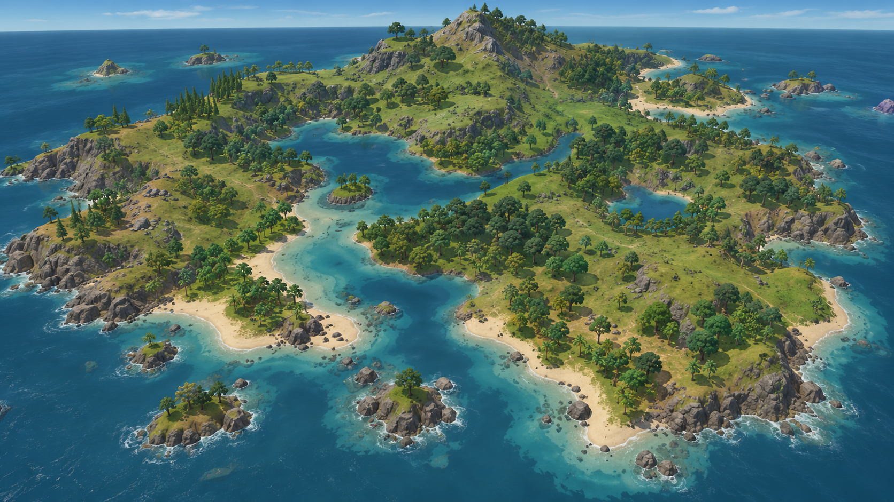
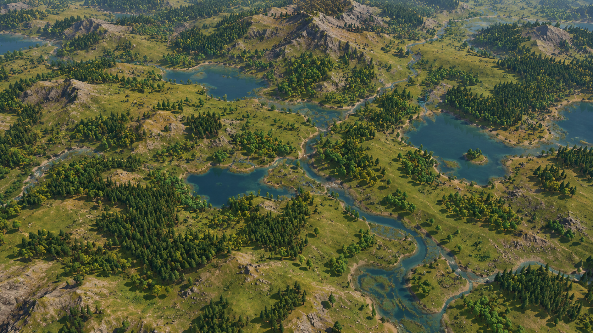

# Direção visual e técnicas de apresentação no MonoGame

**Status:** stack MonoGame confirmada; requisitos visuais aceitos; técnica de apresentação em avaliação. **Revisão:** 21/10/2026. Este documento orienta a validação visual dentro do MonoGame; a implementação completa do cliente continua condicionada ao gate visual.

## Referências visuais

As imagens abaixo foram fornecidas pelo usuário para orientar a identidade e a qualidade desejadas. São referências documentais; não são assets do runtime nem metas de reprodução literal.

Elas mostram uma paisagem natural estilizada em câmera elevada, com leitura ampla e sensação de volume: relevo de encostas, vales e paredões; água que acompanha a topografia e forma quedas; rochas volumétricas; árvores de tipos e alturas variados; vegetação em manchas orgânicas; luz direcional e sombras. Para o projeto, essas imagens orientam a composição e a leitura do cenário — relações entre os elementos, escala, volume, variedade e densidade —, mas não definem uma paleta nem um estilo de cores a reproduzir.

### Referência de fauna e integração visual

[Procedural Pixel Creatures, de idlerunner00](https://github.com/idlerunner00/procedural-pixel-creatures), é a referência de processo para projetar e adaptar o algoritmo de geração procedural da fauna. O projeto demonstra geração por código de anatomia, variações de aparência, estruturas de animação e movimento. Essa referência guia a construção e a variedade dos seres; por si só, não exige que todo o cenário seja pixel art nem que use a mesma técnica de renderização. Qualquer reutilização futura de código ou recursos deve respeitar a licença e as atribuições aplicáveis.

O cenário e a fauna devem parecer parte do mesmo mundo quando vistos juntos. Procedural Pixel Creatures rasteriza criaturas em pixel art e oferece genes, anatomia, rigs e animação; isso pode contrastar com malhas 3D contínuas se as duas camadas forem avaliadas separadamente. Antes de fechar a técnica, integrar uma criatura de prova e comparar na mesma câmera e escala: densidade de pixels na tela, legibilidade de silhueta, contorno, frequência de detalhes do fundo, iluminação e sombra de contato. Se ainda parecerem linguagens distintas, comparar um tratamento de pixelização/contorno aplicado ao conjunto com a adaptação da criatura para a escala da cena; decidir por captura e custo medidos. Não fixar uma paleta universal para resolver o contraste: as cores continuam vindo das características da espécie e das condições representadas.

### Cor, coerência ecológica e custo de representação

O projeto busca um simulador de vida com uma representação estilizada e legível, não realismo. Simplificar geometria, detalhes e animações é esperado para manter o custo de apresentação adequado a um mundo com muitas entidades e interações simultâneas. Priorizar silhuetas identificáveis, diferenças úteis entre espécies, relações espaciais compreensíveis e variação ambiental apoiada pelos dados; não adicionar detalhe visual caro sem benefício claro para leitura ou observação.

Cor deve comunicar espécie, ambiente ou condição observável, e não ser escolhida apenas para impor um estilo. Plantas amareladas, por exemplo, só são adequadas se a espécie tiver essa coloração naturalmente ou permitir a mudança por uma causa representada, como clima, estação ou doença; não usar essa cor como decoração genérica. O mesmo princípio vale para fauna, solo e água: manter variedade visual, mas evitar que a aparência afirme estados que o modelo não representa. As referências orientam a organização e a compatibilidade do conjunto, sem obrigar cópia de cores, materiais ou aparência literal.

O snapshot atual publica biomassa de gramíneas e lenhosas por célula, mas não a identidade de cada espécie vegetal. Até essa identidade existir, tons fixos por arquétipo são apenas hipóteses estilizadas apoiadas por descritores documentados; não são estados taxonômicos. Variação cromática por seed, estação, seca ou doença precisa de uma causa publicada e de um traço de espécie compatível. O material do terreno pode representar substrato, elevação, inclinação e umidade presentes no snapshot. Uma máscara visual de aridez por seed não deve classificar o clima como deserto nem alterar a presença de organismos; essa classificação espera dados ambientais apropriados.

O céu procedural foi removido da apresentação atual porque a faixa visível não combinava com a composição elevada desejada. Nuvens e chuva ficam para a implementação do clima: em uma vista distante, nuvens poderão ser desenhadas quando houver estado atmosférico publicado; em uma vista próxima, sua passagem poderá ser percebida por sombras coerentes no terreno. Sem esse estado, o renderer não inventa tempo meteorológico. A navegação permite aproximação até a escala da vegetação rasteira; insetos e aranhas só serão acrescentados quando a fauna simulada os publicar.

## Diretriz visual aprovada

O objetivo é um mundo natural procedural, reconhecível, coerente e visualmente rico. A estilização pode simplificar superfícies, materiais e silhuetas, mas deve preservar a leitura de profundidade, volume, escala relativa, relevo e relações entre terreno, água, rocha e vegetação. Aparência low-poly, sprites, tiles, câmera top-down e projeção ortográfica são opções de técnica, não requisitos.

O resultado deve cumprir estas necessidades:

- Representar elevações, declives, encostas, vales, platôs e paredes rochosas com geometria ou uma técnica que demonstre resultado equivalente.
- Integrar rios, lagos e cachoeiras à topografia e ao estado hidrológico exposto pelos snapshots.
- Dar diversidade morfológica legível a árvores, arbustos e gramíneas e distribuir elementos por receitas determinísticas, usando observações ambientais disponíveis.
- Variar forma e composição de rochas procedurais e integrá-las à superfície.
- Produzir luz, sombras e oclusão coerentes com a geometria e com a direção de iluminação escolhida.
- Evitar juntas visíveis de chunks, padrões repetidos de tiles e manchas artificiais causadas pela representação.
- Compor uma região extensa que ainda permita reconhecer água, relevo e vegetação em resolução de jogo.

Conteúdo natural visível deve ser criado por algoritmos, parâmetros e seeds controlados pelo projeto. Bibliotecas de geometria, renderizadores, shaders, ruídos e ferramentas técnicas são permitidos após análise de licença e integração. Pacotes externos de modelos artísticos prontos não devem ser necessários para construir o mundo. As imagens de referência não são carregadas pelo runtime.

## Simulação e apresentação

A arquitetura modular e os contratos científicos existentes permanecem válidos. Cosmos, Atmosphere, Geosphere, Hydrosphere e Biosphere mantêm ownership, unidades, cadências, determinismo, conservação e limites já documentados. A camada visual lê snapshots e resultados publicados; não escolhe parâmetros físicos nem escreve nos estados dos módulos.

A dimensionalidade da simulação é uma decisão de cada processo. Grades de elevação, drenagem, clima, solo e ecologia podem continuar sendo campos 2D ou usar resoluções próprias, enquanto a apresentação constrói terreno e objetos em 3D. Representar uma cena em 3D não exige física volumétrica para todos os processos. Câmera, frame rate, nível de detalhe, cache e carregamento visual não podem alterar a evolução do mundo.

## Abordagens de representação

| Abordagem | Vantagens para este projeto | Custos e riscos | Tratamento nesta revisão |
|---|---|---|---|
| 2D por sprites/camadas | Baixo custo inicial; encaixa bem com campos em grade, inspeção e desenhos determinísticos | Profundidade, paredes, água em desníveis e espécies volumétricas dependem de composição, ordem e arte específica; maior adaptação para técnicas geométricas | Permanece elegível se provar a qualidade e a variedade exigidas |
| Híbrida/2.5D | Pode combinar malha de elevação com elementos 2D, projeções ou geometria limitada; transição incremental a partir do protótipo atual | Ordenação, oclusão, âncoras, sombras e mudanças de câmera podem exigir exceções por tipo de objeto; qualidade depende da composição | Candidata legítima para comparação, sem compromisso com as decisões atuais |
| 3D estilizado | Geometria, câmeras, luz, sombras, instanciamento e níveis de detalhe podem atender diretamente a vários elementos da referência; bibliotecas 3D procedurais podem ser usadas sem converter o core | Requer geração e gestão de malhas, materiais, água, distribuição e custo de GPU; 3D por si só não garante boa direção artística ou desempenho | Primeira hipótese a validar, não decisão definitiva |

Para a validação, comparar câmera ortográfica e perspectiva elevada. A escolha de projeção e ângulo deve vir da leitura do mundo e dos resultados observados. O cliente pode carregar um save/snapshot reproduzível com `--snapshot-file <caminho>`; em `--visual-evaluation`, ele é pausado e apresentado sem avançar a simulação. Isso permite comparar estações e estados ecológicos realmente produzidos pelo modelo, em vez de forçar uma estação somente no renderer.

## Stack confirmada: MonoGame

MonoGame é a stack obrigatória do cliente. O projeto permanecerá em C#/.NET e MonoGame para que o desenvolvimento e os recursos do jogo possam ser produzidos por IA dentro de uma base de código única, conforme a restrição definida pelo usuário. Não há avaliação, recomendação ou gate para trocar de motor.

MonoGame é um framework C#/.NET com APIs para gráficos 2D e 3D, efeitos/shaders e modelos. Como não inclui editor de cenas ou ferramenta de autoria pronta, o terreno, materiais, sombras, câmera, instanciamento, LOD e utilitários específicos serão implementados em código no próprio projeto. Esse fluxo code-first se alinha à produção assistida por IA pretendida; os custos serão controlados por protótipos pequenos, componentes reutilizáveis e ferramentas internas simples. Fontes oficiais: [visão geral e modelo de framework](https://docs.monogame.net/articles/tutorials/building_2d_games/01_what_is_monogame/index.html), [renderização 3D](https://docs.monogame.net/articles/getting_to_know/whatis/graphics/WhatIs_3DRendering.html), [plataformas](https://docs.monogame.net/articles/getting_started/platforms.html), [licença](https://github.com/MonoGame/MonoGame/blob/develop/LICENSE.txt).

### Técnicas a validar dentro do MonoGame

| Técnica | Aplicação no MonoGame | Pontos a medir |
|---|---|---|
| **3D estilizado por malhas** | Terreno elevado, rochas, água, árvores e vegetação como geometria procedural; câmera, luz, materiais e shaders no cliente MonoGame. | Qualidade de volume e silhueta, custo de geração de malha, draw calls, sombras, memória e desempenho. |
| **Híbrida: terreno 3D e elementos 2D** | Malha para relevo e água com billboards/sprites ou elementos planos para folhagem, detalhes e marcadores. | Legibilidade em diferentes ângulos, ordenação, oclusão, escala, custo de conteúdo e coerência das sombras. |
| **2D em camadas** | Sprites, polígonos e composição em camadas projetadas, mantendo a cena e as ferramentas no MonoGame. | Se profundidade, paredões, água em desníveis e diversidade de espécies atendem aos critérios visuais e permitem inspeção clara. |

Começar pela prova de 3D estilizado em MonoGame e avaliar a composição híbrida como alternativa de custo. A direção artística pode combinar malhas, shaders, primitivas, texturas e sprites gerados proceduralmente por código desenvolvido com IA, desde que os recursos sejam rastreáveis, reproduzíveis e utilizáveis sem depender de pacotes artísticos prontos. A escolha entre técnicas depende da cena demonstrativa, do custo de implementação, do desempenho e dos alvos de distribuição aprovados; a stack MonoGame permanece fixa.

## Validação visual comparativa

Antes de consolidar o cliente de N4, produzir uma cena demonstrativa procedural no MonoGame e comparar nela as técnicas de apresentação. Priorizar o cenário canônico L0 seed 1 e repetir as verificações de determinismo com seeds 2 e 3. Reutilizar snapshots existentes; se algum elemento de apresentação — por exemplo, uma cachoeira — não existir nos dados atuais, usar uma fixture de renderização identificada como tal, sem alegar que ela foi simulada nem alterar parâmetros físicos ou biológicos.

### Conteúdo da cena

- Uma área de vale com encostas, cristas, platô, parede rochosa e variação de relevo em escalas diferentes.
- Uma rede de água ligada à elevação, um lago nivelado em depressão e uma queda d’água demonstrativa amarrada a um desnível controlado.
- Rochas procedurais com volumes, contornos e materiais diferentes.
- Gramíneas, arbustos, árvores de copa ampla e coníferas geradas a partir de receitas; a distribuição usa campos ambientais existentes e permanece visual, sem criar organismos simulados.
- Luz direcional, sombras e oclusão; variações sazonais de aparência só quando apoiadas por traços e estados publicados, sem alterar o estado científico.
- Câmeras ortográfica e perspectiva elevadas, cada uma enquadrando a mesma área e permitindo inspeção e navegação simples.

### Critérios de aprovação

| Dimensão | Evidência e critério |
|---|---|
| Terreno | A malha acompanha a elevação recebida, exibe encostas e faces em ângulos de referência e não apresenta fendas nas bordas de chunks. Verificar geometrias com teste automatizado e captura da cena. |
| Água | A superfície de lago é nivelada por estágio; rios, margens e queda respeitam a geometria da fixture; não há água suspensa ou enterrada por erro de renderização. O teste de integração confere níveis e alturas usados na malha. |
| Vegetação | Pelo menos quatro silhuetas distinguíveis; escala e agrupamento são determinísticos; áreas de água profunda, inclinação e habitat seguem as regras fornecidas; nenhuma projeção substitui estado ausente. |
| Rochas | Geometria irregular volumétrica, sem aparência de sprite plano em ângulos validados; a rocha acompanha a superfície e suas faces se leem sob a luz. |
| Luz e profundidade | A direção das sombras coincide com a fonte de luz; superfícies e objetos mantêm ordem de oclusão; encostas, vales e copas continuam reconhecíveis na vista ampla. |
| Composição | A grade L0 inteira é visível a 1280 × 720 e os elementos principais continuam legíveis; sem padrão de tile ou borda de chunk dominante. Avaliar as duas projeções por rubrica visual 0–4 em relevo, água, vegetação, rocha, iluminação e composição; cada categoria precisa obter pelo menos 3. |
| Determinismo | Mesma seed, versão de receita e snapshot produzem a mesma distribuição, transformações e malhas de entrada em execução repetida. Capturas de pixels podem variar entre drivers e não são o único teste. |
| Desempenho | Medir a cena igual em Release, 1280 × 720 e hardware registrado: média ≥30 FPS, P95 ≤33,3 ms e P99 ≤50 ms. Alvo mínimo: 8 GB de RAM e 4 GB de VRAM; configuração recomendada para melhor desempenho: 16 GB de RAM e 8 GB de VRAM. Registrar bytes privados, working set e memória de GPU quando disponível. Não existe teto fixo de memória privada do processo; validar a carga visual na configuração mínima e reduzir uso de cena/cache/LOD se houver pressão observada. Registrar aquecimento, driver, versão, seed, CPU/GPU, custo de geração/reconstrução e tempos de quadro. |
| Escala | Repetir com a população visual do cenário e com 10× de instâncias decorativas procedurais; contabilizar draw calls, instâncias, triângulos, memória e tempo de geração. Cache, instanciamento, chunks e LOD só entram se os perfis mostrarem necessidade e sem alterar o snapshot. |
| Integração e plataforma | Core, testes científicos e runner headless continuam independentes do cliente gráfico; medir esforço de integração e registrar build/exportação MonoGame comprovada para cada alvo aprovado. A máquina de referência atual (15,87 GiB RAM e RTX 5060 com 8.151 MiB VRAM reportados) atende à classe recomendada; a classe mínima ainda requer validação em hardware real. Web é um gate separado, não inferido do suporte desktop. |
| Licença | Inventário das bibliotecas, ferramentas e recursos gerados com licença/SPDX, avisos de redistribuição e limitações por plataforma. |

Anexar capturas em enquadramento comum, configuração completa, resultados brutos, inventário de componentes e esforço de implementação. Se nenhuma técnica cumprir os gates, registrar o gargalo e ajustar a técnica ou o escopo visual dentro do MonoGame, com justificativa. Não reduzir o modelo científico para favorecer uma abordagem de renderização.

## Impacto no roadmap

N0–N3, seus contratos científicos, cenários, conservação, cadências e testes headless continuam iguais. A seleção visual não bloqueia a evolução de clima, hidrologia, botânica ou fauna. O gate de validação visual antecede o fechamento de N4 e é responsável por fechar câmera, representação e técnica dentro do MonoGame usando evidência. Benchmarks anteriores continuam úteis como linha de base do cliente atual, mas não comparam técnicas nem comprovam a direção visual final.

## Fontes e data de consulta

Fontes técnicas primárias do MonoGame foram consultadas em 21/10/2026. Recursos e termos podem mudar; confirmar versões, licenças e plataformas na execução do protótipo. Esta análise é qualitativa, não benchmark independente nem parecer jurídico.
