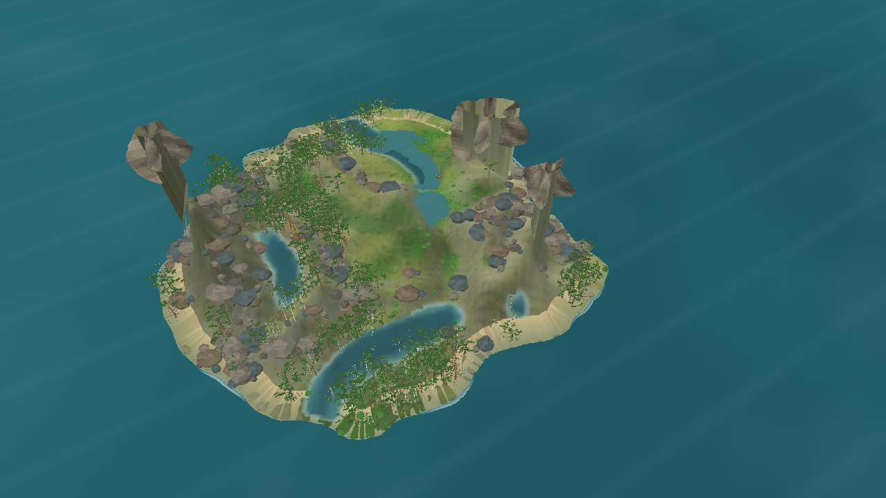
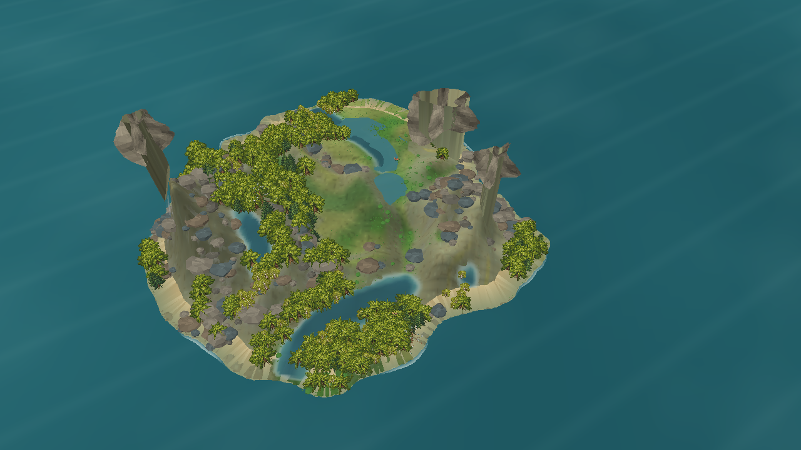
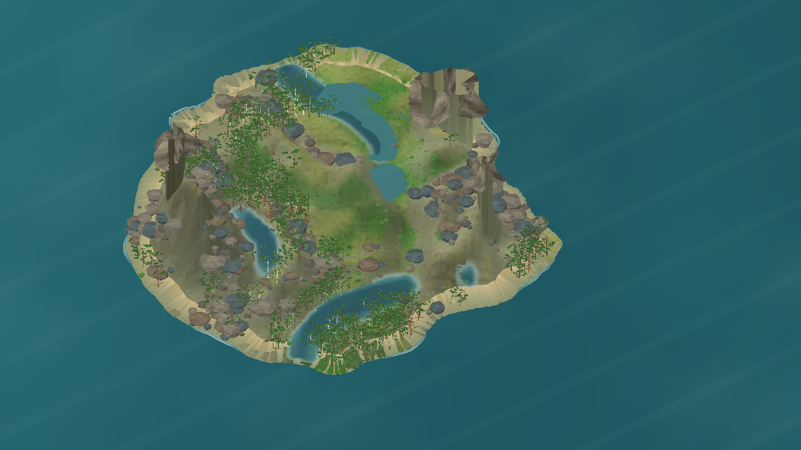
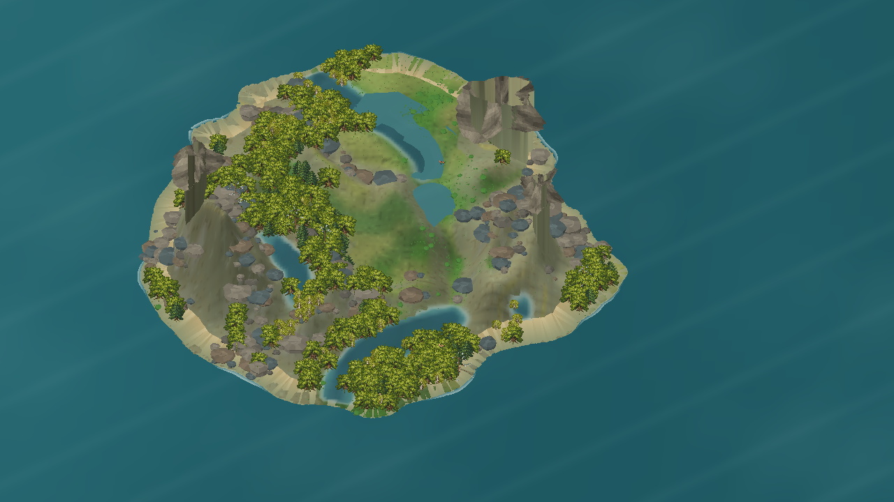
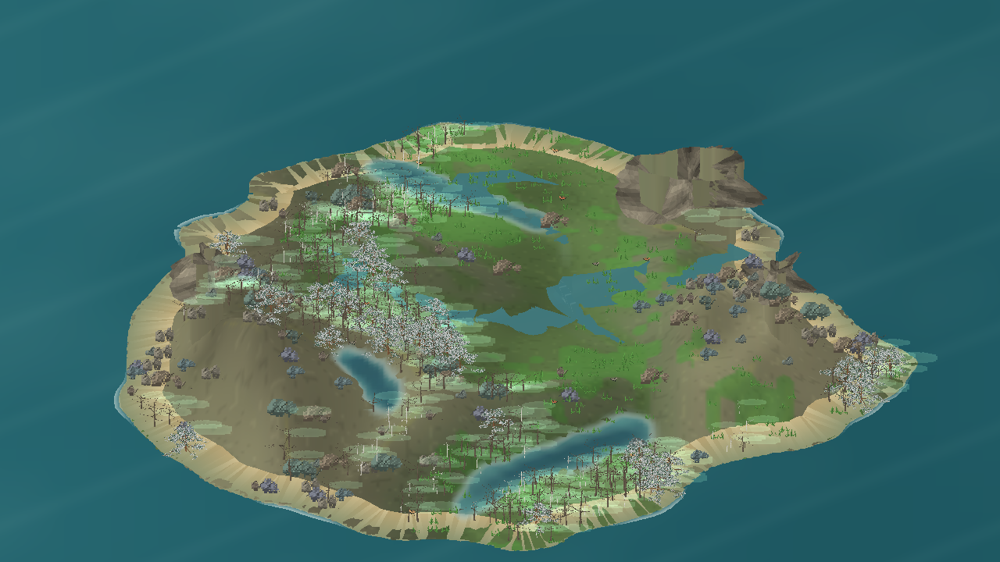

# N4 — evidência visual e integração MonoGame

**Data:** 22/10/2026\
**Status do marco:** **N4 ainda não aprovado**. As medições locais de integração e desempenho passaram nas configurações ensaiadas; o gate visual não passou e validações de plataforma continuam pendentes. Os sprites do comparador histórico têm licença não registrada, mas estão fora da direção de produção escolhida para árvores.

## Escopo e preservação dos marcos anteriores

As capturas e comparações visuais leem snapshots imutáveis e ficam pausadas. O benchmark oficial de desktop, em separado, inicia no dia zero e deixa a simulação ativa. N0–N3, contratos científicos e parâmetros L0 não foram alterados para favorecer o renderer. O cenário N3 continua sendo a origem da fauna da demonstração; animais e vegetação desenhados continuam sendo projeções dos dados publicados.

O snapshot de comparação é seed 1, dia 172, cenário `temperate-valley-n3-v1`. Ele pode ser recriado após a build Release com:

```powershell
dotnet src/Game.App/bin/Release/net10.0/Game.App.dll --n3-scenario --seed 1 --ticks 24768 --save bin/n4-evaluation-20261022/seed-1-day172.json
```

A cena de conferência da fauna usa o snapshot seed 1 do dia 2 (`--ticks 144`). No estado registrado havia 41 animais (37 herbívoros e 4 predadores); três predadores tinham histórico de captura. A captura ampla mostra apenas os animais que caem no enquadramento.

## Comparação da apresentação

As quatro capturas usam o mesmo snapshot e resolução 1280×720. O enquadramento é equivalente por projeção: perspectiva zoom 3,4 e ortográfica zoom 2,8. Elas registram uma comparação histórica entre malha 3D procedural e híbrido com LOD por billboards; a comparação não define mais a direção de produção para árvores.

| Projeção e técnica | Captura |
|---|---|
| Perspectiva — 3D procedural |  |
| Perspectiva — híbrida |  |
| Ortográfica — 3D procedural |  |
| Ortográfica — híbrida |  |

As duas opções preservam as mesmas 621 árvores visíveis e o mesmo `faunaLayoutHash` (`43931487CF2182AFDFFED2A8A701D17DF7959CF8BBA61CA9E689ECD7461CD054`). Aumentamos as copas procedurais derivadas dos pontos de ramificação e folhagem: a malha 3D ganhou massa, mas ainda lê pontilhada e menos uniforme que a copa híbrida. Em 22/10/2026, o usuário confirmou que árvores devem continuar como objetos 3D gerados proceduralmente e que sprites/billboards fogem dessa direção. A malha 3D é, portanto, o único caminho de produção considerado para árvores; o resultado híbrido fica arquivado apenas como comparação histórica. Os PNGs do comparador não entram no renderer escolhido.

### Rubrica visual 0–4

Notas qualitativas desta rodada, aplicadas às capturas acima. Cada categoria precisa atingir 3/4 em ambas as projeções.

| Categoria | 3D perspectiva | Híbrida perspectiva | 3D ortográfica | Híbrida ortográfica | Observação |
|---|---:|---:|---:|---:|---|
| Terreno | 2 | 2 | 2 | 2 | Relevo, encostas e afloramentos são visíveis; a superfície continua blocada e as paredes dominam a escala. |
| Água | 1 | 1 | 1 | 1 | Canais e depressões aparecem como formas angulares; margens não leem como uma rede contínua. |
| Vegetação | 2 | 2 | 2 | 2 | Na malha 3D, a folhagem ainda lê pontilhada; a coluna híbrida é só referência histórica e não é uma opção de produção. |
| Rochas | 2 | 2 | 2 | 2 | Os volumes estão presentes, porém muitas pedras são pequenas, arredondadas e pouco integradas à encosta. |
| Luz e profundidade | 1 | 1 | 1 | 1 | A luz ajuda a ler o terreno; sombras projetadas e oclusão ainda não separam bem as copas e rochas. |
| Composição | 3 | 3 | 3 | 3 | A ilha inteira cabe no quadro e os principais elementos se distinguem; a área central vazia e detalhes pequenos ainda reduzem a leitura. |

**Resultado:** o gate visual falha nas quatro combinações. A perspectiva é mais forte para profundidade; a ortográfica permanece útil para inspeção. A direção de árvores é 3D procedural, mas a qualidade visual da malha ainda não passou.

O diagnóstico quantitativo atual do relevo e as tentativas rejeitadas por regressão de throughput estão em [GEOSPHERE_RELIEF_DIAGNOSTIC_2026-10-22](GEOSPHERE_RELIEF_DIAGNOSTIC_2026-10-22.md). O estado N1 da Geosphere permanece validado; a nota 2/4 de terreno é um bloqueio visual N4.

**Decisão de direção para árvores:** seguir com malhas 3D inteiramente procedurais. O gate de qualidade das copas continua aberto: a imagem da referência serve para avaliar preenchimento e silhueta, não para justificar o uso de sprites.

## Inspeção próxima — árvores em geometria procedural

A galeria de avaliação escolhe uma área interna sem água próxima. Antes, podia usar a célula de maior biomassa junto a uma margem e colocar os espécimes sobre uma lagoa ou o mar. A seleção do ponto da galeria é apenas renderização e não altera distribuição ecológica, snapshot ou simulação.

O preenchimento de copa próximo agora usa lobos volumétricos 3D de baixa tesselação junto aos ramos e folhas individuais como malha. Os cartões cruzados de folhagem foram removidos do builder de árvores. A galeria é render-only; suas cinco formas não afirmam identidades de espécies.

Na galeria de cinco espécimes, o log marcou `floraTrees=5`, `treeBillboards=0`, `treeBillboardVertices=0`, `treeMeshVertices=2147664` e `faunaSprites=0`. Na inspeção do bosque real, zoom 20, foram 178 árvores, `treeBillboards=0`, `treeMeshVertices=18870390` e construção da cena em 976,01 ms. Esse tempo é uma amostra de construção estática, não benchmark de FPS, memória ou hardware mínimo. A comparação e os limites estão no [relatório da iteração 51](PROCEDURAL_TREE_GEOMETRY_ITERATION_51_2026-10-22.md).


Build Release do cliente: 0 avisos, 0 erros. Comando reproduzível para a galeria próxima:

```powershell
dotnet src/Game.Client.Desktop/bin/Release/net10.0/Game.Client.Desktop.dll --visual-evaluation --snapshot-file bin/n4-evaluation-20261022/seed-1-day172.json --projection perspective --tree-quality-view --lower-reference-angle --camera-zoom 38 --capture docs/reports/evidence/n4-procedural-tree-gallery-3d-lobes-zoom38.png --disable-vsync
```

### Água e queda d’água

No snapshot seed 1 do dia 2, a Hydrosphere fornece 18 arestas conectadas e o maior desnível de segmento de canal é 4,72 m; não há queda natural produzida pelo modelo (`renderedWaterfalls=0`). A cachoeira desenhada na prova é uma fixture de renderização amarrada à borda de um afloramento, sem criar fluxo ou modificar o snapshot. A fixture foi registrada com desnível físico geométrico de 84,14 m e deve continuar identificada como apresentação controlada:

- [Cena ampla com fixture](evidence/n4-seed1-perspective-controlled-waterfall.png)
- [Detalhe da fixture](evidence/n4-seed1-waterfall-detail-facing.png)

O detalhe prova que uma lâmina vertical pode ser colocada na cena; não prova uma cachoeira simulada nem resolve a leitura da água na vista ampla.

Na continuidade desta rodada, a superfície de poças foi isolada em `ProceduralWaterPoolSurfaceBuilder`: ela considera manchas conectadas com água armazenada dentro de bacias e calcula a cota gráfica a partir do volume do snapshot e do leito exibido, sem alterar o estado hidrológico. Quando essa cota apagaria mais de 25% da mancha, a renderização preserva os níveis locais do snapshot. Para seed 1/dia 172, a captura registrou 229 células úmidas em bacias, cobertura renderizada em 218 células e apenas uma célula com estágio nivelado ≥1 cm; os demais fragmentos mantiveram as cotas locais. Uma terceira passagem de suavização também não mudou a leitura visual e foi descartada. A captura revisada está em [seed 1/dia 172 — superfície de poças](evidence/n4-seed1-day172-water-pool-3x.png). A rubrica de água continua em 1/4: a mudança evita uma redistribuição visual que esconderia a água existente, mas ainda não melhora de forma perceptível a continuidade dos canais ou o contorno das margens.

## Determinismo

As capturas estáticas congelam o tempo visual de água e espuma. Para cada seed, duas execuções com o mesmo snapshot, câmera e build produziram PNGs com SHA-256 idêntico. As posições de fauna também repetiram o mesmo hash.

| Seed | Estado | `faunaLayoutHash` | SHA-256 das duas capturas |
|---:|---|---|---|
| 1 | dia 2, 41 animais; 14 sprites no enquadramento | `4AD4A1BA1BFD66BA7A9D2624A59662AB3AAACF80A2C9663BF009DC63540C9364` | `A336607425BF59C278DF46EE18DA29AA86F0D0A8D799BB3F09BB755F5A2F9B0D` |
| 2 | dia 2, 43 animais; 14 sprites no enquadramento | `007BC8F8A58A84F19696F7F3FF00C5520CEB1F07B2DA70CD440FD988686620E5` | `3E57399E61F09F4469A68281451DF72A6703243BE58F57CF3640004A71ED9BD1` |
| 3 | dia 2, 41 animais; 18 sprites no enquadramento | `32B5DED0509B9B12BB5E3FD5CF3D631484C2602428CA1F16F99CA80302867A0B` | `F62B8C09FB3059A02DD4207B7A1A51207A237503935F7821F4E79FC584579D0B` |

Arquivos A/B: [seed 1 A](evidence/n4-determinism-seed1-run-a.png) / [B](evidence/n4-determinism-seed1-run-b.png), [seed 2 A](evidence/n4-determinism-seed2-run-a.png) / [B](evidence/n4-determinism-seed2-run-b.png), [seed 3 A](evidence/n4-determinism-seed3-run-a.png) / [B](evidence/n4-determinism-seed3-run-b.png). O hash da imagem é evidência local de repetição no mesmo driver; não é contrato de igualdade entre drivers diferentes.

## Desempenho e escala

Hardware: Windows 11, Intel Core i3-10105, 15,87 GiB RAM, NVIDIA GeForce RTX 5060, driver reportado por `nvidia-smi` 610.88, 8.151 MiB de VRAM. SDK .NET 10.0.400, build Release. A máquina está na classe recomendada, mas não substitui o teste em 8 GB RAM/4 GB VRAM.

| Configuração | Janela / quadros | FPS médio | P95 / P99 | Máximo | CPU de um núcleo | Working set / privado | Build da cena | Árvores | Draw calls / primitives por quadro (máx.) |
|---|---:|---:|---:|---:|---:|---:|---:|---:|---:|
| Gate oficial: seed 1 dia 0, simulação ativa, cliente padrão (revalidado após ajuste da água) | 60 s / 3.576 | 59,60 | 17,29 / 36,73 ms | 200,84 ms | 34,4% | 256,1 / 278,5 MiB | 105,74 ms | 621 | 736 / 355.114 |
| Perspectiva 3D, copas it. 56 + rochas it. 57 | 60 s / 3.600 | 59,98 | 17,21 / 17,59 ms | 47,80 ms | 29,2% | 286,5 / 328,9 MiB | 290,91 ms | 621 | 29 / 696.787 |
| Perspectiva 3D, copa subdividida (it. 56) | 60 s / 3.600 | 60,00 | 17,25 / 17,78 ms | 42,35 ms | 30,8% | 287,7 / 332,7 MiB | 285,70 ms | 621 | 29 / 693.968 |
| Perspectiva 3D | 60 s / 3.601 | 60,00 | 17,22 / 17,71 ms | 41,36 ms | 30,0% | 210,8 / 239,5 MiB | 251,63 ms | 621 | 29 / 443.254 |
| Perspectiva híbrida | 60 s / 3.600 | 60,00 | 17,19 / 17,89 ms | 45,10 ms | 29,8% | 188,7 / 204,6 MiB | 149,95 ms | 621 (619 billboards) | 33 / 278.226 |
| Perspectiva 3D, carga 10× | 60 s / 3.600 | 59,98 | 17,17 / 17,64 ms | 50,06 ms | 29,9% | 768,6 / 1.071,6 MiB | 1.221,66 ms | 6.210 | 29 / 2.509.612 |
| Ortográfica 3D | 60 s / 3.600 | 59,98 | 17,17 / 17,63 ms | 51,67 ms | 29,8% | 215,5 / 244,8 MiB | 260,12 ms | 621 | 29 / 459.760 |
| Ortográfica híbrida | 60 s / 3.601 | 60,00 | 17,25 / 17,84 ms | 43,19 ms | 30,9% | 184,2 / 200,0 MiB | 151,41 ms | 621 (616 billboards) | 33 / 295.632 |

O gate oficial de `docs/20` foi repetido na build atual desde o snapshot seed 1/dia zero, com simulação ativa a 6 ticks/s, água desenhada, grade inteira enquadrada e 1280×720. Passou média ≥30 FPS, P95 ≤33,3 ms e P99 ≤50 ms nesta máquina. O quadro máximo chegou a 200,84 ms, com rebuilds de água (48,61 ms), sprites (105,74 ms) e textura do terreno (44,79 ms); embora os percentis passem, esse pico pode ser percebido como hitch. Um experimento temporário com seis subdivisões na malha de água elevou o P99 a 67,99 ms e o rebuild máximo de água a 77,19 ms sem diferença visual perceptível; foi descartado, e a configuração final voltou a três subdivisões. Os quatro ensaios comparativos de 60 s usam snapshots pausados do dia 172 e câmera fixa. Uma primeira janela da perspectiva 3D marcou 41,92 FPS; a repetição, com os mesmos parâmetros registrados (zoom 3,40 e pan zero), voltou a 60 FPS. Como não foi reproduzida, a primeira amostra foi tratada como outlier e não compõe a tabela. O máximo isolado de 50,06 ms no ensaio 10× não reprova o P99. A cena base passa de 621 a 6.210 instâncias visuais determinísticas, sem alterar animais, snapshot ou estado científico. O teste 10× elevou o working set a 768,6 MiB e a memória privada a 1.071,6 MiB; isso não substitui o ensaio em hardware mínimo.



As métricas de memória de GPU não permitem atribuir uso ao processo MonoGame neste ambiente. Depois dos testes, `nvidia-smi` reportou 1.208 MiB usados e 6.689 MiB livres **no sistema inteiro**; esse valor inclui outros usos e não é a memória consumida pelo cliente. O inventário de GPU por processo e o ensaio na classe mínima continuam pendentes.

As saídas completas e os comandos das seis janelas de 60 s estão em [N4_BENCHMARKS_2026-10-22.md](N4_BENCHMARKS_2026-10-22.md), incluindo a primeira amostra 3D anômala e sua repetição.

## Integração e verificações executadas

- `dotnet test Game.sln -c Release --nologo`: passou, 95/95.
- `Game.App` headless iniciou o cenário 40/4 e avançou 144 ticks nas seeds 1, 2 e 3. Em todos houve histórico de captura e balanços finitos; os maiores resíduos hídricos foram `7,234×10⁻⁷ L`, matéria seca `6,353×10⁻⁶ g` e N `8,382×10⁻⁹ g` em valor absoluto.
- A suíte inclui regressões de zoologia e save/load. A execução manual do fluxo F5/F9 no cliente não foi repetida nesta rodada.
- O assembly do cliente revalidado após o ajuste da superfície de água tem SHA-256 `DF5F80B68D6E5F0D88036A668E670DC37F11E4CA0B9AA7B00321F14C964BAA88`.

## Iteração 49 — massas de copa procedural no LOD distante

A revisão da captura apontou que as folhas em cartões verticais ficavam quase de perfil na câmera elevada, deixando as copas pontilhadas. A iteração 49 substituiu apenas essa representação distante por massas opacas e irregulares ancoradas nos brotos terminais da copa. Os LODs próximos preservam galhos e folhas procedurais. O atlas inclui um quarto material opaco para essas massas; nenhuma biomassa ou distribuição simulada mudou.

Uma busca no SciSpace encontrou estudos de LOD de folhagem híbrido, contínuo e volumétrico. A implementação adota apenas a separação de representação por distância; os artigos não são calibração botânica nem validação dos perfis visuais locais. Detalhes e fontes estão em [iteração 49 de copas procedurais](PROCEDURAL_TREE_CANOPY_VOLUME_ITERATION_49_2026-10-22.md).

Na captura equivalente de seed 1/dia 172, perspectiva e zoom 3,4, foram mantidas 621 árvores e o mesmo `faunaLayoutHash`. Flora total caiu de 716.145 para 662.001 vértices (−7,6% na amostra), e o build visual foi 228,53 ms. A imagem mostra maior preenchimento da silhueta, mas ainda parece arredondada e aglomerada; não recebe nota 3/4, e a rubrica N4 continua sem aprovação. Esta captura não mede FPS ou VRAM.

## Iteração 50 — contraste de sombra

Uma segunda mudança visual elevou a opacidade central da sombra procedural das árvores de 38/255 para 56/255. Deslocamento, forma, direção da luz e malha permaneceram iguais; a captura ampla produziu pixels diferentes sem acrescentar vértices. A imagem de zoom 3,4 e um detalhe em zoom 5,2 estão no [relatório da iteração 50](PROCEDURAL_TREE_SHADOWS_ITERATION_50_2026-10-22.md). A sombra ficou um pouco mais legível, mas ainda não atinge 3/4 para luz e profundidade. Não houve benchmark de 60 s nesta alteração.

## Iteração 55 — continuidade das copas 3D distantes

A iteração 55 aumentou a sobreposição entre massas 3D nos LODs distantes e ajustou seus eixos conforme a arquitetura da copa. A mudança reduziu os vazios sem alterar a topologia por lobo, não introduziu sprites/billboards e não alterou a quantidade simulada de folhagem. Build Release: 0 avisos e 0 erros. As capturas de seed 1/dia 172 em perspectiva e ortográfica mostram 621 árvores e nenhum billboard; os builds visuais foram 249,89 ms e 246,40 ms, respectivamente. A galeria aproximada mantém os cinco perfis reconhecíveis. Ainda há aparência de aglomerados facetados, sem nova nota formal de 3/4. Detalhes, métricas e limites: [relatório da iteração 55](PROCEDURAL_TREE_CANOPY_OVERLAP_ITERATION_55_2026-10-22.md).

## Iteração 56 — subdivisão e luz suave nos cachos distantes

O LOD de folhas largas passou de 20 para 80 faces por lobo e usa cor interpolada por vértice; proporções e irregularidade continuam determinísticas e seguem a arquitetura do perfil. A mudança reduz a angularidade visível, mas a inspeção ainda mostra cachos arredondados; ela não justifica nota 3/4 e o gate visual permanece aberto. Em Release, as capturas de seed 1/dia 172 mantiveram 621 árvores e zero billboards. O benchmark de 60 s na perspectiva pausada marcou 60 FPS, P95 17,25 ms e P99 17,78 ms nesta máquina. Capturas, vértices, custo e limites estão no [relatório da iteração 56](PROCEDURAL_TREE_CANOPY_SMOOTHING_ITERATION_56_2026-10-22.md).

## Iteração 57 — base e inclinação das rochas

As rochas 3D passaram a usar a normal local do relevo, limitada a 25°, base mais larga iniciada parcialmente enterrada, fechamento inferior e topo irregular. Isso removeu aberturas visíveis em encostas e melhorou o contato sem alterar a geologia. A captura aproximada mostra o contato corrigido, mas o conjunto ainda não chega a 3/4 em tamanho, variedade e integração das rochas. A revisão combinada com as copas da iteração 56 passou 60 s em Release a 59,98 FPS (P95 17,21 ms, P99 17,59 ms). Evidências, custo e limites: [relatório da iteração 57](PROCEDURAL_ROCK_SLOPE_CONTACT_ITERATION_57_2026-10-22.md).

## Investigação posterior — continuidade da água

Antes de seguir a pendência visual da água, uma busca no SciSpace comparou redes hidrográficas e superfícies contínuas. *Procedural Riverscapes* propõe derivar leito e superfície de fluxo como uma estrutura contínua a partir da rede e do relevo; isso pressupõe curso e leito bem definidos. *GraphFlood* resolve profundidade/vazão por um algoritmo hidrodinâmico sobre a rede, o que ampliaria o escopo de Hydrosphere. O cliente atual já interpola ribbons em Catmull–Rom e usa superfícies de bacia derivadas do volume salvo; aplicar uma rede fictícia ou alterar estoques para melhorar a captura violaria o contrato N4.

- Peytavie et al., [*Procedural Riverscapes*](https://doi.org/10.1111/cgf.13814): trajetória, inscrição de leito e superfície de fluxo contínua são construídas em conjunto.
- Gailleton et al., [*GraphFlood 1.0*](https://doi.org/10.5194/esurf-12-1295-2024): estima profundidade e descarga a partir de um modelo hidrodinâmico em DEM; é uma ampliação de simulação, não somente uma correção do renderer.

Checagem das três capturas já existentes de seed 1–3 no dia 172: seed 1 teve 302 células com água e 20 arestas de rio desenhadas; seed 2, 349 e 20; seed 3, 267 e 13. Nenhuma produziu queda d'água natural. Os canais e margens ainda não chegam a 3/4, e essa consulta não encontrou ajuste visual seguro que aumente a continuidade atual sem acrescentar informação física que os snapshots não contêm. O gate da água permanece aberto; o próximo avanço depende de estado hidrológico com canais conectados ou de uma ampliação explícita de Hydrosphere, mantendo qualquer fixture de cachoeira rotulada como apresentação.

## Estado dos gates

| Gate | Estado nesta rodada |
|---|---|
| Build, testes e runner headless | **Passou** no Windows atual; N0–N3 preservados. |
| Determinismo visual nas seeds 1–3 | **Passou** para repetição no mesmo hardware/driver: PNG e hash de fauna coincidem. |
| Desempenho N4 oficial e escala 10× | **Passou** o gate atual de 60 s com simulação ativa desde o dia zero nesta máquina (P99 36,73 ms); a carga 10× também passou 60 s na perspectiva pausada na rodada anterior. |
| Direção de árvores | **Definida:** malhas 3D procedurais; sprites e billboards não substituem as árvores. A nota visual da vegetação permanece abaixo do gate. |
| Cachoeira integrada à simulação | **Pendente**: não há queda natural no snapshot; a queda mostrada é fixture apenas de renderização. |
| Validação mínima e outros alvos | **Pendente**: não há máquina de 8 GB/4 GB nem build/exportação validada para outro sistema operacional nesta rodada. |
| PNGs do comparador híbrido | **Fora da direção de produção**; licença não arquivada. Não são usados pelas capturas procedurais novas. |
| Save/load pelo cliente F5/F9 | **Pendente de demonstração manual**; o core e os testes de save/load passaram. |

## Próxima sequência para fechar N4

1. Continuar a revisão da coesão entre os brotos terminais e as massas de copa em árvores isoladas e grupos, incluindo vistas laterais/oblíquas; depois repetir a rubrica nas duas projeções. As iterações 55–56 reduziram vazios e faces grandes, mas a copa ainda lê como cachos arredondados e não passou a nota 3/4. Não retomar sprites ou billboards como substitutos de árvores.
2. Retomar a água quando houver um snapshot com canais conectados suficientes para validar margens e depressões; conservar a fixture de cachoeira separada da evidência hidrológica. Se a simulação não produzir essa evidência, propor um gate explícito de Hydrosphere antes de alterar o estado físico.
3. Reavaliar a sombra da iteração 50 com enquadramento comum e continuar tamanho, agrupamento e integração das rochas da iteração 57; repetir a rubrica nas duas projeções até todas as notas chegarem a 3/4.
4. Repetir benchmarks nas configurações aprovadas, testar a memória em hardware mínimo, validar save/load pelo cliente e registrar as plataformas aprovadas.

## Comandos de benchmark

```powershell
dotnet src/Game.Client.Desktop/bin/Release/net10.0/Game.Client.Desktop.dll --visual-evaluation --snapshot-file bin/n4-evaluation-20261022/seed-1-day172.json --projection perspective --reference-landscape-view --camera-zoom 3.4 --volume-canopy --distance-aware-tree-lod --benchmark-seconds 60
dotnet src/Game.Client.Desktop/bin/Release/net10.0/Game.Client.Desktop.dll --visual-evaluation --snapshot-file bin/n4-evaluation-20261022/seed-1-day172.json --projection perspective --reference-landscape-view --camera-zoom 3.4 --volume-canopy --distance-aware-tree-lod --visual-instance-multiplier 10 --benchmark-seconds 60
dotnet src/Game.Client.Desktop/bin/Release/net10.0/Game.Client.Desktop.dll --visual-evaluation --snapshot-file bin/n4-evaluation-20261022/seed-1-day172.json --projection perspective --reference-landscape-view --camera-zoom 3.4 --hybrid-tree-lod --distance-aware-tree-lod --benchmark-seconds 60
dotnet src/Game.App/bin/Release/net10.0/Game.App.dll --n3-scenario --seed 1 --ticks 0 --save bin/n4-evaluation-20261022/seed-1-day000.json
dotnet src/Game.Client.Desktop/bin/Release/net10.0/Game.Client.Desktop.dll --snapshot-file bin/n4-evaluation-20261022/seed-1-day000.json --benchmark-seconds 60
```
