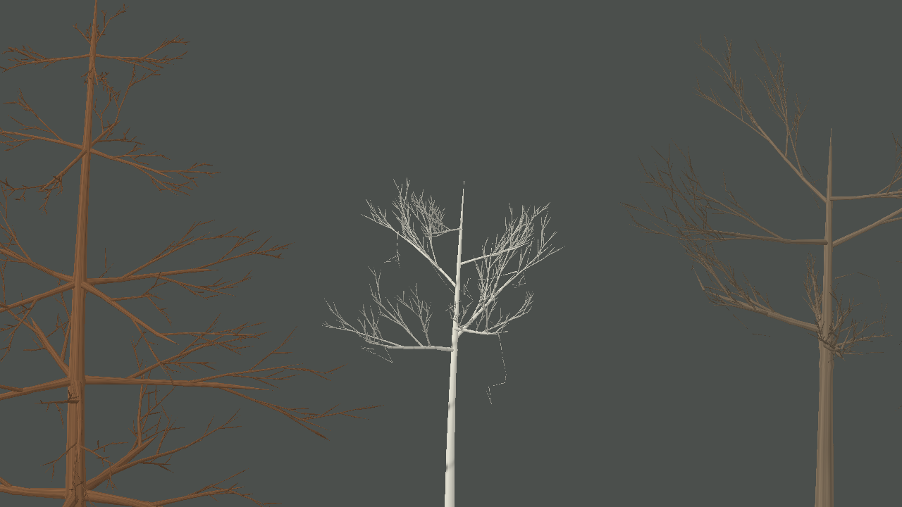

# Junções da ramificação arbórea — iteração 44

**Data:** 22/10/2026  
**Escopo:** representação das junções entre tronco, galhos primários e brotos maiores. Texturas, pigmentos, snapshot e parâmetros ecológicos não foram alterados.

## Base técnica

A comparação dos cinco repositórios está documentada em [pesquisa de geração procedural de árvores — iteração 43](PROCEDURAL_TREE_REPOSITORY_RESEARCH_ITERATION_43_2026-10-22.md). Esta etapa aplica a separação entre estrutura e malha observada no MTree e em EZ-Tree: o gerador mantém o grafo de segmentos e o renderer trata a superfície de suporte. A implementação de Space Colonization em C e as referências C# foram estudadas, mas não foi necessário alterar o algoritmo de crescimento nesta etapa. Nenhuma dependência de Unity, TubeRenderer, Three.js ou Blender foi introduzida.

## Diagnóstico e alteração

`ProceduralFloraMeshBuilder` já percorria cada cadeia de galhos como uma malha tubular e construía pequenas expansões no tronco para receber os galhos primários. As inserções secundárias e terciárias não recebiam o mesmo tratamento, então os tubos se sobrepunham e as ligações podiam parecer fios encostados.

O renderer agora calcula uma lista determinística de brotos por segmento de suporte e interpola um colar curto no tronco e nos galhos primários para receber esses brotos. As junções entre ramos finos continuam com tubos simples, limitando a geometria adicional em árvores densas. O grafo e suas seeds permanecem intactos; a alteração só afeta a malha de apresentação.

Também foi incluído um teste para três perfis que compara a malha com a mesma seed e verifica que as posições são finitas.

## Evidência e validação

Vista de galhos sem folhagem, cinco árvores, seed 3, 1280 × 720, zoom 64:

- Malha arbórea gerada: **212.952 vértices** para cinco árvores nessa captura. A métrica inclui os galhos da vista de avaliação; não é uma medição de FPS nem uma projeção para toda a ilha.
- Build Release de `Game.sln`: aprovado, 0 avisos e 0 erros.
- Suíte `Game.Tests`: aprovada, 43/43 testes.
- Não foi medido FPS nem VRAM nesta iteração.

## Limites e próximo passo

A imagem mostra as junções maiores com mais suporte, mas a arquitetura ainda parece esparsa e rígida em vários indivíduos. A técnica não funde as malhas em uma superfície topologicamente contínua, e os galhos finos continuam parecendo tubos independentes. A captura sem folhas é diagnóstica; ela não demonstra que a qualidade final de árvore se aproxima da referência enviada. Próximas avaliações devem priorizar curvatura e distribuição dos galhos estruturais, mantendo a copa fora do escopo até os ramos lerem melhor.
