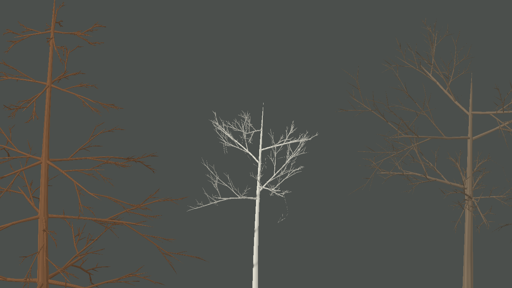

# Arquitetura e curvatura dos galhos — iteração 47

**Data:** 22/10/2026  
**Escopo:** pesquisa dos cinco geradores indicados, regras geométricas por ordem e encaixe das bifurcações. Texturas, cor, snapshot, fenologia e parâmetros ecológicos não foram alterados.

## Pesquisa dos repositórios

Os projetos foram usados como referências de algoritmo e arquitetura. Nenhum código, asset ou dependência externa foi incorporado.

| Referência | Observação dos arquivos indicados | Aplicação/limite no Gênesis |
| --- | --- | --- |
| [EZ-Tree](https://github.com/dgreenheck/ez-tree) — `src/lib/tree.js`, `branch.js`, `options.js` | Esqueleto hierárquico separado da malha. Regras por ordem controlam comprimento, raio, taper, curvatura/força e folhagem. A malha pode reduzir seções e folhas sem substituir o esqueleto que sustenta a silhueta. | Mantemos grafo determinístico independente do MonoGame e acrescentamos proporções por ordem ao perfil. O projeto usa Three.js; nenhuma API foi trazida. |
| [MTree](https://github.com/GoodPie/modular_tree) — `m_tree/source/tree_functions/BranchFunction.cpp`, `GrowthFunction.cpp`, `PipeRadiusFunction.cpp` | A arquitetura separa produção de galhos, evolução/vigor e raio de sustentação. Regras expõem dominância apical e gravidade; a função de raio acumula suporte ao longo da ramificação. | A curvatura gravitacional é uma heurística apenas de apresentação. O estágio atual não tem árvores individuais nem vigor anual no snapshot, então dominância hormonal e crescimento ambiental não são simulados. Os valores dos nós/predefinições não são medições botânicas. |
| [Space Colonization](https://github.com/jakobrichert/space-colonization) — `src/tree.c` | A cada passo, pontos de atração vivos são associados ao nó mais próximo dentro do raio de influência; direções são somadas e normalizadas para estender o grafo. A região de morte remove alvos alcançados. A grade espacial acelera as consultas quando o número de nós cresce. | O Gênesis já usa um passe pequeno e determinístico para preencher o envelope de copas de folhas largas. Com até 144 atratores, a grade adicional não se justifica. A espessura de suporte continua agregada pela folhagem descendente. |
| [SeedThree](https://github.com/SkyeShark/SeedThree) — `src/core/weber-penn.js`, `src/species/` | Weber–Penn parametriza comprimento, ângulo, curvatura, taper e distribuição por nível; receitas de espécies selecionam perfis ou famílias distintas de geradores, depois malhas, folhas e LODs. O repositório se apresenta como alpha, conforme o contexto da tarefa. | Inspirou a explicitação de razões de comprimento e divergência por ordem. Perfis continuam arquétipos visuais; as predefinições e o pipeline de texturas não validam espécies reais nem foram importados. |
| [Unity Space Colonization](https://github.com/jasonwebb/unity-space-colonization) — `Assets/Scripts/GrowthManager.cs`, `Node.cs`, `Attractor.cs` | A implementação C# mantém nós, atratores, índice KD-tree e listas de crescimento; consulta atratores próximos, soma direções e limita iterações. É útil para observar uma organização de algoritmo em C#. | Nenhuma dependência Unity, `UnityEngine`, KD-tree externa ou TubeRenderer foi adicionada. A solução atual usa `System.Numerics`, hashing por contador e o orçamento já existente. |

Esses repositórios demonstram formas de organizar e gerar estruturas; não são evidência de que os parâmetros visuais escolhidos representem quantitativamente uma espécie. Também não substituem estudos morfológicos, estados individuais, dados de campo ou validação com árvores medidas.

## Diagnóstico desta revisão

O esqueleto já preservava o tronco, os galhos primários e a seed entre níveis de geometria. O limite mais imediato estava nas regras de descendência: todas as espécies compartilhavam as mesmas razões de comprimento e divergência; galhos filhos eram iniciados no ponto exato da curva Bézier enquanto a malha os conectava a uma polilinha amostrada. Curvaturas mais fortes podiam afastar o broto do eixo de madeira que o renderer realmente desenhava. As junções de segunda ordem também não tinham o colar volumétrico usado nos galhos maiores.

## Alterações

Em `ProceduralTreeStructure.cs`:

- Cada perfil agora define razões próprias de comprimento para ramos secundários, terciários e terminais, em ordem decrescente. Os valores alteram a arquitetura renderizada; não são coeficientes alométricos ou calibrações de espécies.
- Os perfis controlam o ângulo de divergência dos níveis secundário e terminal, permitindo diferenças entre copa espalhada, vertical, cônica e pendente sem uma classe de gerador por espécie.
- A curva Bézier recebe sag gravitacional leve, crescente com a ordem do ramo. É uma deformação geométrica estática, sem cálculo de carga, rigidez ou crescimento anual.
- As inserções agora começam na linha central amostrada que será enviada à malha, e o raio de partida é interpolado nesse mesmo segmento. Isso elimina o pequeno desencaixe entre a curva matemática e a representação desenhada.

Em `ProceduralFloraMeshBuilder.cs`, as bifurcações secundárias recebem colares menores no LOD próximo. Os níveis mais distantes mantêm tubos simples para conter o aumento de geometria.

Nenhuma destas alterações consulta câmera para decidir forma, modifica snapshots ou consome RNG ecológico. A seed continua determinando as variações individuais.

## Evidência, custo e validação

Captura estrutural sem folhagem, seed 3, cinco árvores, câmera em perspectiva, zoom 64:

- Os galhos principais mantêm os mesmos limites de contagem da captura de referência. Para as cinco árvores isoladas, a malha passou de **212.952 para 279.696 vértices** com os colares de segunda ordem (**+31,3%**). Isso mede custo geométrico na vista de avaliação, não FPS ou VRAM.
- Na captura de paisagem com `distance-aware-tree-lod`, seed 2, foram renderizadas 13.546 árvores, 9.180.498 vértices arbóreos e 12.691.476 vértices de flora combinada. A câmera estava distante e os colares novos estão limitados ao LOD próximo; não se trata de comparação A/B nem benchmark de desempenho.
- Build Release da solution: aprovada, sem avisos ou erros.
- Suíte `Game.Tests` em Release: **54/54 aprovados**, incluindo hierarquia conectada, encaixe e raio de suporte, determinismo, posições dos galhos principais entre LODs e propriedades dos perfis.

## Limitações e próximo trabalho

A captura evidencia melhor separação e curvatura dos galhos descendentes, mas a silhueta ainda parece repetitiva e fina em alguns indivíduos e está distante da referência fotográfica. Os colares aumentam o custo em close e não tornam a união uma superfície topologicamente contínua. A apresentação de cinco perfis continua sendo arquétipos; o snapshot agregado ainda não contém idade, espécie individual, vigor, histórico de crescimento, causa de senescência ou estado reprodutivo.

O próximo gate de galhos deve validar inserções e ramificações em diferentes ângulos, medir o número de colares realmente visíveis e comparar custo da LOD próxima em uma composição de floresta. Só depois de confirmar que as bifurcações leem melhor vale voltar a ampliar detalhe de copa. Mudanças de forma permanecem receitas visuais, não alterações biológicas no mundo simulado.
