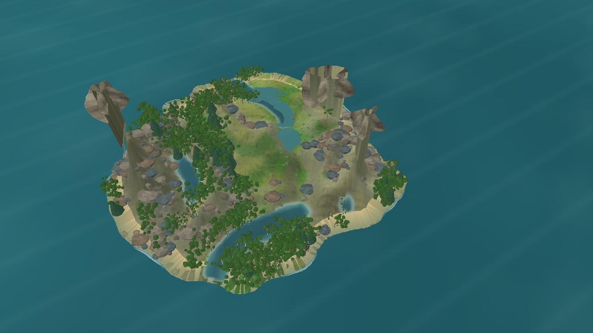

# Volumes procedurais para copas distantes — iteração 49

**Data:** 22/10/2026\
**Escopo:** representação de copas arbóreas no LOD de paisagem, sem alteração do snapshot, da distribuição ecológica, da biomassa ou dos parâmetros do mundo.

## Diagnóstico

A comparação N4 mostrava copas largas pontilhadas na vista elevada. O LOD distante ainda representava cada terminal de copa por cartões verticais com folhas recortadas. Na câmera de paisagem, esses planos ficavam quase de perfil e deixavam falhas grandes na silhueta.

## Pesquisa aplicada

A busca no SciSpace recuperou trabalhos sobre LOD contínuo, agrupamento de folhagem, billboards híbridos e representação volumétrica distante. A decisão local foi manter a estrutura e as folhas detalhadas perto da câmera e trocar somente a copa larga do LOD distante por volumes opacos vinculados aos mesmos pontos terminais. Os trabalhos apoiam a separação por distância, mas não calibram morfologia ou espécies do Gênesis.

- Bao, Zhang e Che, [*Billboards for Tree Simplification and Real-Time Forest Rendering*](https://doi.org/10.1109/PMA.2009.38): híbrido mantém tronco/galhos em geometria e simplifica folhagem em distâncias maiores.
- Kohek e Strnad, [*Interactive Large-Scale Procedural Forest Construction and Visualization Based on Particle Flow Simulation*](https://doi.org/10.1111/cgf.13304): combina geometria próxima e uma representação volumétrica distante.
- Rebollo et al., [*An Efficient Continuous Level of Detail Model for Foliage*](https://dspace5.zcu.cz/handle/11025/6661): descreve clusters de folhagem com níveis de detalhe graduais.

## Alteração

- O LOD distante de broadleaf agora reduz os pontos terminais espalhados por amostragem determinística e constrói pequenas massas 3D irregulares nesses pontos. Coníferas mantêm a forma cônica.
- O atlas procedural ganhou um quarto material, opaco e com variação tonal sutil, exclusivo para volumes de copa. Folhas individuais continuam usando o material recortado.
- O algoritmo usa seeds visuais estáveis e só lê o perfil arbóreo e a receita de copa. Não altera RNG ecológico, estado persistido ou biomassa.
- LODs próximos continuam usando galhos e lâminas foliares; a troca entre níveis ainda é discreta, sem crossfade.

## Evidência

Captura Release do snapshot seed 1, dia 172, câmera em perspectiva elevada, zoom 3,4 e 1280 × 720:



O mesmo comando anterior de comparação produziu **621 árvores** e manteve o hash de layout da fauna `43931487CF2182AFDFFED2A8A701D17DF7959CF8BBA61CA9E689ECD7461CD054`. A malha arbórea mediu **486.084 vértices** e flora total **662.001**, abaixo dos 716.145 vértices de flora registrados para a captura 3D anterior (redução observada de 7,6%). A medição de construção desta captura foi 228,53 ms; ela não é benchmark de FPS ou memória.

Uma segunda captura com os mesmos argumentos produziu o mesmo SHA-256 de pixels: `7280062A2E86733400FDE535B42BCDD5D3EBDFFA994059AA9ED47F4BA9832CC1`. O assembly Release usado para essa imagem tinha SHA-256 `494A23A1CA0357D715695475C8397C171BADCC480CFC38D2492944FDC74CF69B`.

Build de `Game.Client.Desktop` em Release: 0 avisos, 0 erros. O conjunto de testes não foi repetido nesta iteração visual; a execução documentada no checkpoint N4 continua sendo evidência histórica, não validação do novo renderer.

Comando reproduzível:

```powershell
dotnet src/Game.Client.Desktop/bin/Release/net10.0/Game.Client.Desktop.dll --visual-evaluation --snapshot-file bin/n4-evaluation-20261022/seed-1-day172.json --projection perspective --reference-landscape-view --camera-zoom 3.4 --volume-canopy --distance-aware-tree-lod --capture docs/reports/evidence/iteration-49-distant-canopy-volume.png --disable-vsync
```

## Limites e próximo passo

A copa agora ocupa mais área de tela e continua derivada dos brotos da árvore, sem depender do pacote de billboards cuja licença não está registrada. A captura ainda mostra volumes arredondados e aglomerados; não se atribui a nota 3/4 nem se fecha o gate visual. Faltam comparar a mesma composição nas duas projeções, inspecionar vistas oblíquas/laterais e conferir a transição entre LODs. O desempenho de 60 s, a classe mínima de hardware e a licença dos recursos externos também não foram revalidados por esta iteração.
