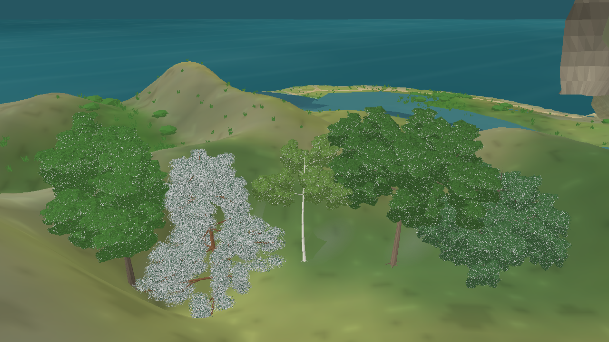
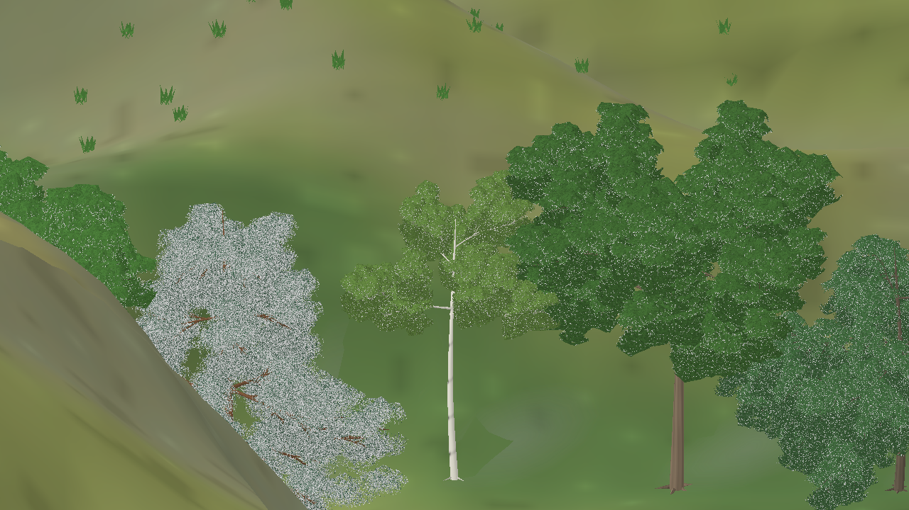
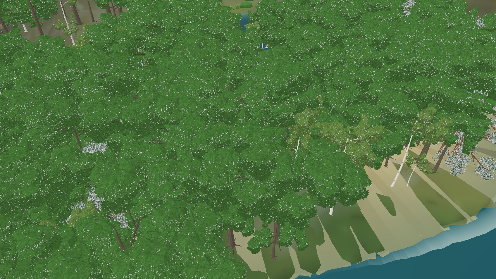

# Folhagem arbórea em geometria volumétrica — iteração 51

**Data:** 22/10/2026\
**Escopo:** substituir o preenchimento por cartões cruzados na malha arbórea por massas de folhagem 3D procedurais. Sem alteração de snapshot, população, biomassa ou distribuição ecológica.

## Direção

O usuário definiu que árvores e objetos naturais devem ser modelos 3D gerados proceduralmente. Billboards e sprites de árvore ficam fora da direção de produção; a comparação híbrida anterior permanece somente como evidência histórica.

## Alteração

- Removi `AddCanopyCard` do builder de árvores. O caminho de malha agora usa lobos icosaédricos 3D irregulares junto aos ramos e folhas individuais representadas por triângulos de malha.
- Os lobos usam a tesselação baixa de 20 faces; galhos e lâminas individuais preservam a silhueta próxima. No detalhe máximo, o leque broadleaf passou de 32 para 24 lâminas por broto.
- Coníferas mantêm agulhas individuais em torno do esqueleto de ramos. O LOD distante já utilizava copas em malha volumétrica desde a iteração 49.
- A textura aplicada aos volumes continua sendo gerada por regras determinísticas no atlas procedural; ela não contém uma imagem completa de árvore.
- A galeria render-only exige uma área interna e sem água em seu entorno. Essa correção evita posicionar os cinco espécimes visuais sobre lagoas ou o mar.

## Evidência

Galeria de cinco receitas arquitetônicas, em perspectiva baixa, zoom 38, snapshot seed 1/dia 172, Release, 1280×720:



O log registrou `floraTrees=5`, `treeBillboards=0`, `treeBillboardVertices=0`, `treeMeshVertices=2147664` e `faunaSprites=0`.

A mesma galeria em projeção ortográfica mantém as cinco receitas volumétricas sem troca de representação:



Na cena do bosque real, snapshot seed 1/dia 172, zoom 20 e 178 árvores visíveis, foram registrados `treeBillboards=0`, `treeMeshVertices=18870390` e `visualSceneBuildMs=976.01`. A captura antiga em enquadramento igual tinha 19.741.074 vértices arbóreos com cartões cruzados; a nova malha 3D ficou 4,4% menor. O tempo de construção é uma única amostra estática, não uma medição de FPS, P95/P99 ou memória.



Uma versão intermediária com lobos suaves e 32 lâminas por broto elevou a árvore do bosque para 36.302.526 vértices. Ela foi descartada; a tesselação de 20 faces e 24 lâminas mantiveram o preenchimento e controlaram o custo.

Build Release do cliente: **0 avisos, 0 erros**. A suíte de testes não foi executada nesta iteração visual.

Comandos reproduzíveis:

```powershell
dotnet src/Game.Client.Desktop/bin/Release/net10.0/Game.Client.Desktop.dll --visual-evaluation --snapshot-file bin/n4-evaluation-20261022/seed-1-day172.json --projection perspective --tree-quality-view --lower-reference-angle --camera-zoom 38 --capture docs/reports/evidence/n4-procedural-tree-gallery-3d-lobes-zoom38.png --disable-vsync
dotnet src/Game.Client.Desktop/bin/Release/net10.0/Game.Client.Desktop.dll --visual-evaluation --snapshot-file bin/n4-evaluation-20261022/seed-1-day172.json --projection perspective --reference-landscape-view --lower-reference-angle --camera-focus 365 505 --camera-zoom 20 --distance-aware-tree-lod --capture docs/reports/evidence/n4-inworld-3d-lobes-tree-close-zoom20.png --disable-vsync
```

## Limites e próximo passo

A captura mostra a leitura das malhas 3D próximas nas duas projeções, mas a copa ainda tem granulação visível e sua nota visual N4 permanece abaixo de 3/4. O custo em zoom 20 continua alto; esta captura não substitui benchmark em janela longa nem inspeção de memória. Próximo passo do N4: inspecionar a silhueta em ângulos mais laterais e medir a navegação próxima, mantendo apenas a representação procedural 3D.
