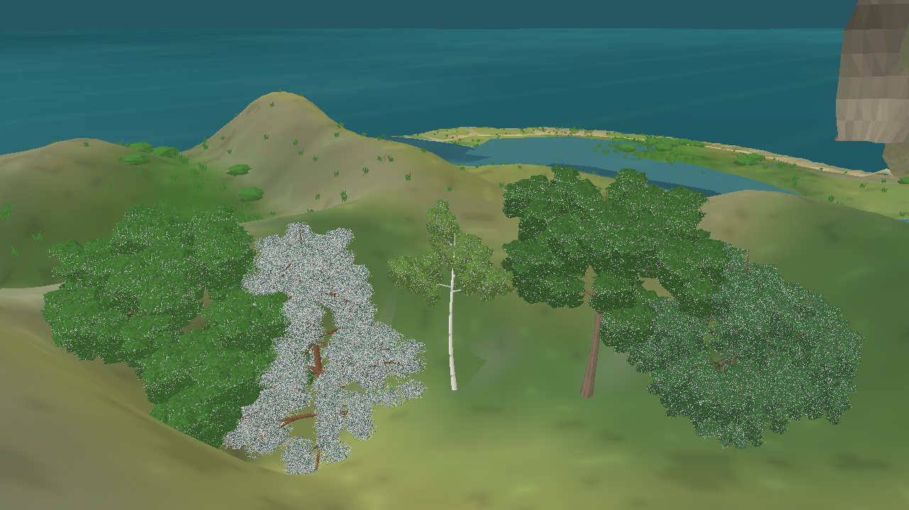
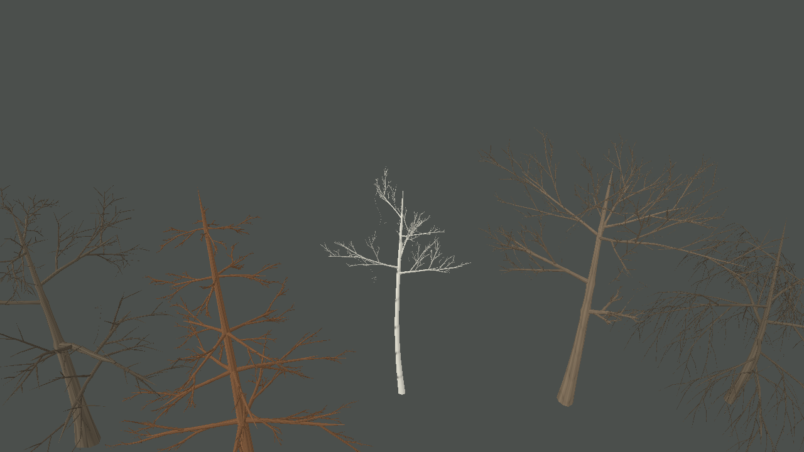

# Troncos e identidade por perfil — iteração 52

**Data:** 22/10/2026\
**Escopo:** engrossar e quebrar a simetria dos troncos, tornar as cinco receitas arbóreas mais distinguíveis e não aplicar raízes aparentes como detalhe padrão. A mudança é apenas visual e determinística; não altera ecologia, snapshot, biomassa ou distribuição das árvores.

## Alterações

- A receita de tronco agora tem taper, flare basal, irregularidade, lean e curvatura por perfil. O carvalho usa base mais robusta e irregular; bordo recebe flare intermediário; pinheiro e bétula mantêm bases estreitas. A malha usa uma seção radial assimétrica com flutes suaves no tronco.
- Reforçamos características de copa/ramificação sem depender apenas da contagem: carvalho com copa hemisférica e galhos primários grossos e baixos; pinheiro com líder e verticilos cônicos; bétula com copa estreita e galhos ascendentes; bordo com copa arredondada e mais ramos principais; salgueiro com copa mais baixa e ramos distais longos e pendentes.
- A quantidade de galhos do bordo, salgueiro e bétula foi mantida próxima da receita anterior. Isso conserva o orçamento de geometria enquanto diferenças passam a vir da forma, taper, ângulos, curva e material.
- A casca procedural ganhou padrões distintos para bordo-campestre e salgueiro, além das receitas existentes de carvalho, pinheiro e bétula.
- Raízes expostas são um efeito opcional condicionado por chance e escala específicas do perfil, seed e variação individual de quantidade, comprimento, espessura e azimute. O carvalho tem a chance mais alta; pinheiro, bétula, bordo e salgueiro têm valores progressivamente menores. Não são colocadas em todas as árvores nem representam a rede radicular subterrânea.
- O snapshot não informa erosão ou exposição do solo ao redor de cada organismo. Portanto, a raiz aparente é somente um recurso visual determinístico, sem pretensão de modelar sua causa biológica. As fontes consultadas distinguem raízes rasas/amplas de raízes visivelmente expostas; no salgueiro, ramos em contato com o solo podem criar raízes, o que também é diferente de um flare visível no tronco. Ver [15_RESEARCH.md](../15_RESEARCH.md#raízes-superficiais-e-exposição).

## Capturas e custo de malha

Galeria em perspectiva, seed 1/dia 172, Release, 1280 × 720, zoom 38. Foram registrados cinco perfis, zero billboards e 1.891.152 vértices de árvore; a construção da cena nesta única captura foi 296,59 ms, sem representar benchmark de FPS:



A inspeção sem folhas, zoom 56, mostra o esqueleto, as seções de tronco e os galhos; foram 251.568 vértices de árvore, zero billboards:



Na captura completa, a malha arbórea caiu de 2.147.664 vértices da iteração 51 para 1.891.152 (−11,9%), enquanto a forma por perfil ganhou contraste. O valor não mede o custo total da cena ou o uso de GPU.

Build `Release`: **0 avisos, 0 erros**. Nenhuma suíte de testes foi executada nesta iteração visual.

## Limites e próximo passo

Os cinco nomes continuam arquétipos de apresentação, não táxons calibrados. A variação é baseada em parâmetros qualitativos e as raízes aparentes não são um modelo ecológico. A captura próxima ainda mostra os troncos numa perspectiva de galeria, sem validação de árvore isolada com solo/erosão representados. A nota visual N4 continua abaixo do critério de aprovação; sombras, água e custo em cena cheia seguem gates próprios.

Comandos reproduzíveis:

```powershell
dotnet src/Game.Client.Desktop/bin/Release/net10.0/Game.Client.Desktop.dll --visual-evaluation --snapshot-file bin/n4-evaluation-20261022/seed-1-day172.json --projection perspective --tree-quality-view --lower-reference-angle --camera-zoom 38 --capture docs/reports/evidence/n4-tree-trunk-roots-iteration52-zoom38.png --disable-vsync
dotnet src/Game.Client.Desktop/bin/Release/net10.0/Game.Client.Desktop.dll --visual-evaluation --snapshot-file bin/n4-evaluation-20261022/seed-1-day172.json --projection perspective --tree-branches-only --lower-reference-angle --camera-zoom 56 --capture docs/reports/evidence/n4-tree-trunk-branches-only-iteration52-zoom56.png --disable-vsync
```
