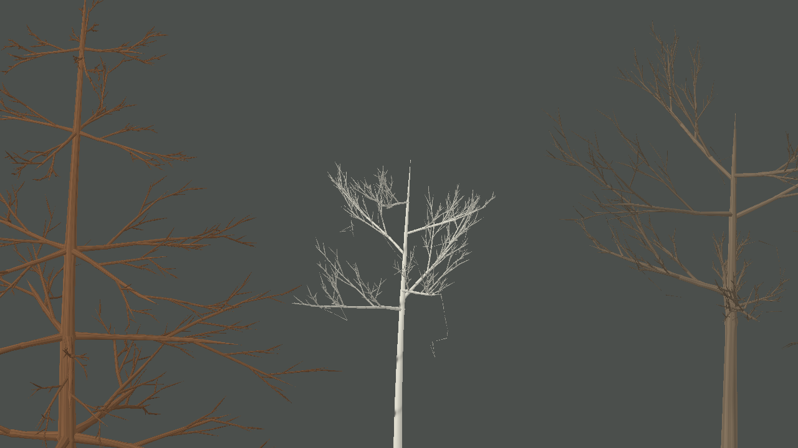

# Estrutura dos galhos e suporte da copa — iteração 46

**Data:** 22/10/2026  
**Escopo:** estudo das referências de geração vegetal e melhoria incremental da hierarquia, orientação e espessura dos galhos. Texturas, pigmentos, cobertura foliar e parâmetros da simulação não foram alterados.

## Referências estudadas

| Repositório | Observação útil para o Gênesis |
| --- | --- |
| [EZ-Tree](https://github.com/dgreenheck/ez-tree) — `src/lib/tree.js`, `branch.js`, `options.js` | Gera o esqueleto recursivamente com parâmetros por ordem e separa os buffers de galhos e folhas. Curvatura, seções, taper e posição dos brotos são propriedades dos ramos. A árvore continua determinística por seed. |
| [MTree](https://github.com/GoodPie/modular_tree) — `BranchFunction.cpp`, `GrowthFunction.cpp`, `PipeRadiusFunction.cpp` | Separa crescimento e geometria, modela dominância apical e gravidade, e acumula carga das ramificações para calcular raios de suporte. São regras de implementação; os valores dos presets não são dados botânicos medidos. |
| [Space Colonization](https://github.com/jakobrichert/space-colonization) — `src/tree.c` | Associa atratores ao nó mais próximo dentro do raio de influência, cresce na direção média e remove atratores quando a estrutura chega à zona de morte. Uma grade espacial limita consultas; a carga de folhas descendentes aumenta a espessura em direção ao tronco. |
| [SeedThree](https://github.com/SkyeShark/SeedThree) — `src/core/weber-penn.js`, `src/species/` | Organiza forma por perfis e níveis de galho. Weber–Penn controla comprimento, ângulo, curva, taper e silhueta; outros grupos botânicos podem usar outro gerador. O próprio projeto se identifica como alpha, então suas predefinições são exemplos de arquitetura, não validação científica. |
| [Unity Space Colonization](https://github.com/jasonwebb/unity-space-colonization) — `GrowthManager.cs`, `Node.cs`, `Attractor.cs` | Serve como referência de fluxo em C#: nós e atratores, associação espacial, crescimento por iteração e cálculo de espessura. O projeto declara dependência do Unity e de TubeRenderer; nenhum código ou dependência dessas tecnologias foi trazido para o Gênesis. |

## Diagnóstico do gerador

O Gênesis já mantinha um grafo determinístico de segmentos, curvas Bézier, perfis de copa, ramificações recursivas e um passe limitado de Space Colonization. A geração da malha acontecia depois, no cliente MonoGame. A inspeção encontrou três limitações específicas:

1. A direção radial do galho primário era passada sem mudança para todos os descendentes. Isso fazia cada nível voltar a apontar para fora do tronco e produzia subárvores com forma de leque.
2. Filhos usavam azimutes igualmente espaçados ao redor do ramo, formando pequenos verticilos regulares também em árvores de folha larga.
3. O raio dependia de fatores fixos por ordem. A quantidade de folhagem sustentada não influenciava a base dos ramos; além disso, alguns ramos abaixo do raio mínimo podiam engrossar em direção à ponta.

## Alterações

Em `ProceduralTreeStructure.cs`:

- A orientação horizontal local de cada galho agora é transmitida à ordem seguinte, preservando a direção herdada sem forçar todos os descendentes a se afastarem radialmente do tronco.
- A sucessão azimutal dos brotos usa o ângulo áureo com perturbação determinística. A quantidade de ramos e os limites dos perfis não aumentaram.
- Depois de posicionar os locais de folhagem, uma passagem acumula sua área representativa para os segmentos ancestrais. A raiz dos ramos é reforçada segundo a raiz quadrada da fração de copa sustentada, com limite relativo ao ramo de apoio. É uma aproximação visual inspirada no modelo de tubulação, não uma estimativa fisiológica ou um parâmetro ecológico.
- O raio mínimo é aplicado antes do taper, impedindo que um ramo muito fino cresça para fora em vez de afinar.

O grafo continua independente do renderer. As regras usam somente os perfis e a seed visual da árvore; não leem nem alteram snapshots, RNG ecológico, clima, solo ou crescimento da simulação.

## Validação

Captura de diagnóstico sem folhagem, seed 3, perspectiva, cinco árvores, zoom 64:

- Build Release de `Game.sln`: aprovado, 0 avisos e 0 erros.
- Testes focados de `ProceduralTreeStructureTests`: aprovados, 21/21.
- Suíte completa `Game.Tests`: aprovada, 48/48.
- A captura produziu **212.808 vértices arbóreos**; a captura de referência da iteração 44 produziu 212.952 no mesmo modo e seed. O custo geométrico observado não aumentou, mas esta contagem não é uma medição de FPS nem de VRAM.

## Limitações e próximo passo

Os ramos ainda são tubos segmentados que se sobrepõem nas junções, e a curvatura é amostrada em poucos pontos. A captura demonstra suporte mais coerente na hierarquia, mas as silhuetas ainda não alcançam a referência enviada. A próxima etapa deve avaliar curvatura contínua e união de malha nos ramos de suporte; folhas e materiais continuam fora desse passo até que a arquitetura sem folhagem esteja convincente.
