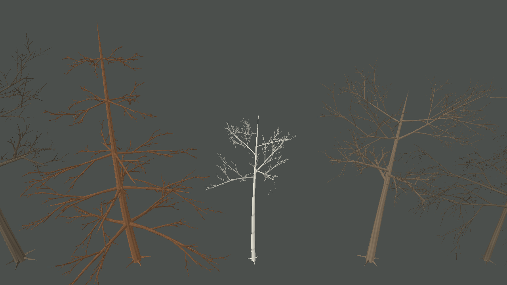
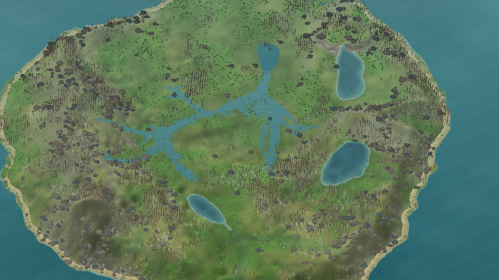

# Esqueleto de galhos estável entre LODs — iteração 48

**Data:** 22/10/2026  
**Escopo:** comparação atual dos cinco repositórios indicados e consistência do esqueleto de galhos principais entre níveis de detalhe. Sem mudanças em texturas, snapshots, RNG ecológico ou parâmetros L0.

## O que as referências mostram

| Repositório e arquivos | Técnica observada | Decisão para o Gênesis |
| --- | --- | --- |
| [EZ-Tree — `tree.js`](https://github.com/dgreenheck/ez-tree/blob/main/src/lib/tree.js), [`options.js`](https://github.com/dgreenheck/ez-tree/blob/main/src/lib/options.js) | Gera primeiro um esqueleto com seed; passes de malha independentes reutilizam essa estrutura. O LOD reduz amostras de seção, segmentos radiais e folhas e ajusta a escala dos elementos retidos. | Tratar distância como simplificação da representação, mantendo os mesmos eixos dos galhos que permanecem visíveis. O projeto usa Three.js, que não é trazido ao cliente MonoGame. |
| [MTree/GoodPie — `GrowthFunction.cpp`](https://github.com/GoodPie/modular_tree/blob/main/m_tree/source/tree_functions/GrowthFunction.cpp), [`BranchFunction.cpp`](https://github.com/GoodPie/modular_tree/blob/main/m_tree/source/tree_functions/BranchFunction.cpp), [`PipeRadiusFunction.cpp`](https://github.com/GoodPie/modular_tree/blob/main/m_tree/source/tree_functions/PipeRadiusFunction.cpp) | Separa a arquitetura do crescimento; distribui vigor com dominância apical, e a regra de gravidade usa peso acumulado e rigidez. O raio pode ser calculado por soma de potências dos ramos-filhos. O repositório atual é um fork para Blender 4.3+. | Usar separação de regras e geometria como referência. O nosso sag continua uma receita visual estática: ainda não há idade, vigor, carga ou rigidez por árvore no snapshot. Não importar Blender, nós, Eigen ou C++. |
| [Space Colonization — `tree.c`](https://github.com/jakobrichert/space-colonization/blob/main/src/tree.c) | A cada passo, atribui atratores vivos ao nó mais próximo dentro da zona de influência, cresce na direção média e remove pontos dentro da zona de morte. Uma grade espacial limita a busca a células próximas. | O Gênesis usa o mesmo princípio de associação e crescimento no preenchimento determinístico da copa. O orçamento atual continua pequeno (até 144 alvos); não acrescentar grade espacial antes de medir um caso que justifique sua manutenção. |
| [SeedThree — `weber-penn.js`](https://github.com/SkyeShark/SeedThree/blob/main/src/core/weber-penn.js) e [receitas de espécie](https://github.com/SkyeShark/SeedThree/tree/main/src/species) | Weber–Penn usa regras por nível para forma da copa, comprimento, taper, curva, ângulos e distribuição dos ramos. Receitas selecionam parâmetros e famílias de gerador. | Continuar ampliando perfis declarativos e determinísticos. Os perfis locais são arquétipos visuais; nem o alpha indicado pelo pedido nem suas receitas demonstram calibração de espécies do Gênesis. |
| [Unity Space Colonization — `GrowthManager.cs`](https://github.com/jasonwebb/unity-space-colonization/blob/master/Assets/Scripts/GrowthManager.cs) | O C# organiza atualização em etapas: associação de atratores por KD-tree, crescimento dos nós, poda dos alvos e reconstrução do índice espacial. | Referência de fluxo e indexação. Nenhuma dependência de Unity, `UnityEngine`, TubeRenderer ou KD-tree foi incorporada; o protótipo permanece em C# puro com `System.Numerics`. |

Esses projetos são evidência de técnicas de implementação, não validação de parâmetros botânicos. Nenhum código, asset ou dependência externa foi copiado.

## Diagnóstico no código local

`ProceduralTreeGenerator` já separa o grafo determinístico da malha MonoGame e tem regras por ordem. Ainda havia um acoplamento entre câmera/LOD e a forma: a resolução da curva e o progresso usado para sag e inclinação dependiam do nível de detalhe. A seleção reduzida de filhos também recalculava alturas, azimutes e chaves aleatórias a partir do novo número de filhos. Assim, um galho principal podia curvar ou receber outros descendentes quando a câmera mudava de distância.

## Alterações desta iteração

- As amostras centrais e a curva dos galhos por ordem agora são independentes do LOD. A renderização ainda reduz lados radiais, ordens finas e folhagem.
- A curvatura e a inclinação usam a ordem máxima declarada pelo perfil, não a ordem que o LOD decidiu renderizar.
- Cada perfil determina o calibre dos galhos primários; o ajuste de suporte por carga não redimensiona esses galhos a partir da quantidade de folhagem que o LOD omitiu.
- Os níveis reduzidos escolhem um subconjunto espalhado dos mesmos slots de ramificação do nível detalhado. Posição, orientação, comprimento e seed de cada galho compartilhado permanecem constantes.
- Os níveis finos continuam reduzidos por distância e o passe Space Colonization ainda pode produzir detalhes adicionais em alta resolução. Portanto, esta alteração estabiliza o tronco e os galhos primários e os brotos comuns; não congela toda a árvore em um único grafo completo.

As regras são apenas de apresentação; câmera e LOD não avançam processos do mundo ou consomem RNG ecológico.

## Evidência, custo e validação

Captura de diagnóstico sem folhas, seed 3, cinco perfis e perspectiva:

- Malha arbórea: **279.840 vértices**, contra 279.696 na captura comparativa da iteração 47 (**+144, cerca de 0,05%**). São contagens desta galeria, não FPS, tempo de geração ou VRAM.
- Cena ampla, seed 2: **13.546 árvores**, 4.154.664 vértices arbóreos e 7.665.642 vértices de flora total. A captura anterior da iteração 47 registrou 9.180.498 vértices arbóreos; o valor menor agora resulta de remover bulges de junção de filhos que não são renderizados no LOD distante e decimar o centroline enviado à malha. As capturas não são um benchmark de FPS ou VRAM.
- O teste automatizado verifica, nos cinco perfis, igualdade de segmentos, posições e raios dos galhos primários entre LODs 0, 1 e 2.
- Suíte `Game.Tests` Release: **59/59 aprovados**. Build Release da solution: **0 avisos, 0 erros**.

## Limitações e próximo passo

A galeria ainda mostra galhos finos, ramos longos e bifurcações visualmente regulares; a silhueta não alcança a referência fornecida. A mudança reduz o salto de forma entre distâncias, mas não representa uma melhora visual suficiente da arquitetura isolada. As ordens superiores e o preenchimento por atratores continuam mais densos no LOD próximo. A próxima revisão deve comparar os galhos principais e seus encaixes em vistas laterais e oblíquas, mantendo o foco na estrutura antes de ampliar as copas. Ainda não foram medidos FPS, VRAM ou custo total da floresta com esta mudança.
