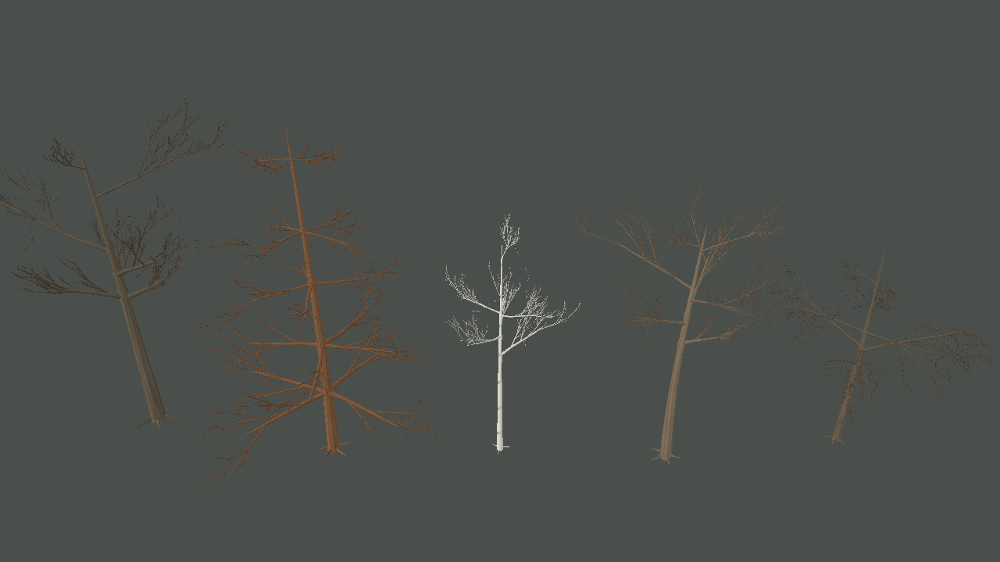

# Pesquisa de geração procedural de árvores — iteração 43

**Data:** 22/10/2026
**Escopo:** estrutura e geometria de troncos/galhos, crescimento, silhueta, folhagem ligada ao esqueleto e LOD. Texturas não foram alteradas.

## Resultado da inspeção

Os cinco repositórios foram clonados e inspecionados nos arquivos centrais indicados. Eles oferecem modelos complementares, não uma única solução para copiar:

| Referência | O que demonstra | Uso adequado no Gênesis |
| --- | --- | --- |
| [EZ-Tree](https://github.com/dgreenheck/ez-tree) — `src/lib/tree.js`, `branch.js`, `options.js` | Crescimento recursivo por níveis; comprimento, raio, taper, seções, curvatura/força e distribuição de folhas parametrizados por nível. A malha LOD é derivada do mesmo esqueleto e preserva seus pontos terminais. | Continuar separando o esqueleto determinístico da malha. Usar resolução de curva, taper e orçamento por ordem, mantendo os mesmos suportes de galhos ao trocar LOD. Não trazer Three.js. |
| [MTree](https://github.com/GoodPie/modular_tree) — `BranchFunction.cpp`, `GrowthFunction.cpp`, `PipeRadiusFunction.cpp` | Separa nós e regras de ramificação da geometria. Expõe dominância apical/vigor, gravidade e rigidez; calcula raios do suporte para a ponta pela soma de potências dos ramos filhos. | Tratar gravidade, dominância e espessura como parâmetros de um perfil botânico independente do renderer. O código demonstra arquitetura e regras úteis, mas seus valores não são medições de espécies do Gênesis. Não trazer Blender, Geometry Nodes ou biblioteca C++. |
| [Space Colonization](https://github.com/jakobrichert/space-colonization) — `src/tree.c`, `tree.h` | Distribui atratores num envelope volumétrico; atribui cada ponto ao nó mais próximo dentro da zona de influência; cresce na direção média; remove pontos na zona de morte. Uma grade espacial acelera consultas. Detecta estagnação e usa direcionamento individual como recuperação. A espessura é derivada da carga de folhas descendentes. | Usar colonização como passe limitado para explorar espaços da copa depois de construir os ramos estruturais. Manter envelope, pontos e iterações determinísticos e orçados. Avaliar uma grade espacial somente se o orçamento futuro superar o passe atual pequeno. |
| [SeedThree](https://github.com/SkyeShark/SeedThree) — `src/core/weber-penn.js`, `tree.js`, `src/species/` | Weber–Penn parametriza a forma por nível: comprimento, curva, taper, ângulo, rotação/filotaxia e distribuição vertical. Perfis de planta escolhem parâmetros e família de gerador; a construção separa espinhas, malhas, cartões e LOD/impostor. | Referência de perfis e envelopes. O Gênesis usa a forma de copa declarada pelo perfil para modular o comprimento de galhos primários. O projeto está em alpha e suas predefinições são exemplos de implementação, não validação botânica. Não importar Three.js/WebGPU, materiais ou pipeline de texturas. |
| [Unity Space Colonization](https://github.com/jasonwebb/unity-space-colonization) — `Assets/Scripts/GrowthManager.cs`, `Node.cs`, `Attractor.cs` | Implementação C# com lista de nós/raízes, busca espacial KD-tree, atratores configuráveis, obstáculos/limites e uma etapa de crescimento por iteração. | Referência para organizar o algoritmo em C#. Usar `System.Numerics`, seeds por contador e contratos do Gênesis. O repositório depende de `UnityEngine`, de uma KD-tree própria e declara o TubeRenderer pago; nenhum desses componentes é incorporado. |

## Diagnóstico do Gênesis antes desta iteração

`ProceduralTreeGenerator` já produzia um grafo determinístico de segmentos cônicos com hierarquia, galhos primários posicionados por seed, curvas Bézier segmentadas, redução de raio, atratores de copa e locais de folhagem ligados a ramos terminais. `ProceduralFloraMeshBuilder` construía tubos ao longo dessas cadeias e tinha tratamento especial para conexões com o tronco.

Havia dois problemas estruturais identificáveis:

1. O comprimento dos galhos primários variava pouco com a altura e com a forma da copa. Isso deixava os perfis largos, esféricos e cônicos próximos de uma mesma estrutura radial.
2. O passe de colonização guardava o primeiro segmento de cada galho primário como se fosse a ponta. Como um galho primário contém vários segmentos Bézier, os novos galhos de preenchimento partiam perto do tronco em vez de partir da extremidade real.

O Gênesis já limitava atratores a 144 pontos, novas extensões a 64 segmentos e sete iterações no maior nível. O algoritmo C em `tree.c` usa uma grade espacial para quantidades maiores; copiar essa estrutura agora acrescentaria custo e complexidade sem necessidade demonstrada para esse orçamento.

## Alterações aplicadas

- `TreeRenderProfile` agora declara uma forma qualitativa de copa: cônica, esférica, hemisférica, cilíndrica, cilíndrica afilada, chama, cônica invertida ou chama estreita.
- O comprimento dos galhos primários segue uma razão de forma inspirada em Weber–Penn. Carvalho e bordo usam envelope esférico; pinheiro, cônico; bétula, cilíndrico afilado; salgueiro, hemisférico. O fator conserva um comprimento mínimo de 18% para que os ramos da borda não terminem como tocos isolados.
- `GrowBranch` devolve o índice do último segmento da cadeia de mesma ordem. A colonização da copa passa a iniciar na ponta real do galho primário.
- Foram adicionados testes sobre tendências de comprimento por faixa da copa, continuidade da hierarquia, determinismo e início da colonização nas pontas primárias.

Essas formas são arquétipos de apresentação. Os nomes dos perfis não implicam coeficientes medidos ou identificação de táxon. A câmera continua sem alterar o RNG ecológico, os parâmetros biológicos ou snapshots.

## Evidência e desempenho observado

Vista de diagnóstico com cinco árvores sem folhagem, seed 3, câmera em perspectiva e zoom 44:

A captura registrou **191.028 vértices de malha arbórea** antes e depois da mudança; as alterações mudam comprimentos e pontos de partida, sem aumentar a contagem de segmentos neste caso. Não houve medição de FPS nesta vista. A imagem confirma diferenças de silhueta entre os envelopes, mas os galhos ainda parecem finos e esparsos; a meta visual da referência não foi atingida.

Verificações:

- Build Release de `Game.Client.Desktop`: aprovado, 0 avisos e 0 erros.
- Suíte completa `Game.Tests`: aprovada, 40/40 testes.
- A suíte inclui regressões para determinismo, relações pai-filho, encaixe de galhos e envelopes de comprimento dos galhos principais.

## Limitações e próximos passos

- O fator de copa altera os galhos primários, mas ainda não é um sistema completo Weber–Penn nem um modelo de desenvolvimento anual.
- O passe de colonização não possui aceleração espacial; os limites atuais são pequenos. A geração visual ainda precisa ser medida quando centenas/milhares de árvores forem reconstruídas.
- Galhos secundários ainda se cruzam como tubos independentes e suas uniões não formam uma malha volumétrica contínua. Melhorar colares, suporte de espessura por subárvore e curvatura em vários pontos é o próximo trabalho estrutural.
- A gravidade de MTree e a lei de raio por subárvore do Space Colonization são boas referências para a próxima etapa, desde que permaneçam parâmetros visuais explícitos até haver estados individuais e calibração biológica no snapshot.
- A folhagem por clusters continua sendo um passe separado e ainda necessita validação visual própria; esta iteração não altera texturas ou pigmentos.
