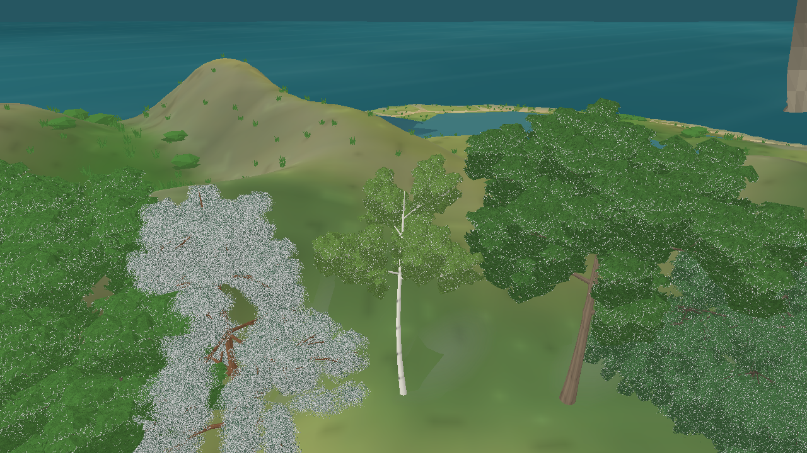

# Traços radiculares por perfil — iteração 53

O surgimento de raízes acima do solo deixou de depender de uma probabilidade aleatória comum do renderer. `TreeRootTraits`, mantido no módulo Biosphere, descreve o potencial biológico de expressão superficial, alcance lateral, espessura e dispersão de cada perfil. A seed do indivíduo ainda produz pequenas diferenças de forma, mas só depois que o fenótipo do perfil permite a geometria aparente; potencial biológico não significa exposição inevitável em qualquer local.

No protótipo atual, o carvalho tem maior expressão superficial, o bordo intermediária, o salgueiro discreta, e pinheiro e bétula não recebem raízes aparentes na condição de referência. Os coeficientes são qualitativos e provisórios: os perfis ainda são arquétipos de espécies temperadas, não parâmetros botânicos calibrados. A literatura consultada distingue arquitetura subterrânea de exposição real: raízes de pinheiro-silvestre respondem anatomicamente após exposição por erosão, enquanto estudos de carvalho-pedunculado descrevem raízes superficiais e profundas sem afirmar que sejam aparentes acima do solo ([Rubiales et al., 2008](https://doi.org/10.5194/nhess-8-223-2008); [Lucot & Bruckert, 1992](https://doi.org/10.1051/forest:19920503)).

Essa alteração representa a diferença biológica entre perfis, mas não simula as condições que deixam raízes expostas em um local. Idade individual, solo descoberto, erosão e outros fatores ainda não estão disponíveis no snapshot da flora. A aparência de raízes não deve ser lida como simulação dessas causas. A arquitetura e os limites estão detalhados em [FLORA_ARCHITECTURE.md](../specs/FLORA_ARCHITECTURE.md#arquiteturas-presentes) e a distinção entre raízes superficiais e exposição está em [15_RESEARCH.md](../15_RESEARCH.md#raízes-superficiais-e-exposição).

O teste `Exposed_root_expression_is_specific_to_biological_tree_profile` verifica que a expressão potencial é diferente entre os perfis: carvalho > bordo > salgueiro, com pinheiro e bétula em zero na referência. A regressão de malha das criaturas passou 8/8, o filtro conjunto de árvores e Z4 41/41, e a suíte Release passou 148/148. A captura de zoom 56 aproxima a galeria das cinco arquiteturas, embora a composição ainda não isole a base de cada árvore para uma inspeção radicular dedicada.

