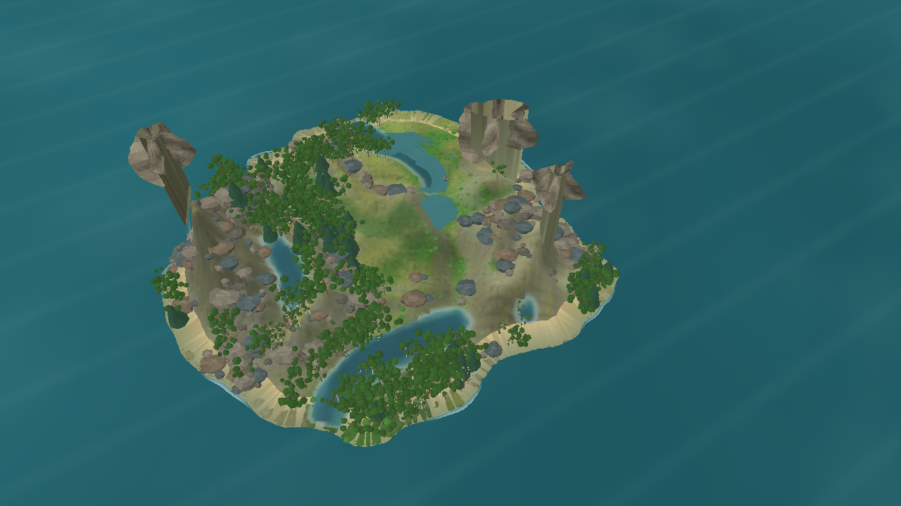

# Contraste das sombras arbóreas — iteração 50

**Data:** 22/10/2026\
**Escopo:** contraste da sombra render-only no N4; sem alteração do estado do mundo, da fonte de luz ou da geometria das árvores.

## Diagnóstico e alteração

As sombras suaves existentes já seguiam a projeção oposta à direção horizontal da luz e se conformavam à elevação amostrada. Na composição ampla, a opacidade central de 38/255 quase não separava copas, rochas e terreno. A opacidade central passou para 56/255; o gradiente exterior transparente, deslocamento e elipses foram mantidos. O número de vértices permanece igual.

## Evidência

Captura correspondente em zoom para inspecionar a composição local: [detalhe das sombras](evidence/iteration-50-canopy-shadow-detail.png). A captura ampla mantém seed 1/dia 172, 1280 × 720, perspectiva, zoom 3,4 e 621 árvores. SHA-256 da imagem ampla: `2064EF0BE7D66E83D0BAA0E7BF2F70EBA443240997F657C1A282D2669A8F786F`.

Build Release do cliente: 0 avisos, 0 erros. O assembly tem SHA-256 `869BA04CC15FF5D809308C74B4A2128F5624AF2B9D618AEC16535F3450B098CA`. Não houve benchmark de 60 s nem execução da suíte de testes nesta iteração visual. O custo geométrico da sombra permaneceu inalterado.

## Limites

A captura mostra uma alteração de pixels e leve reforço do contato visual, mas as sombras ainda não separam as copas e o relevo o suficiente para receber 3/4. A mudança não inclui oclusão entre árvores, sombra dinâmica por vento/hora do dia, filtragem em espaço de tela nem validação da luz em ambas as projeções. O gate de luz e profundidade permanece aberto.
