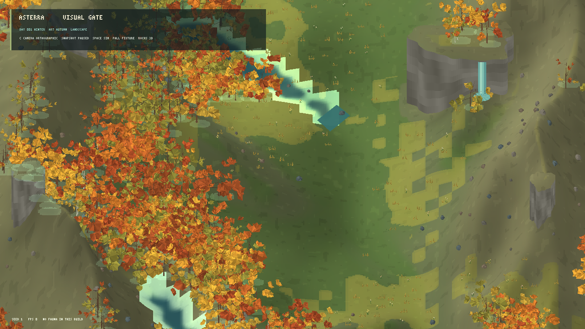
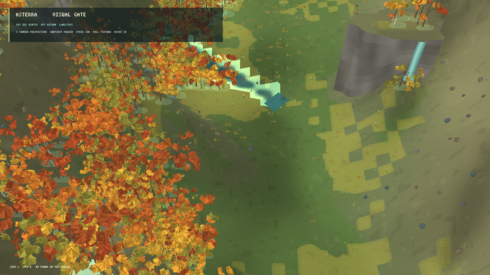

# Avaliação visual do renderer MonoGame — 21/10/2026

**Estado:** primeiro protótipo comparativo; gate visual ainda não aprovado.  
**Stack:** C#/.NET 10, MonoGame DesktopGL.  
**Snapshot:** cenário `temperate-valley-l0-v17`, seed 1, estado inicial.  
**Escopo:** câmera ortográfica e perspectiva elevadas na mesma composição de vale.

## Cena e controles

O modo `--visual-evaluation` enquadra uma região de aproximadamente 44 células da grade 64×64, com terreno geométrico subdividido, cobertura visual do snapshot, árvores procedurais e rochas 3D facetadas. O modo inicia pausado para manter o snapshot igual durante a comparação. `C` alterna a projeção e `Space` retoma os ticks simulados.

A cachoeira e a pequena poça ao pé do afloramento são uma **fixture somente de apresentação**. O snapshot L0 não publica uma cachoeira; a fixture está presa à parede do afloramento 0 para comparar volume, cor e composição. Ela não representa um processo hidrológico simulado e não modifica os dados, parâmetros ou RNG do mundo. A estação artística está em outono para expor variação de folhagem sem avançar o calendário científico.

Capturas comuns, 1280×720:

| Projeção | Captura |
|---|---|
| Ortográfica |  |
| Perspectiva |  |

Comando para abrir a cena interativa:

```powershell
dotnet run --project src/Game.Client.Desktop/Game.Client.Desktop.csproj -c Release -- --visual-evaluation --projection perspective
```

Para capturas, acrescente `--capture <caminho.png>`. Para medir, acrescente `--benchmark-seconds 15`; o benchmark usa 5 s de aquecimento e informa média, P95/P99, memória privada, memória residente, CPU e contagem visual.

## Comparação visual

| Critério | Nota 0–4 | Observação |
|---|---:|---|
| Terreno | 2 | Encostas, parede do afloramento e relevo têm volume. A resolução visual do campo e as transições do material ainda produzem blocos e manchas; algumas encostas dominam demais o enquadramento. |
| Água | 1 | A fixture prova que uma queda vertical pode ser desenhada dentro da cena. Os canais do snapshot continuam com margens escalonadas e manchas de água que não formam uma rede coerente; a cachoeira não é evidência de hidrologia simulada. |
| Vegetação | 2 | Galhos e copas têm geometria e variação de cor. Folhas triangulares, tufos pequenos, densidade irregular e marcas planas sobre o terreno ainda parecem artificiais, especialmente em perspectiva. |
| Rochas | 2 | Os novos pedregulhos são malhas volumétricas determinísticas e as paredes têm relevo. A maior parte dos pedregulhos é pequena para a vista ampla e as faces não recebem sombra coerente. |
| Luz e profundidade | 1 | A luz direcional do `BasicEffect` ajuda a ler a malha do terreno. Árvores e rochas usam cores pré-sombreadas; não há sombras projetadas de geometria nem oclusão ambiente real. |
| Composição | 2 | Perspectiva revela escala e distância entre mata, vale, encosta e afloramento. A água fica periférica, o centro abre uma grande área vazia e a fixture compete com a paisagem. |

Todas as categorias precisam atingir 3/4 segundo o gate de [direção visual](../22_VISUAL_DIRECTION_AND_TECHNOLOGY.md). A cena não passa esse critério; ela valida o fluxo de câmera e as malhas volumétricas, não a direção visual final.

**Ortográfica:** mantém escala e forma comparáveis ao longo do quadro e serve melhor para inspecionar campos e distribuição. Nesta cena, reduz a leitura de distância e achata o paredão.

**Perspectiva:** dá maior leitura de altura, proximidade e sobreposição entre encosta, árvores e afloramento, aproximando mais a composição elevada da referência. A escala varia com a distância e os detalhes planos ficam mais evidentes. É a candidata principal para a próxima iteração visual, mantendo ortográfica como opção de inspeção; ainda não é uma decisão de renderer de produção.

## Desempenho medido

Ensaios locais em Release, 1280×720, seed 1, cena pausada, 5 s de aquecimento e 15 s medidos. O sincronismo vertical limita a média observada a aproximadamente 60 FPS. As duas projeções foram executadas em processos separados:

| Projeção | Média | P95 | P99 | CPU de um núcleo | Memória privada | Working set | Árvores visíveis | Vértices de flora | Rochas 3D |
|---|---:|---:|---:|---:|---:|---:|---:|---:|---:|
| Ortográfica | 59,93 FPS | 17,17 ms | 17,62 ms | 32,2% | 203,3 MiB | 187,3 MiB | 525 | 535.938 | 104 |
| Perspectiva | 59,93 FPS | 17,12 ms | 17,43 ms | 35,9% | 189,4 MiB | 178,2 MiB | 451 | 455.916 | 70 |

Máquina: Intel Core i3-10105, NVIDIA GeForce RTX 5060, driver 32.0.16.1088, Windows, MonoGame DesktopGL. O snapshot pausado passa os limites locais de média ≥30 FPS, P95 ≤33,3 ms e P99 ≤50 ms. O teto histórico de 1 GiB de memória privada deixou de ser um gate; os alvos atuais são 8 GB RAM/4 GB VRAM mínimo e 16 GB RAM/8 GB VRAM recomendado, com validação da carga em hardware mínimo ainda pendente. O total de árvores/rochas difere entre projeções por causa do frustum e da perspectiva; portanto, esses números medem cada câmera como usada, não uma carga de instâncias idêntica.

Uma medição exploratória anterior manteve a simulação ativa por 15 s após o aquecimento. Ortográfica: 58,73 FPS, P95 17,22 ms, P99 59,62 ms; perspectiva: 59,00 FPS, P95 17,16 ms, P99 54,43 ms. O P99 ultrapassou 50 ms durante rebuilds periódicos de água e objetos de solo, que chegaram a aproximadamente 25 ms. Esse resultado dinâmico não passa o limite de P99 e precisa ser repetido após a próxima revisão desses rebuilds.

## Limites e próxima decisão

- O protótipo usa `BasicEffect`, cores de vértice e a malha/texture pipeline atual. Ainda não compara materiais com shaders próprios, reflexos, ondas, sombras em tempo real nem oclusão ambiente.
- A grama, as flores e algumas sombras continuam como sprites projetados em tela. Em perspectiva, ordenação, escala e profundidade desses elementos não acompanham totalmente a geometria.
- O terreno visual é subdividido, mas os campos científicos permanecem 64×64. Cor e água expõem a grade e o desenho dos canais precisa ser revisto para mostrar margens contínuas e relações claras com altitude.
- A fixture de cachoeira não é simulada. Ainda falta uma representação de queda derivada de snapshot hidrológico ou uma fixture de teste claramente isolada no contrato de apresentação.
- A avaliação cobre apenas seed 1; seeds 2 e 3, teste automatizado da geometria, escala de 10× instâncias, integração de novos shaders e outros alvos de plataforma não foram medidos.
- Nenhum teste automatizado foi executado nesta avaliação. O cliente desktop compilou em Release sem avisos; esta evidência não aprova os gates de testes científicos/headless.

**Decisão deste gate:** manter MonoGame e levar a perspectiva elevada à próxima rodada como hipótese visual líder. Antes de ampliar o renderer, corrigir água/margens, densidade e silhuetas da vegetação, integração espacial dos detalhes, sombras e leitura das rochas; repetir a rubrica e os benchmarks com as mesmas capturas e com seeds 2 e 3. Não alterar os modelos científicos para compensar limitações de apresentação.
