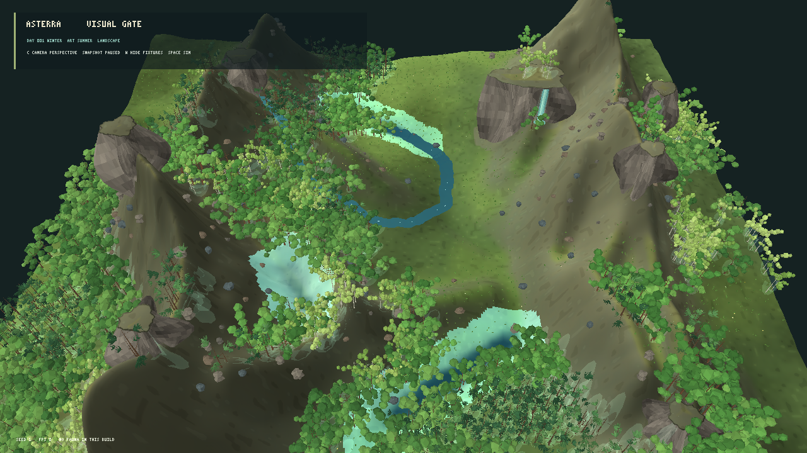
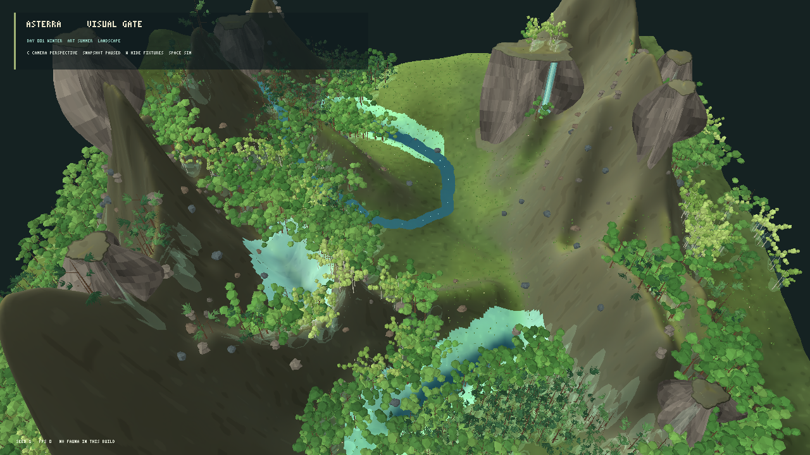

# Avaliação visual do renderer MonoGame — iteração 10 — 21/10/2026

**Estado:** material de encosta aprimorado em avaliação; gate visual segue reprovado.  
**Cena:** snapshot L0 pausado, seed 1, câmera panorâmica em perspectiva, copa volumétrica; comparação de escala vertical 1,00 e 1,40.

## Material sensível à inclinação





A textura natural de avaliação agora aumenta a exposição de rocha em encostas e reduz a cobertura pigmentada de grama onde o terreno é íngreme. A variação usa a inclinação amostrada e ruído derivado da seed; o caminho de autotile 2D não é alterado. O resultado deixa estrias minerais e áreas mais secas visíveis nas montanhas, mas a encosta central ainda parece lisa em áreas grandes e os paredões continuam fortes.

O novo material é exclusivamente albedo de apresentação: não altera solo, biomassa, água, vegetação, elevação armazenada ou suas regras. Build Release separado em `bin/terrain-slope-material/` terminou com zero avisos e zero erros. O benchmark de desempenho completo não foi repetido; o material aumenta o trabalho de textura na inicialização e não adiciona vértices, enquanto a escala altera somente posições verticais de apresentação.

## Decisão provisória

Manter escala vertical 1,00 e o material de encosta no modo de avaliação. A escala 1,40 fica disponível somente por `--exaggerated-relief-view`. O resultado melhora a leitura do substrato em encostas, mas não resolve a composição, os paredões, as rochas nem a densidade da floresta. O gate visual continua reprovado e a escolha do renderer permanece aberta.

## Reprodução

```powershell
dotnet src/Game.Client.Desktop/bin/terrain-slope-material/Release/net10.0/Game.Client.Desktop.dll --visual-evaluation --panorama-evaluation-view --volume-canopy --projection perspective --seed 1
dotnet src/Game.Client.Desktop/bin/terrain-slope-material/Release/net10.0/Game.Client.Desktop.dll --visual-evaluation --panorama-evaluation-view --volume-canopy --exaggerated-relief-view --projection perspective --seed 1
```
