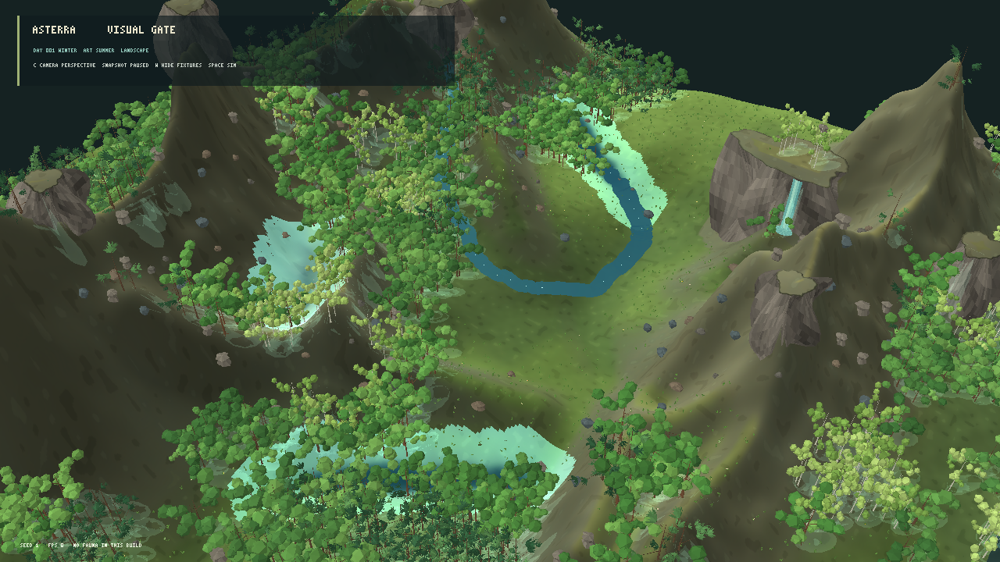
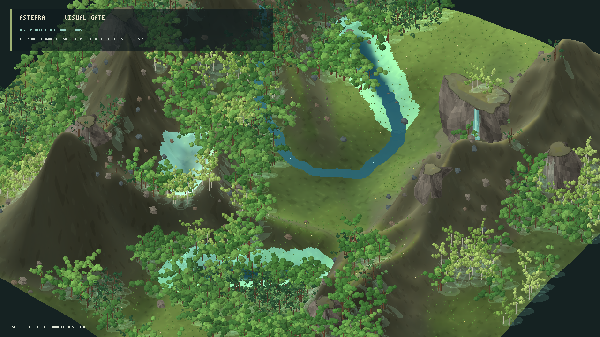

# Avaliação visual do renderer MonoGame — iteração 11 — 21/10/2026

**Estado:** câmera oblíqua melhora a leitura panorâmica; gate visual segue reprovado.  
**Cena:** snapshot L0 seed 1, escala de elevação 1,00, copas volumétricas procedurais, mesmo alvo; câmera perspectiva ou ortográfica.

## Enquadramento diagonal

Testei uma câmera elevada deslocada para sudeste, com FOV de 32° em perspectiva e largura ortográfica de 640 m. A direção do rio passou a cruzar a cena em diagonal e a vista mostrou mais do vale, aproximando a organização espacial da referência.



A perspectiva ajuda a perceber a queda e as encostas, mas as cristas e os paredões ainda se projetam como torres e cortam o enquadramento.



A ortográfica mantém a distribuição ampla mais estável e mostra a área completa do vale, mas achata a queda e a profundidade. Para este seed, a perspectiva oblíqua é a melhor candidata de composição entre as duas capturas; ela ainda não é uma escolha definitiva.

## Contagem e desempenho

As capturas incluem 1.363 árvores visíveis e 3.290.922 vértices de flora em perspectiva; a ortográfica inclui 1.490 árvores e 3.536.874 vértices. Não repeti benchmark nesta rodada, pois a diferença principal é o enquadramento e a amostra anterior já mede a variante de copa volumétrica. A média anterior de 60 FPS estava limitada por VSync; validar a nova vista sem concorrência e medir GPU time continuam necessários.

## Comparação com a referência

O rio agora atravessa o quadro diagonalmente, a floresta forma manchas maiores e o terreno ocupa a área de apresentação. A cena ainda falha no gate: as paredes de afloramento são altas em relação às copas; há grandes faixas lisas sem a mistura de prado, arbustos e rocha da imagem-alvo; os afloramentos pequenos parecem espalhados; a água permanece ciano e as árvores em volume ainda têm uma silhueta low-poly uniforme.

O snapshot, o gerador ecológico e os parâmetros científicos não foram alterados. O novo modo `--reference-composition-view` controla apenas o alvo, a câmera e a projeção do renderer de avaliação. Escala vertical 1,00 e material de encosta são os padrões visuais usados nesta rodada.

## Próxima melhoria

Manter a perspectiva oblíqua para a próxima comparação. O gargalo agora é a integração visual entre afloramentos, encostas e vegetação. Continuar com uma revisão de apresentação dos afloramentos e dos mapas de materiais, sem esconder elevações ou alterar o estado da simulação; medir a vista final depois desse ajuste.

Build Release isolado em `bin/reference-composition/` terminou com zero avisos e zero erros. Não foram executados testes automatizados nesta rodada.

## Reprodução

```powershell
dotnet src/Game.Client.Desktop/bin/reference-composition/Release/net10.0/Game.Client.Desktop.dll --visual-evaluation --reference-composition-view --volume-canopy --projection perspective --seed 1
dotnet src/Game.Client.Desktop/bin/reference-composition/Release/net10.0/Game.Client.Desktop.dll --visual-evaluation --reference-composition-view --volume-canopy --projection orthographic --seed 1
```
