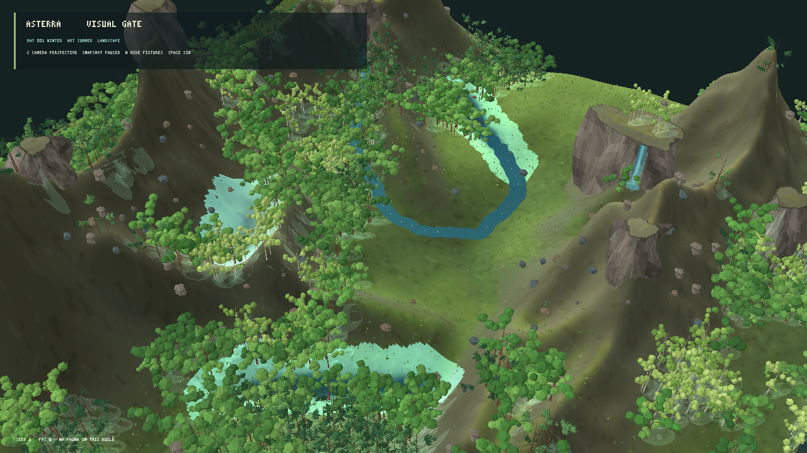
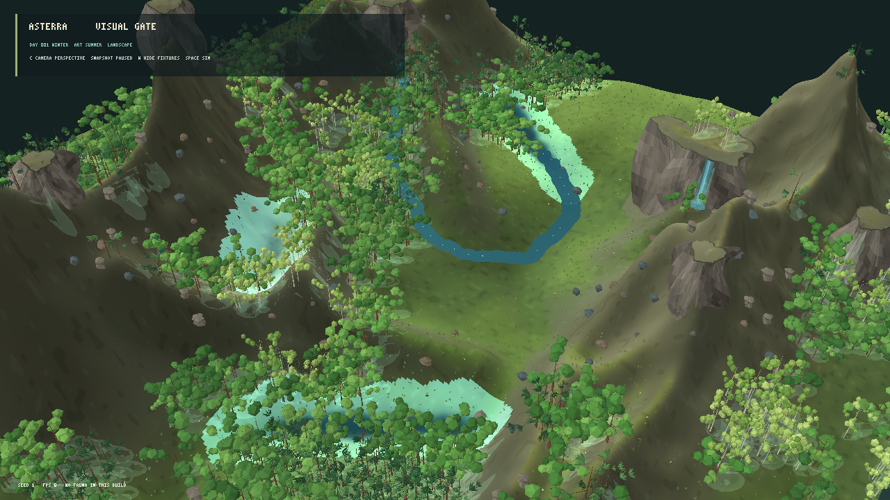

# Avaliação visual do renderer MonoGame — iteração 13 — 21/10/2026

**Estado:** LOD baseado em tamanho projetado reduz o custo; gate visual segue reprovado.  
**Cena:** snapshot L0 pausado, seed 1, perspectiva oblíqua, escala vertical 1,00 e copas volumétricas procedurais.

## Comparação

### Volume procedural sem LOD de distância



### Mesmo renderer com LOD por tamanho projetado



O LOD usa a altura em pixels de cada árvore na projeção: abaixo de 80 px usa a estrutura simplificada, entre 80 e 180 px usa o nível intermediário e acima disso mantém o nível alto. A árvore continua determinística pela mesma seed; câmera e projeção escolhem apenas qual geometria de apresentação construir. Na captura, árvores distantes ficam mais simples, enquanto o padrão de copas agrupadas permanece legível.

## Desempenho pareado

Build Release, 1280 × 720, seed 1, simulação pausada, mesma câmera e VSync, com 5 s de aquecimento e 10 s medidos. Máquina: Intel Core i3-10105 e NVIDIA GeForce RTX 5060, driver 32.0.16.1088.

| Variante | FPS médio | P95 | P99 | Máximo | Memória privada | CPU de um núcleo | Vértices de flora |
|---|---:|---:|---:|---:|---:|---:|---:|
| Copa volumétrica, sem LOD | 60,00 | 16,91 ms | 17,06 ms | 17,32 ms | 518,4 MiB | 17,5% | 3.290.922 |
| Copa volumétrica, LOD de distância | 60,00 | 16,84 ms | 16,98 ms | 17,21 ms | 338,9 MiB | 16,1% | 2.503.710 |

O LOD reduz vértices de flora em 24% e memória privada em 34,6%. Ambos os resultados ficam a 60 FPS por causa do VSync; o ganho visível no teste é sobretudo de memória e CPU. As medições não cobrem 10× de instâncias nem a reconstrução do renderer ao longo da simulação.

## Avaliação visual e limite atual

A variante reduzida conserva a leitura da mata nesta vista ampla, mas folhas e galhos distantes perdem definição. Árvores continuam pouco diversas e a floresta não chega à riqueza da referência. A perspectiva oblíqua deixa o rio diagonal e o vale mais legíveis; rochas, paredões, grandes áreas lisas do terreno e o brilho da água ainda mantêm as notas abaixo de 3/4. O gate visual permanece reprovado.

A paleta da fixture de cachoeira e poça também foi desaturada para tons minerais no renderer de avaliação. Isso não muda a água do snapshot; a água real ainda precisa de mais validação visual em seeds e estados hidrológicos diferentes.

## Fronteira científica

LOD, materiais, câmera e malhas são derivados de snapshot, perfil visual e seed. Alterar câmera ou mudar entre os níveis de malha não chama RNG ecológico, não modifica biomassas nem parâmetros físicos ou biológicos, e não altera o snapshot.

Build Release isolado em `bin/terrain-camera-lod-aggressive/` terminou com zero avisos e zero erros. Não foram executados testes automatizados nesta rodada.

## Reprodução

```powershell
dotnet src/Game.Client.Desktop/bin/terrain-camera-lod-aggressive/Release/net10.0/Game.Client.Desktop.dll --visual-evaluation --reference-composition-view --volume-canopy --projection perspective --seed 1
dotnet src/Game.Client.Desktop/bin/terrain-camera-lod-aggressive/Release/net10.0/Game.Client.Desktop.dll --visual-evaluation --reference-composition-view --volume-canopy --distance-aware-tree-lod --projection perspective --seed 1
```
