# Avaliação visual do renderer MonoGame — iteração 16 — 21/10/2026

**Estado:** cena 3D e LOD híbrido demonstrados; gate visual continua reprovado.  
**Cena:** snapshot L0 pausado, seed 1, MonoGame DesktopGL, 1280 × 720, relevo vertical 1,0 e paleta sazonal de outono somente para apresentação.

**Nota de revisão (iteração 17):** a paleta de outono e as cores sorteadas descritas abaixo pertencem à avaliação histórica. O código atual removeu a prévia sazonal independente e exige traço de espécie/estado causal para mudanças de pigmento; consulte [iteração 17](VISUAL_RENDERER_EVALUATION_ITERATION_17_2026-10-21.md) para a política e evidência atuais.

## Direção e fontes inspecionadas

O commit `4cf8be08b965dca6653ed97175c4c0b3a7a2502c` é o `main` remoto confirmado. Esta cópia de trabalho está em um ramo de implementação divergente e contém alterações locais extensas; os arquivos da direção visual e do ADR-0004 presentes no checkout foram preservados sem mesclar o ramo documental, que remove arquivos da implementação atual.

O DwarfCorp confirma uma referência de mundo 3D com arte de sprites, mas usa terreno voxel. A geração por ruído de continentes, montanhas e colinas pode orientar a organização de formas; a malha em blocos não serve ao objetivo. O WorldGenerator é um port FNA/MonoGame; `chunked-terrain` demonstra terreno procedural dividido em chunks; SharpCraft é um clone de Minecraft. Essas referências ajudam a separar geração e apresentação, sem definir a aparência final.

Em `Spectators-of-Life`, o terreno é desenhado em 2D. `buildLandformElevationField` usa um filtro gaussiano 5×5 com 25% de elevação local e 75% de forma regional; `terrain-palette.ts` classifica superfícies e interpola cores; `terrain-lighting.ts` calcula gradiente, hillshade e uma aproximação curta de oclusão de horizonte; o autotile de grama usa ruído determinístico e nunca cria cobertura sem biomassa. São regras aproveitáveis para materiais e cobertura visual, mas não uma solução de geometria 3D. Nenhum arquivo desse projeto foi alterado nesta rodada.

## Capturas e comparação

### Malhas procedurais, perspectiva elevada

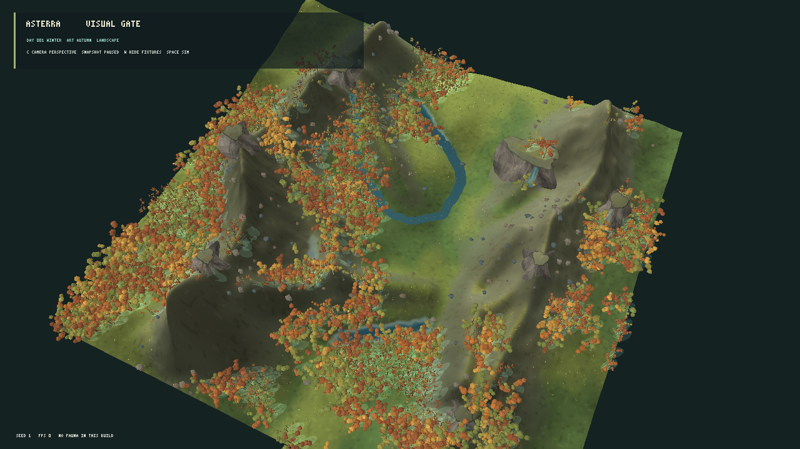

### Mesma cena, câmera ortográfica

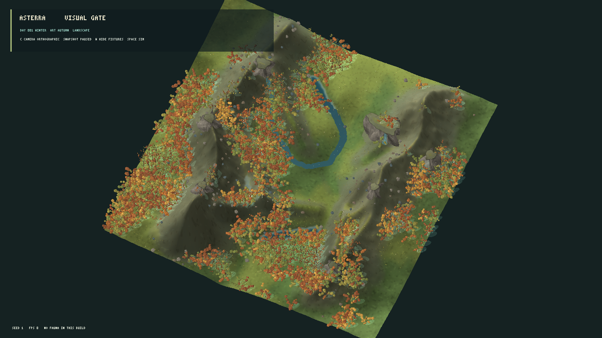

### Terreno 3D com árvores em billboards

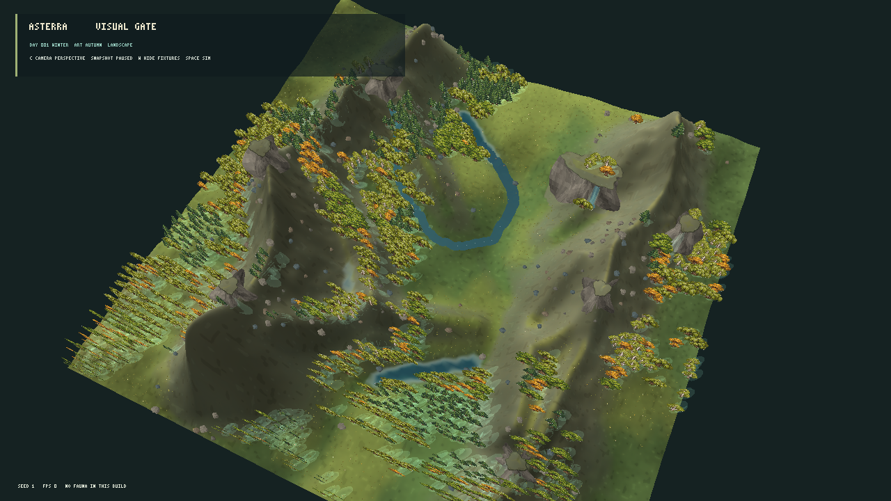

A perspectiva comunica melhor a altura das encostas e dos paredões. A ortográfica preserva o arranjo espacial, mas reduz a sensação de profundidade. Os billboards reduzem bastante a geometria e a memória, porém ficam estreitos de lado, repetitivos e incompatíveis com esta vista oblíqua. A técnica escolhida para a próxima experiência é terreno e rochas em 3D com árvores volumétricas; billboards simples ficam rejeitados nesta câmera. Billboards cruzados ou outros LODs planos continuam como hipótese distante, condicionada a uma nova avaliação visual. Esta decisão orienta o protótipo seguinte, sem aprovar o renderer para produção.

A correção de alpha eliminou os brilhos quase brancos da água. O canal agora fica em teal mineral escuro, mas ainda é uma fita estreita. `riverEdges=0` no snapshot seed 1; o curso contínuo e a cachoeira visíveis nessas capturas são fixtures explicitamente visuais, não água simulada. A paleta outonal reduz a predominância de copas verdes brilhantes e traz árvores douradas e ferrugem, embora a mata ainda se organize em faixas e abra clareiras grandes.

### Experiência de composição e água — iteração 18

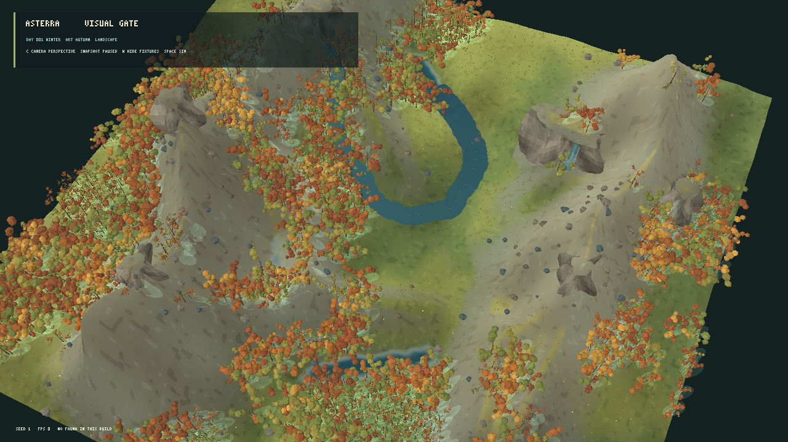

O enquadramento em perspectiva foi aproximado para 30° e o curso visual alargado até desembocar num lago raso. A borda do lago deriva da elevação local e usa seed visual determinística; a superfície continua marcada como fixture de renderer. A maior área de água e o enquadramento mais cheio melhoram a leitura da composição. Ainda há uma margem visível do mapa no lado direito; a água contorna uma ilha com forma regular; as encostas estão mais claras, mas permanecem largas e lisas; a vegetação se concentra em faixas. A captura não passa o gate visual e não valida hidrologia real.

A cena passou a confiar no hillshade direcional já presente na textura e desliga a segunda iluminação do `BasicEffect` somente no modo de avaliação. Isso clareia as encostas e revela mais variação do material, mas também reduz o contraste volumétrico; precisa ser comparado novamente com uma iluminação integrada antes de virar padrão.

| Seed | `riverEdges` | Árvores visíveis | Vértices de flora | Captura |
|---|---:|---:|---:|---|
| 1 | 0 | 1.518 | 2.717.022 | [seed 1](evidence/visual-evaluation-iteration-18-watercourse-lake-seed-1.png) |
| 2 | 0 | 1.002 | 1.746.099 | [seed 2](evidence/visual-evaluation-iteration-18-watercourse-lake-seed-2.png) |
| 3 | 0 | 1.354 | 2.450.181 | [seed 3](evidence/visual-evaluation-iteration-18-watercourse-lake-seed-3.png) |

As três seeds geram composições e agrupamentos diferentes de modo determinístico, mas nenhuma expõe arestas de rio no snapshot. O curso largo observado nelas é fixture visual; os arquivos também confirmam que a aparência da água não deve ser relatada como hidrologia simulada.

Uma segunda captura completa da seed 1, com a mesma configuração e no mesmo driver, gerou PNG bit a bit idêntico (`SHA-256 B6ED75ACE069376E206CD9CCB59444911BCB5BA4267A936D881FBDF035DB9F41`). Isso comprova repetibilidade local desta captura e seed; não garante igualdade de pixels entre drivers ou GPUs.

### Comparação de câmera, relevo e arquitetura de copas — iterações 19–26

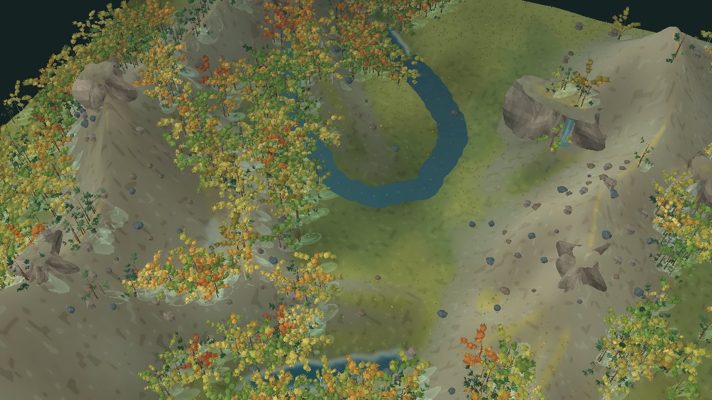

Reduzir a câmera de 64° para cerca de 55° acima do plano e comprimir o relevo de apresentação para 72% dá mais leitura às encostas e às paredes; nenhuma altura física ou snapshot foi alterado. Um FOV de 28° preenche o quadro melhor que 36°, mas ainda deixa cantos do limite do mapa visíveis e corta parte da paisagem. Uma névoa atmosférica básica foi testada; na distância desta câmera, quase não altera a imagem e não esconde o contorno.

A mistura sazonal foi ajustada para manter coníferas verdes, bétulas douradas e reservar laranjas mais fortes para bordos. A seleção de espécie agora usa um campo espacial suave mais variação local, em vez de blocos rígidos de 8 × 8 células. Essa escolha muda só a receita de aparência por seed; não lê nem grava estado ecológico. A distribuição de grupos fica menos retangular, embora a cena ainda tenha faixas e grandes áreas sem cobertura.

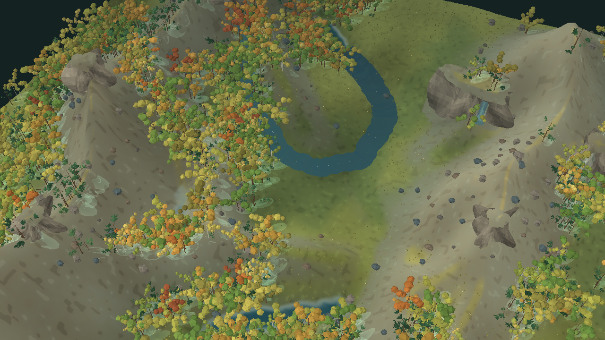

As duas versões mantêm troncos e ramos 3D. A versão de copa volumétrica reduz a malha de flora de 3,44 M para 2,67 M vértices nesta captura, mas produz tufos arredondados e repetitivos. A versão com leques de folhas tem borda de copa mais quebrada e se aproxima mais da referência nesta escala; ela permanece como variante escolhida para a próxima avaliação. A comparação é visual e local, não uma validação botânica completa.

| Seed | `riverEdges` no snapshot | Árvores visíveis | Vértices de flora | Captura |
|---|---:|---:|---:|---|
| 1 | 0 | 1.126 | 3.437.472 | [seed 1](evidence/visual-evaluation-iteration-25-forest-palette-seed-1.png) |
| 2 | 0 | 791 | 2.430.951 | [seed 2](evidence/visual-evaluation-iteration-25-forest-palette-seed-2.png) |
| 3 | 0 | 922 | 2.790.303 | [seed 3](evidence/visual-evaluation-iteration-25-forest-palette-seed-3.png) |

As três capturas ainda usam água demonstrativa do renderer porque não há arestas fluviais nos snapshots testados. A repetição local da seed 1 produziu PNG bit a bit igual (`SHA-256 C9B84608B927CFABC323E636EEFF26BAC01875DC5678ED3E94B200FBB5891B0E`).

### Correção de seleção do canal e água real — iteração 28

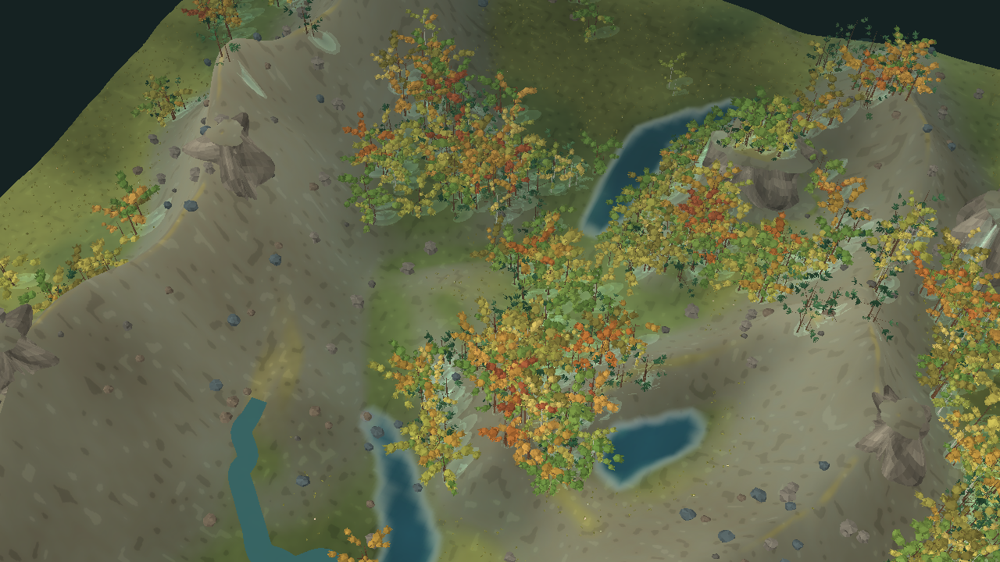

O diagnóstico separou geração hidrológica de apresentação. As snapshots 1–3 continham, respectivamente, 577, 653 e 633 células com água; porém, a seleção anterior do renderer escolhia o segmento de maior acumulação e descartava toda a rede quando aquele percurso terminava em um lago depois de uma ou duas arestas. A correção escolhe o percurso contínuo mais longo entre arestas molhadas e usa acumulação apenas como desempate. Ela só filtra a malha de apresentação; o grafo hidrológico e os valores da simulação não mudam.

Com `--snapshot-water-only`, que desliga curso e cachoeira demonstrativos, as seeds 1–3 agora desenham 31, 13 e 16 arestas de canal real. A seed 2 deixa visíveis um curso sinuoso e pools conectados à topografia. Na seed 1 o curso está fora do recorte principal; a seed 3 tem vários pools, mas ainda não uma cachoeira legível na vista ampla. Esta evidência resolve a antiga afirmação de que nenhuma água real aparecia: aquela limitação pertencia ao filtro de seleção anterior, registrado na iteração 25.

### Benchmark de água do snapshot — seed 2

Release, 1280 × 720, seed 2, projeção perspectiva, fixtures desligadas, simulação pausada, VSync ligado, 5 s de aquecimento e 10 s medidos.

| FPS médio | P95 | P99 | Máximo | CPU de um núcleo | Working set | Memória privada | Árvores visíveis | Vértices de flora |
|---:|---:|---:|---:|---:|---:|---:|---:|---:|
| 60,00 | 16,97 ms | 17,25 ms | 17,72 ms | 18,7% | 332,4 MiB | 415,1 MiB | 791 | 2.430.951 |

### Integração de rochas e sombras de contato — iterações 29–31

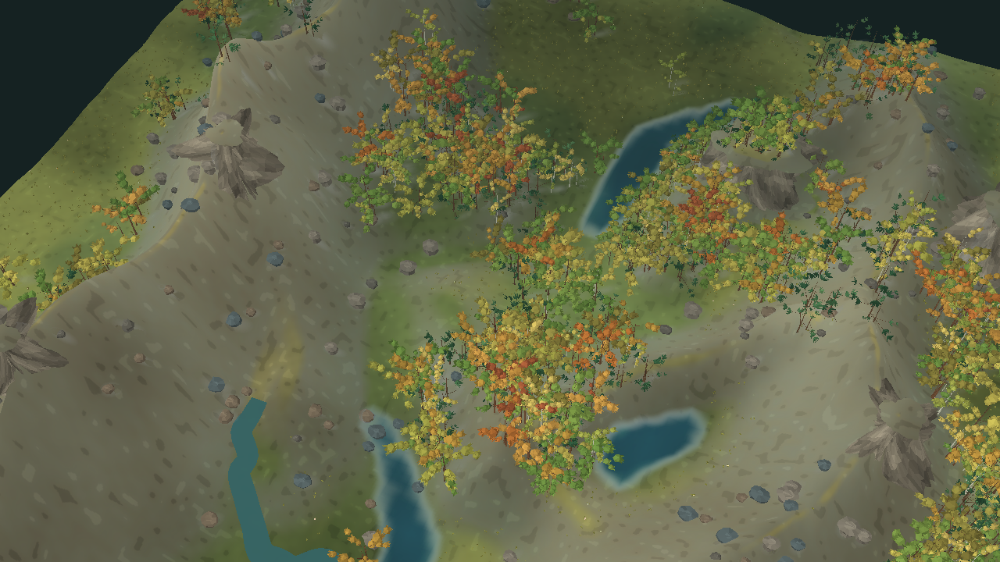

As bordas dos paredões ganharam 12 faixas verticais com perturbação determinística de face; o teste causou uma mudança pequena na vista ampla. Os pedregulhos agora têm cristas superiores mais largas e menos pontas radiais. A mudança mais legível veio das sombras suaves no chão: compare com [a captura anterior](evidence/visual-evaluation-iteration-28-snapshot-water-seed-2.png). Sombras de árvores e rochas usam alpha não premultiplicado e leitura de profundidade sem escrever profundidade, seguindo a mesma direção de luz.

A captura mantém `--snapshot-water-only`: rios e pools vêm dos campos publicados, sem curso ou cachoeira demonstrativos. As três seeds continuam mostrando 31, 13 e 16 arestas reais de canal. Rochas e sombras são derivadas somente para apresentação e usam a superfície do snapshot como apoio.

### Benchmark com rochas e sombras de contato — seed 2

Release, 1280 × 720, simulação pausada, VSync ligado, 5 s de aquecimento e 10 s medidos.

| FPS médio | P95 | P99 | Máximo | CPU de um núcleo | Working set | Memória privada | Árvores visíveis | Vértices de flora | Vértices de sombra |
|---:|---:|---:|---:|---:|---:|---:|---:|---:|---:|
| 60,00 | 16,92 ms | 17,09 ms | 17,48 ms | 17,8% | 354,5 MiB | 435,7 MiB | 791 | 2.430.951 | 34.818 |

### Teste de enquadramento mais fechado — iteração 32

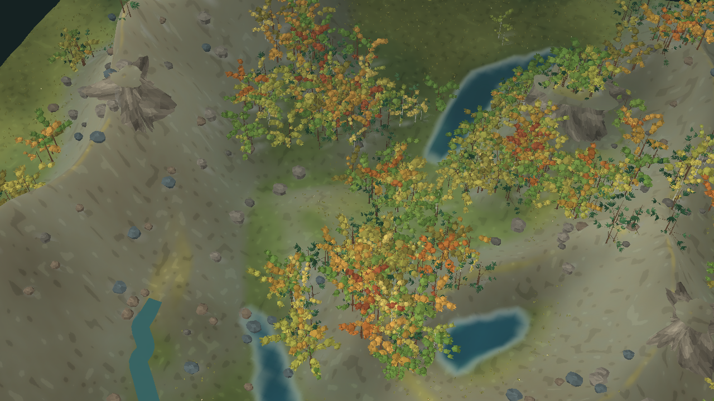

FOV 24° esconde quase todo o limite retangular, mas corta o grid L0 e parte do relevo. Na mesma seed e viewport, as árvores visíveis caem de 791 para 628 e os vértices de flora de 2.430.951 para 1.965.249. O teste foi rejeitado como enquadramento principal: preservar a região simulada inteira tem prioridade, então a referência continua em FOV 28° enquanto a borda é investigada como geometria de apresentação.

### Continuidade renderizada além da borda do snapshot — iteração 34

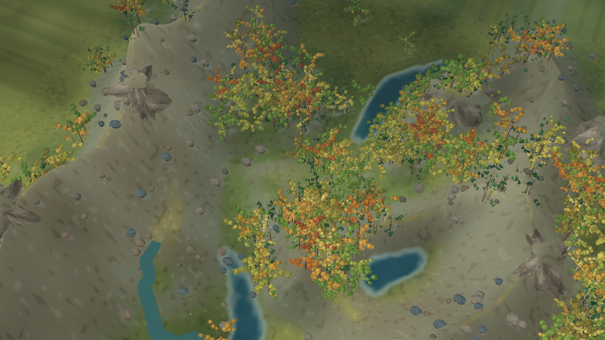

A nova margem usa uma malha `VertexPositionColor` dentro do renderer MonoGame. Ela prolonga somente o campo determinístico de elevação e parte da cor dos pixels da borda; não cria água, vegetação ou estado ecológico fora do snapshot. Trocar UVs esticadas por cores reduz a repetição de textura, mas as capturas posteriores mostram que o prolongamento ainda não se integra à paisagem. O sampler de ruído do terreno limita coordenadas fora do mapa, o que cria bandas no relevo estendido; a câmera ortográfica também expõe o contorno e cantos sem terreno. É um recurso de enquadramento parcial, não terreno novo aprovado para produção.

#### Benchmark com margem colorida — seed 2

Release, 1280 × 720, perspectiva, FOV 28°, água apenas do snapshot, simulação pausada, VSync ligado, 5 s de aquecimento e 10 s medidos. O resultado continua limitado a 60 FPS; o benchmark não isola GPU time.

| FPS médio | P95 | P99 | Máximo | CPU de um núcleo | Working set | Memória privada | Árvores visíveis | Vértices de flora | Vértices de sombra |
|---:|---:|---:|---:|---:|---:|---:|---:|---:|---:|
| 60,00 | 16,84 ms | 17,01 ms | 18,22 ms | 14,4% | 357,6 MiB | 440,0 MiB | 791 | 2.430.951 | 34.818 |

O frame time permanece na faixa do benchmark anterior de 16,92 ms P95; a memória reportada foi 3,1 MiB maior no working set e 4,3 MiB na memória privada. Como as medições não foram pareadas sob carga de GPU isolada, essa diferença não deve ser atribuída exclusivamente aos buffers do fundo.

### Luz geométrica, relevo físico e água rasa — iterações 35–45

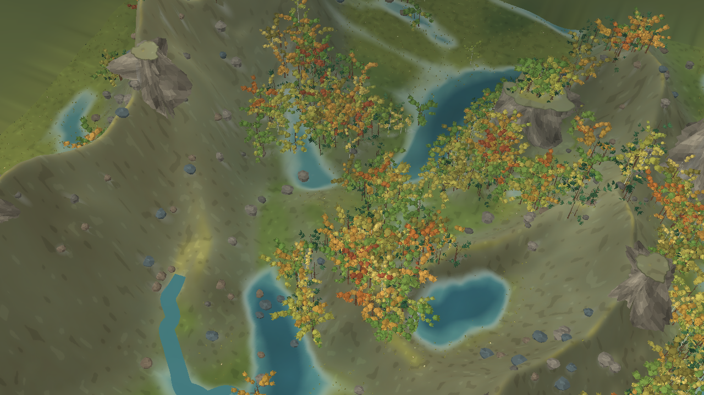

As iterações 35–36 testaram a iluminação direcional da malha em vez de gravar todo o hillshade na textura. A luz geométrica é uma variação válida para a vista de referência, mas não elimina as faixas que vêm do campo do terreno e a cena segue escura nas encostas. A vista de referência agora usa escala vertical 1,0, a elevação do campo sem compressão. Exagerar para 1,4 aumenta o volume, porém corta formações no enquadramento e não foi adotado como padrão.

A projeção ortográfica com o relevo físico inclui mais do mapa, mas deixa aparente a margem retangular e vazios nos cantos; a perspectiva continua sendo a composição principal. O blend para a média de cor do perímetro suaviza a textura do fundo, sem resolver sua junção geométrica. As tentativas intermediárias de baixar o limiar de água não produziram diferença perceptível. Reduzir o limiar até 10–220 mm e suavizar o alpha das margens torna lagoas rasas conectadas mais legíveis em seed 2; as 13 arestas de canal continuam selecionadas do snapshot. A paleta rasa/turquesa aumenta a leitura da água, mas áreas rasas chegam sob copas e ainda não há cachoeira legível.

#### Benchmark com luz geométrica e água rasa — seed 2

Release, 1280 × 720, perspectiva, escala vertical 1,0, `--snapshot-water-only`, simulação pausada, VSync ligado, 5 s de aquecimento e 10 s medidos. A configuração segue limitada a 60 FPS; o benchmark não isola GPU time.

| FPS médio | P95 | P99 | Máximo | CPU de um núcleo | Working set | Memória privada | Árvores visíveis | Vértices de flora |
|---:|---:|---:|---:|---:|---:|---:|---:|---:|
| 60,00 | 16,79 ms | 17,01 ms | 17,35 ms | 13,9% | 363,2 MiB | 454,2 MiB | 793 | 2.436.693 |

O ganho de água melhora a semelhança de escala, não a topologia: a cena ainda não apresenta um curso largo sinuoso nem cachoeira legível como na referência. As rubricas permanecem em 2/4; o próximo gargalo é a continuidade do terreno e a distribuição/densidade de vegetação, não novos efeitos na água.

### Enquadramento, agrupamento de rochas e cachoeira demonstrativa — iterações 46–62

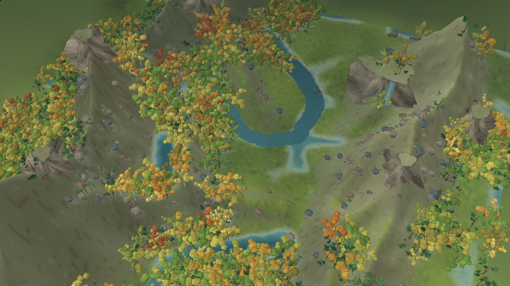

O filtro espacial testado na iteração 46 quase não mudou a imagem e encareceu a construção do relevo; foi removido. A tentativa de deslocar a exposição de rocha também teve efeito visual mínimo e foi revertida. Uma pequena correção de albedo mantém o solo outonal mais verde; a direção atual conserva escala vertical 1,0, luz geométrica, material turquesa e máscara das águas rasas do snapshot.

Seed 1 produz 31 arestas molhadas de canal e 1.121 árvores no FOV 28°; seed 3, 16 arestas e 909 árvores. O teste FOV 32° de seed 1 mostra 1.339 árvores visíveis e uma região mais ampla. O aumento vem do enquadramento, não de organismos novos. As geometrias de rocha passaram a formar grupos determinísticos: na mesma seed e câmera, 164 rochas visíveis viraram 380, com um ou dois blocos menores junto de cada âncora de terreno. Os grupos leem melhor como afloramentos, embora a paisagem ainda tenha grandes encostas lisas e os platôs pareçam mesas.

O diagnóstico de seed 1 e seed 3 encontrou zero quedas d'água na malha derivada do canal: o maior desnível em uma aresta foi 2,98 m. Quando os fixtures estão ligados, a captura iteração 59 também mostra um curso e lago de apresentação que seguem o relevo e uma cortina d'água na borda do afloramento. Essa fixture aproxima a composição da referência, mas não é produzida pela hidrologia do snapshot. A janela permite ocultá-la; comparações científicas devem continuar usando `--snapshot-water-only`.

Na comparação direta com a imagem de referência, esta pequena cena confirma que o enquadramento elevado, o relevo 3D, os afloramentos e a água podem coexistir em MonoGame. Ainda há uma diferença grande: a clareira central ocupa área demais, as copas são esparsas e repetitivas, as encostas têm superfícies lisas, as rochas parecem grupos de blocos facetados e o curso em U é uma fixture de apresentação, não uma rede natural derivada do snapshot. A próxima ampliação deve atacar silhuetas e distribuição das árvores e a forma do terreno antes de adicionar mais efeitos.

As iterações 60–62 testaram copas volumétricas mais cheias e uma paleta natural suavizada derivada de campos do snapshot. A copa maior reduziu o buffer de flora de 4.040.010 para 3.128.166 vértices (−22,6%) sem mudar as 1.339 árvores visíveis; a alteração de paleta tornou a superfície mais coerente em áreas de grama, solo e água, mas a diferença visual entre as capturas 61 e 62 é sutil. A captura 62 deixa mais clara a leitura da depressão e da encosta, porém a mata ainda se organiza em aglomerados de formas repetidas, há grandes manchas abertas e as cristas e paredões têm formas excessivamente regulares.

Na iteração 62, esta cena era uma prova técnica pequena e ainda não uma aproximação suficiente da referência. A rubrica daquele registro era 2/4 em relevo, água, vegetação, rochas, luz/profundidade e composição; nenhuma dimensão alcançava o gate 3/4. O curso em U e a queda visível em outro afloramento eram fixtures do renderer. O snapshot tinha 31 arestas molhadas de canal, mas nenhuma cachoeira derivada: o maior desnível de segmento era 2,98 m. A apresentação não modifica esses dados nem os parâmetros da simulação.

#### Benchmark pareado — baseline 56 e copa/paleta 62

Release, 1280 × 720, perspectiva, seed 1, `--snapshot-water-only`, simulação pausada, VSync, 5 s de aquecimento e 10 s medidos. A janela interativa da captura de referência usa fixtures visuais; elas ficaram desligadas durante as duas medições para comparar a mesma carga de água publicada.

| Variante | FPS médio | P95 | P99 | Máximo | CPU de um núcleo | Working set | Memória privada | Árvores | Rochas | Vértices de flora |
|---|---:|---:|---:|---:|---:|---:|---:|---:|---:|
| Iteração 56 — malhas base | 60,00 | 16,76 ms | 16,84 ms | 16,95 ms | 14,2% | 439,7 MiB | 564,0 MiB | 1.339 | 380 | 4.040.010 |
| Iteração 62 — copas volumétricas e paleta | 60,00 | 16,77 ms | 16,87 ms | 17,01 ms | 13,4% | 386,8 MiB | 462,6 MiB | 1.339 | 380 | 3.128.166 |

As duas execuções ficaram limitadas a 60 FPS pelo VSync e abaixo de 1 GiB de memória privada nessa máquina. É uma medição curta de renderização estável, não isola o tempo de GPU e não mede reconstrução durante a evolução nem carga de 10×. O resultado mostra que a copa mais cheia não piorou esse perfil e reduziu buffers e memória nesta execução; ainda não aprova o renderer para produção.

### Comparação de material, câmera, LOD e hillshade — iterações 63–72

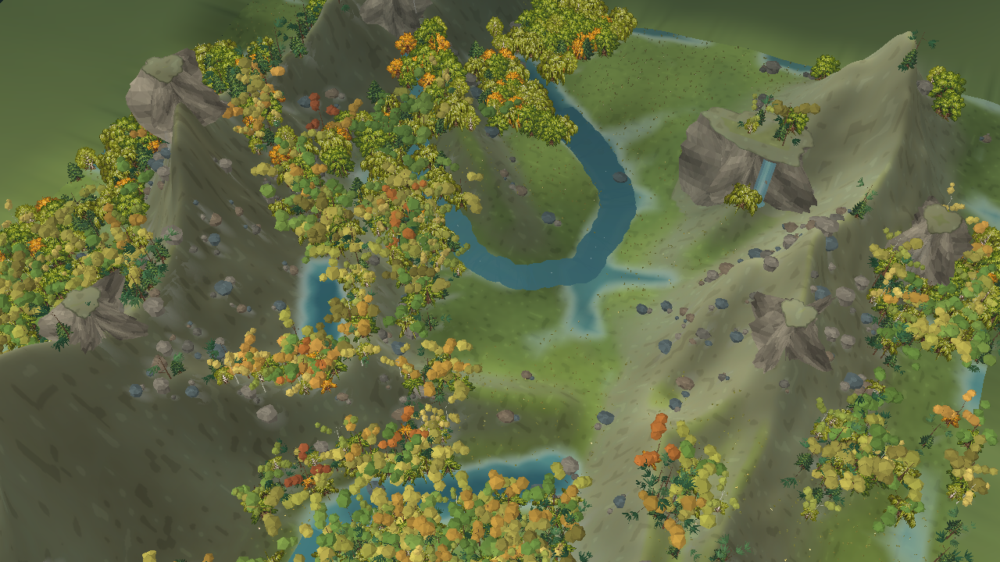

As iterações 63 e 64 ajustaram a amplitude do ruído, o contraste entre materiais de bosque, prado e rocha e o filtro da paleta. As duas capturas ficaram quase iguais à 62: diferença média inferior a 1,1 nível por canal. As alterações de material foram revertidas porque não mudaram a leitura na vista ampla. A iteração 65 baixou a câmera de 56° para cerca de 45° acima do plano do terreno; os troncos ficaram mais visíveis, mas a borda superior revelou o limite do fundo procedural e a composição perdeu área útil. A iteração 66 aumentou a largura e a frequência da cobertura rasteira; os clusters cresceram de 2.898 para 3.226, mas apenas cerca de 0,3% dos pixels da captura mudou de forma perceptível. Essa mudança também foi revertida.

A iteração 67 cruzou três planos de billboard por árvore e alinhou o plano principal com o azimute real da câmera. As copas ficaram mais texturizadas e densas, em uma composição mais próxima da referência; a leitura de cartão continua visível em alguns ângulos. A iteração 68 separou 416 árvores próximas em malha 3D e 923 distantes em billboards cruzados quando a altura projetada fica abaixo de 48 pixels. A revisão 69 passou a mesma escala de projeção para seleção e densidade da malha 3D, sem mudar essa divisão. A captura híbrida preserva volume no primeiro plano e melhora a textura foliar no fundo. Como o terreno, a água e as rochas não mudaram, a rubrica geral permanece em 2/4 e ainda não passa o gate visual.

A iteração 70 mudou a filtragem dos sprites para `PointClamp`, dando bordas um pouco mais nítidas às folhas pixeladas; a diferença média em relação à 69 foi 0,6 nível por canal. A iteração 71 ativa hillshade direcional de relevo, calculado a partir da mesma elevação publicada e combinado com a luz geométrica. A diferença média frente à 70 foi 5,7 níveis por canal, com leitura mais clara de encostas e sombras de terreno. O relevo e a água não foram deslocados; o ajuste atua apenas no albedo da textura do cliente.

A iteração 72 aplicou `PointClamp` também ao albedo do terreno. A captura diferiu da 71 em apenas 0,12 nível médio por canal e não mostrou ganho legível na vista ampla; o filtro pontual foi removido do terreno, mantendo-se apenas nos billboards.

#### Benchmark comparativo — 3D, billboards cruzados e LOD híbrido

Release, 1280 × 720, perspectiva, seed 1, `--snapshot-water-only`, simulação pausada, VSync, 5 s de aquecimento e 10 s medidos. Mesma máquina do benchmark anterior; a medição é curta e limitada pelo VSync.

| Variante | FPS médio | P95 | P99 | Máximo | CPU de um núcleo | Working set | Memória privada | Árvores 3D | Árvores em billboard | Vértices de flora e billboard |
|---|---:|---:|---:|---:|---:|---:|---:|---:|---:|
| Iteração 62 — copas 3D | 60,00 | 16,77 ms | 16,87 ms | 17,01 ms | 13,4% | 386,8 MiB | 462,6 MiB | 1.339 | 0 | 3.128.166 |
| Iteração 67 — 3 planos por árvore | 60,00 | 16,78 ms | 16,89 ms | 17,20 ms | 17,8% | 224,0 MiB | 259,2 MiB | 0 | 1.339 | 203.826 |
| Iteração 68 — LOD híbrido | 59,99 | 16,90 ms | 17,37 ms | 20,09 ms | 17,2% | 306,6 MiB | 364,0 MiB | 416 | 923 | 1.383.354 |
| Iteração 69 — LOD híbrido com projeção coerente | 60,00 | 17,06 ms | 17,34 ms | 17,55 ms | 18,9% | 262,6 MiB | 303,1 MiB | 416 | 923 | 891.312 |
| Iteração 71 — híbrido, ponto e hillshade | 60,00 | 16,79 ms | 16,93 ms | 19,30 ms | 14,7% | 260,2 MiB | 301,4 MiB | 416 | 923 | 891.312 |

Na contagem final, a iteração 67 inclui 24.102 vértices de billboard e 179.724 de outros elementos de flora; a iteração 68 inclui 1.366.740 vértices das árvores próximas e cobertura rasteira, mais 16.614 de billboard. Nas iterações 69 e 71, os 874.698 vértices de árvores próximas e cobertura rasteira somam-se a 16.614 de billboard, totalizando 891.312 — redução aproximada de 71,5% frente às copas 3D da iteração 62. O perfil 71 fica dentro dos limites locais de quadro e memória. O hillshade é preparado na geração da textura, antes do intervalo medido; o benchmark mede renderização estável, fica limitado pelo VSync e não isola GPU time. É necessário repetir sem VSync e em mais cenas antes de fixar o limiar ou aprovar essa técnica.

#### Benchmark com FOV 32° e rochas agrupadas — seed 1

Release, 1280 × 720, perspectiva, água apenas do snapshot, simulação pausada, VSync ligado, 5 s de aquecimento e 10 s medidos. A versão alcançou 60 FPS com 1.339 árvores e 380 geometrias rochosas visíveis.

| FPS médio | P95 | P99 | Máximo | CPU de um núcleo | Working set | Memória privada | Vértices de flora | Vértices de sombra |
|---:|---:|---:|---:|---:|---:|---:|---:|---:|
| 60,00 | 16,76 ms | 16,84 ms | 16,95 ms | 14,2% | 439,7 MiB | 564,0 MiB | 4.040.010 | 64.164 |

O resultado continua limitado pelo VSync; a memória permanece abaixo de 1 GiB, mas aumentou com o enquadramento mais largo e as instâncias adicionais de rocha. O gate visual segue reprovado: a fixture não substitui uma cachoeira hidrológica, as copas ainda se distribuem em manchas escassas, e os flancos e paredões precisam de material e formas mais naturais.

### Nascente, curso e cascata vinculados ao relevo — iterações 73–80

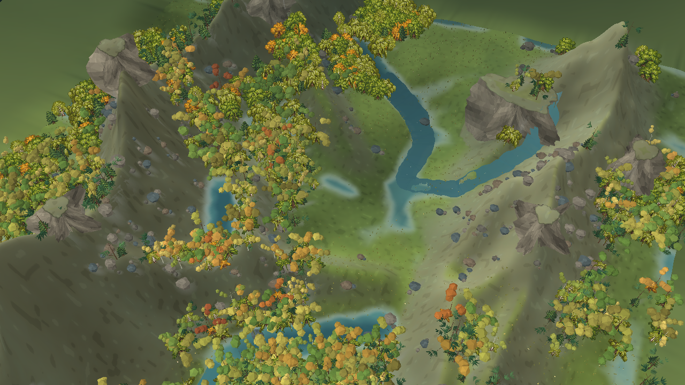

A captura 73 manteve o hillshade direcional como melhor material de terreno até aqui, mas confirmou que o curso largo ainda desenhava um laço e que a cachoeira fixa ficava em outro afloramento. O diagnóstico das iterações 74–75 encontrou no snapshot da seed 1 apenas 31 arestas molhadas de canal, sem cachoeira (maior queda por aresta: 2,98 m). A fixture antiga escolhia o bordo norte do afloramento 0, enquanto outra borda de paredão encostava na nascente do curso de apresentação.

Na iteração 76, a cascata passou a selecionar o afloramento mais próximo da rota e seu poço foi colocado no próprio curso. A distância entre a borda e o canal caiu para 0,035 célula, mas essa nascente ficou cortada pelo enquadramento superior. A iteração 77 passou a testar bordas de paredões como nascentes; a rota selecionada tinha 17,35 células, sinuosidade 1,13 e terminava junto à borda inferior, produzindo outro canal reto e curto. Essa composição foi descartada.

A iteração 79 restringiu a escolha a cursos de pelo menos 26 células e sinuosidade de 1,20–2,55. A rota selecionada começa na borda do afloramento procedural 0, atravessa um desnível de 21,50 m na fixture de cachoeira e percorre 38,13 células com sinuosidade 1,78 até um lago de apresentação. A borda da cascata e o canal compartilham o mesmo centro e direção; o poço ocupa o segundo trecho do curso. O caminho é derivado deterministicamente do terreno da seed, porém continua sendo uma fixture exclusiva da apresentação: o snapshot não publica esse curso nem a cachoeira. A busca inicial da rota levou 268,64 ms nesta máquina e o resultado fica em cache por seed para evitar recalcular os percursos candidatos a cada atualização horária da água.

A captura 80 conserva a aparência da 79 e usa a rota em cache. Em comparação à 73, o laço dominante ficou menos regular e a queda está ancorada a uma borda de rocha que alimenta o curso. A água ainda parece uma lâmina uniforme em alguns trechos, a rede não tem tributários publicados e o lago final segue sendo uma fixture; espuma, transparência, variação de superfície e integração hidrológica continuam pendentes. O hillshade, a luz geométrica, as sombras e o LOD híbrido seguem sem escrever nos snapshots, no RNG ecológico ou nos parâmetros da simulação.

#### Desempenho da cena com o curso integrado — iteração 80

Release, 1280 × 720, perspectiva, seed 1, fixtures visuais ligadas, simulação pausada, VSync ligado, 5 s de aquecimento e 10 s medidos. O teste encerrou no alvo de 60 Hz; a busca inicial do curso ocorre antes da medição e é registrada separadamente acima.

| FPS médio | P95 | P99 | Máximo | CPU de um núcleo | Working set | Memória privada | Árvores 3D | Árvores em billboard | Vértices de flora e billboard |
|---:|---:|---:|---:|---:|---:|---:|---:|---:|---:|
| 60,00 | 17,01 ms | 17,38 ms | 17,65 ms | 18,6% | 262,0 MiB | 300,8 MiB | 416 | 923 | 891.312 |

O quadro e a memória permanecem dentro dos limites locais. O benchmark é curto, limitado por VSync e não isola GPU time; a CPU variou entre 18,6% e 21,4% nas execuções pareadas desta cena. A reconstrução de malha e a busca inicial não entram no tempo de quadro medido; outros seeds, evolução em andamento, carga 10×, projeção ortográfica e plataformas adicionais ainda precisam de perfis próprios.

## Rubrica visual contra a referência

O gate do documento de direção exige nota mínima 3/4 em cada dimensão.

| Dimensão | Nota | Evidência e limitação |
|---|---:|---|
| Relevo | 2/4 | A compressão de 28% reduz o peso das montanhas, mas encostas longas e uniformes ainda dominam. |
| Água | 2/4 | O snapshot da seed 1 publica 31 arestas molhadas e nenhuma cachoeira. A fixture de avaliação agora demonstra um curso sinuoso, uma queda de 21,50 m ancorada a um paredão e um poço ligado à rota; espuma, ramificações e uma cachoeira hidrológica ainda não foram demonstradas. |
| Vegetação | 2/4 | Troncos, ramos e copas têm volume real e há mais mistura de verdes e dourados; ainda faltam densidade de copa, diversidade de silhueta e agrupamento como na referência. |
| Rochas | 2/4 | Pedregulhos agora têm perfis menos pontiagudos e sombras de contato; as paredes ainda lembram mesas lisas e a distribuição continua dispersa. |
| Luz e profundidade | 2/4 | Hillshade na textura clareia as encostas; perspectiva, malhas e sombras ajudam, mas a profundidade perde contraste e a oclusão de terreno permanece simples. |
| Composição | 2/4 | A perspectiva FOV 28° esconde a borda mais próxima, porém ainda corta partes da região; na vista ortográfica a margem e os cantos sem terreno ficam explícitos. |

O protótipo segue muito distante da riqueza espacial e da distribuição orgânica da referência. Nenhuma técnica foi aprovada para produção.

## Desempenho pareado

Release, 1280 × 720, seed 1, simulação pausada, VSync ligado, 5 s de aquecimento e 10 s medidos. Máquina: Intel Core i3-10105, NVIDIA GeForce RTX 5060, driver 32.0.16.1088.

| Variante | FPS médio | P95 | P99 | Máximo | Memória privada | Vértices de flora |
|---|---:|---:|---:|---:|---:|---:|
| Árvores em malhas 3D | 60,00 | 16,80 ms | 16,87 ms | 17,02 ms | 404,7 MiB | 2.968.932 |
| Árvores em billboards | 60,00 | 16,78 ms | 16,91 ms | 17,01 ms | 176,4 MiB | 179.724 |

O VSync limita os dois resultados a 60 FPS. Billboards baixam os vértices de flora em cerca de 94% e a memória privada em cerca de 56%, mas não passam na leitura visual desta câmera. Os dois perfis atendem aos limites locais de quadro e memória; ainda não medem GPU time isolado, reconstrução durante a evolução, escala 10× nem outros alvos.

### Benchmark da variante de perspectiva — iteração 18

Release, 1280 × 720, seed 1, simulação pausada, VSync ligado, 5 s de aquecimento e 10 s medidos. A mesma máquina e driver da medição pareada foram usados.

| Variante | FPS médio | P95 | P99 | Máximo | CPU de um núcleo | Memória privada | Árvores visíveis | Vértices de flora |
|---|---:|---:|---:|---:|---:|---:|---:|---:|
| Perspectiva 3D, enquadramento 30°, curso e lago visuais | 60,00 | 16,89 ms | 17,08 ms | 17,27 ms | 11,9% | 351,3 MiB | 1.518 | 2.717.022 |

O cenário permaneceu dentro do limite local de quadro e memória. A água foi construída antes do aquecimento; o benchmark mede renderização estável, não reconstrução de água durante a evolução nem custo de GPU isolado.

### Benchmark da vista baixa — iteração 25

Release, 1280 × 720, seed 1, simulação pausada, VSync ligado, 5 s de aquecimento e 10 s medidos. Captura em perspectiva, FOV 28°, relevo de apresentação 0,72 e floresta mista.

| FPS médio | P95 | P99 | Máximo | CPU de um núcleo | Working set | Memória privada | Árvores visíveis | Vértices de flora |
|---:|---:|---:|---:|---:|---:|---:|---:|---:|
| 60,00 | 16,92 ms | 17,14 ms | 17,48 ms | 18,6% | 408,9 MiB | 517,0 MiB | 1.126 | 3.437.472 |

O limite de VSync mantém a média em 60 FPS; quadro e memória ficam dentro do gate local. O relatório não isola GPU time nem mede a cena com 10× de instâncias decorativas.

## Mudanças e fronteira científica

- Adicionado `--reference-landscape-view` para comparar composição elevada ampla nas projeções perspectiva e ortográfica; enquadramento e temporada são somente estado de apresentação.
- A água usa `BlendState.NonPremultiplied`, coerente com as cores RGBA diretas de `VertexPositionColor`; água, drenagem e snapshots continuam intocados.
- A vista de referência configura câmera, compressão vertical, névoa e paleta somente no cliente; água, terreno, árvores e snapshots da simulação não recebem essas transformações.
- A seleção do canal visual agora escolhe o percurso contínuo mais longo entre segmentos molhados do snapshot; a seleção anterior descartava a rede quando o percurso de maior acumulação caía em um lago.
- Rochas e árvores recebem sombras suaves com blending de alpha correto, leitura de profundidade e direção solar coerente; o ajuste só afeta buffers de apresentação.
- As capturas limpas removem o HUD somente na saída por `--capture`; a janela interativa continua com controles e status.
- Build Release isolado em `bin/terrain-reference-landscape-water-eval/` concluiu com zero avisos e zero erros. Nenhum teste automatizado foi executado nesta rodada.

## Canvas of Kings e próximos gargalos

O ZIP em Downloads contém um atalho `SteamUnlocked` e um pacote de executáveis de terceiros; ele não foi executado. Instalei e abri a demonstração oficial gratuita pelo Steam. A tela inicial mostrou um canvas 2D vazio com ferramentas de edição de mapas; não oferece, na cena observada, terreno ou água volumétricos. Isso confirma seu uso como referência de composição e caminhos, não como prova de renderer 3D. Nenhum asset foi copiado para o projeto.

Próximas experiências: remover a margem retangular sem perder a vista ampla; quebrar as encostas lisas e os paredões; comparar árvores com mais silhuetas e variação de copa; alargar e irregularizar as margens dos rios publicados, e tornar quedas d'água legíveis sem fixtures. A cena não passa o gate visual e ainda não deve ser ampliada para produção. Manter MonoGame e os contratos científicos.

## Referências consultadas

- [DwarfCorp](https://github.com/Blecki/dwarfcorp)
- [WorldGenerator — port FNA/MonoGame](https://github.com/rds1983/WorldGenerator)
- [chunked-terrain](https://github.com/george7378/chunked-terrain)
- [SharpCraft](https://github.com/Acueres/SharpCraft)
- [Canvas of Kings — página oficial com demo](https://store.steampowered.com/app/2498570/Canvas_of_Kings/)
- [Tree Branch Level of Detail Models for Forest Navigation — DOI 10.1111/CGF.13088](https://doi.org/10.1111/CGF.13088)
- [Ecologically Sound Procedural Generation of Natural Environments — DOI 10.1155/2017/7057141](https://doi.org/10.1155/2017/7057141)
- [A Procedural Model for Diverse Tree Species — DOI 10.1145/3555858.3564251](https://doi.org/10.1145/3555858.3564251)
- [Controllable Modular Trees — DOI 10.1145/3769872.3769904](https://doi.org/10.1145/3769872.3769904)

Os trabalhos científicos foram identificados por título e resumo; não foi feita validação por texto integral nesta rodada. Uma cópia não oficial de Canvas of Kings encontrada em Downloads continha referências a SteamUnlocked e não foi executada. A demonstração oficial foi consultada; nenhum asset foi copiado.

### Iteração 92 — costa de ilha e céu de apresentação

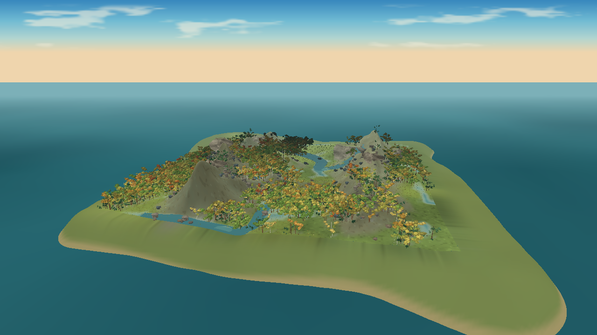

O protótipo agora prolonga o relevo por uma faixa exterior contínua, encerra essa faixa numa costa irregular e desenha o mar abaixo do nível mínimo exibido do snapshot. O oceano é uma camada de apresentação usada como delimitador do mapa; não entra no snapshot nem altera drenagem, água, organismos ou parâmetros científicos. A extensão visual mantém a área simulada central intacta. A câmera de referência foi recuada e inclinada para incluir a ilha, uma linha de horizonte e uma faixa de céu.

O céu é uma textura procedural determinística por seed, com gradiente vertical e nuvens suaves geradas por ruído espacial. A névoa distante agora aproxima o oceano e o terreno da cor do horizonte. A captura da seed 1 mostra o limite do mapa em todos os lados e céu acima do mar. O contorno ainda lê como uma plataforma baixa, a costa não tem ondas ou espuma, e a textura de céu permanece presa à tela; esta cena continua sendo uma prova visual pequena, não um resultado aprovado para produção.

Build Release isolado em `bin/iteration-92-island-sea-eval/` concluiu com zero avisos e zero erros. A cena de captura produziu 1.710 árvores 3D, 2.898 agrupamentos de cobertura do solo, 476 rochas de avaliação e 3.712.980 vértices de flora. Não foi executado benchmark de quadro nem teste automatizado nesta iteração.

### Iterações 100–102 — escala de flora, enquadramento de ilha e céu

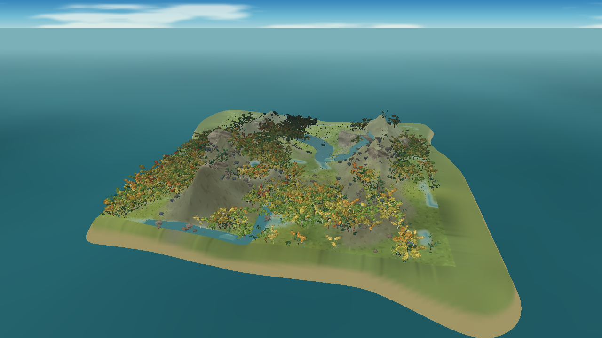

A iteração 100 baixou os cortes de LOD das árvores para a altura projetada real desta câmera. A mudança acrescentou geometria, mas a captura ainda deixava a floresta pequena. Nas iterações 101–102, a faixa costeira foi encurtada e recebeu variação de cor determinística; o horizonte passou a usar uma transição azul-clara e nuvens largas em múltiplas escalas. A câmera de avaliação foi inclinada mais para o terreno e aproximada, mantendo uma faixa de céu acima do mar. O curso de água de avaliação foi alargado para dar mais presença à água na composição.

A apresentação segue isolada dos snapshots: o oceano continua sendo apenas um limite visual, a extensão costeira usa terreno de apresentação, e o canal alargado continua sendo fixture. Na seed 1, o snapshot publica 31 arestas molhadas; a captura registra 1.710 árvores, 2.898 agrupamentos de cobertura, 476 rochas e 3.782.808 vértices de flora. O log também registra zero cachoeiras renderizadas a partir do snapshot. A vista está mais preenchida e já não termina em uma faixa ocre, mas a praia dianteira ainda é cortada pelo quadro, o mar ocupa muito espaço e as copas e o relevo continuam menores e mais simples que na referência. Esta é uma avaliação parcial, não aprovação do gate visual.

Build Release isolado em `bin/iteration-102-sky-framing-eval/` concluiu com zero avisos e zero erros. A captura foi feita em 1280 × 720, seed 1, perspectiva e simulação pausada. Não foram executados testes automatizados nem benchmark nesta rodada.

Na iteração 103, comparei a copa de folhas em lâminas com a copa volumétrica. A forma volumétrica reuniu melhor as folhas em massas de copa e reduziu a flora de 3.782.808 para 3.063.024 vértices na mesma seed e câmera (redução aproximada de 19%). Ela passa a ser a configuração padrão da vista de referência; a malha de troncos, espécies, alturas e posição continua determinística.

As iterações 104–105 alinharam o azimute da câmera com o eixo norte–sul e aproximaram a costa do limite do snapshot. Isso deixa a borda dianteira inteira visível e reduz a plataforma externa. A avaliação ainda mostra picos arredondados, um horizonte simples, mar amplo e folhagem menos variada que a referência. Não houve alteração do terreno científico para disfarçar esses limites.

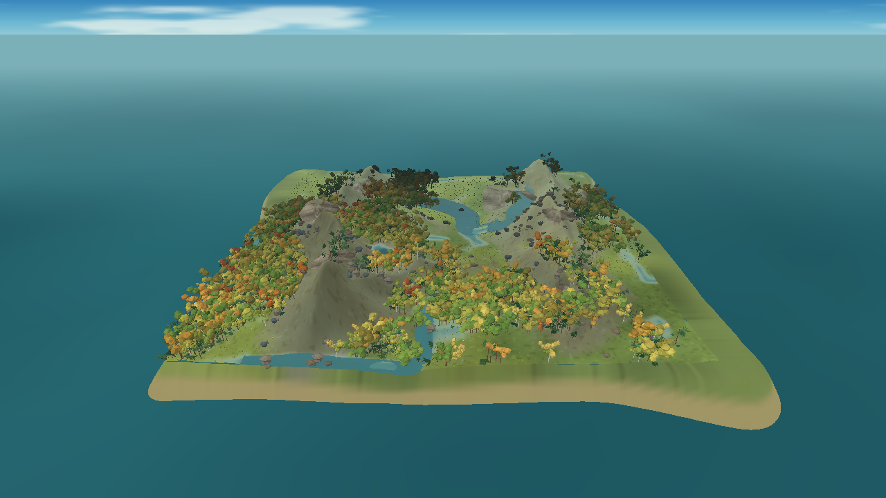

Build Release isolado em `bin/iteration-105-narrow-island-shore-eval/` concluiu com zero avisos e zero erros. A captura foi feita em 1280 × 720, seed 1, perspectiva, copa volumétrica e simulação pausada. Não foram executados testes automatizados nem benchmark nesta rodada.

A iteração 106 tornou a copa volumétrica padrão somente no modo `--reference-landscape-view`, mantendo a opção de avaliação em 3D no cliente MonoGame. A captura sem parâmetro extra reproduz a copa volumétrica da iteração 103, com 3.059.574 vértices de flora. Release compilou com zero avisos e zero erros; a captura de referência está em `evidence/iteration-106-reference-landscape.png`.

### Iterações 107–108 — variação sazonal de copas e rochas

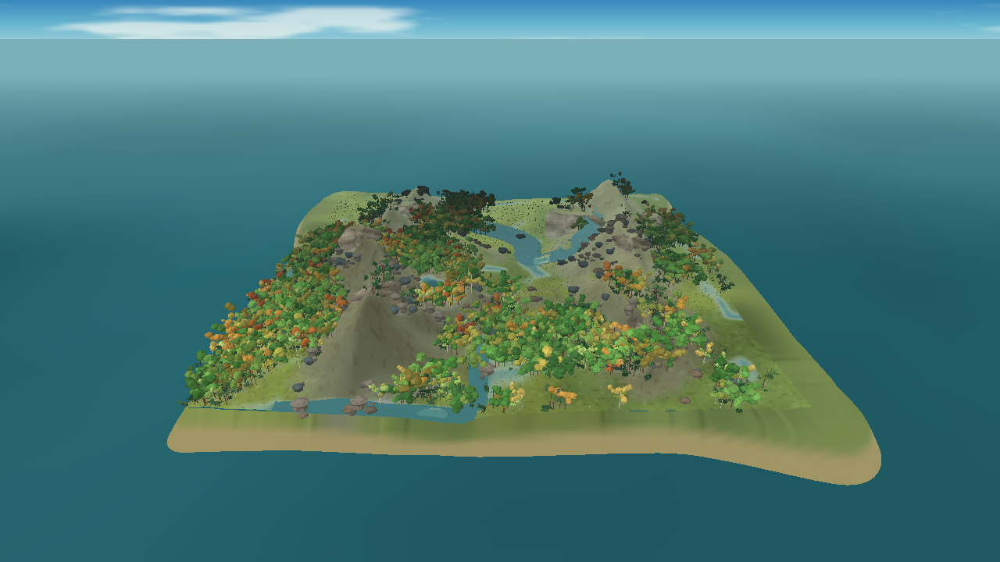

As árvores caducifólias agora recebem paletas verdes ou outonais por espécie e seed, com uma participação maior de verdes e amarelos e acentos ferrugem nos bordos. Essa variação só afeta a coloração do renderer; não altera estação, espécie, biomassa ou RNG ecológico. A iteração 108 ampliou em 1,45× a largura e 1,30× a altura das rochas de avaliação, mantendo as âncoras e a distribuição visual. Os afloramentos se leem melhor na vista ampla; continuam simples comparados às formações rochosas da referência.

Release isolado em `bin/iteration-108-rock-volume-eval/` concluiu com zero avisos e zero erros. A captura seed 1 registra 1.710 árvores, 3.059.574 vértices de flora, 2.898 agrupamentos de cobertura e 478 rochas de avaliação. O relevo ainda apresenta picos arredondados e a costa segue visivelmente artificial; a cena permanece uma avaliação em andamento. Não foram executados testes automatizados nem benchmark nesta rodada.

### Iteração 115 — domínio 2.560 × 2.560 m com ilha orgânica

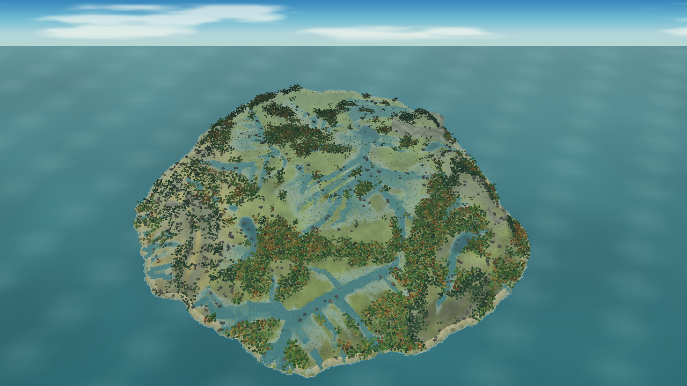

A vista estreita de 2.560 × 640 m foi substituída por uma grade de 256 × 256 células de 100 m², totalizando 2.560 × 2.560 m. A dimensão vertical do relevo não foi ampliada. A ilha usa uma forma oval assimétrica, lobos largos e ruído costeiro determinístico; a costa, a praia e a espuma acompanham esse contorno, enquanto o oceano cobre o restante do quadro. A câmera elevada enquadra a ilha inteira e mantém uma faixa de céu acima do mar.

O primeiro enquadramento revelou uma moldura quadrada de terreno submerso: a composição do céu deixava o teste de profundidade desativado para a malha seguinte. A correção restabelece o estado de profundidade e removeu a placa quadrada. A imagem final mostra água contínua em volta da praia.

A apresentação usa biomas de deserto, pântano e planície derivados de elevação, água, inclinação e seed. Eles mudam cores e receitas visuais; não alteram crescimento, clima, hidrologia, RNG ecológico ou snapshots. A população visual foi reduzida para uma ou duas árvores por célula lenhosa, de modo que células vizinhas formem bosques sem sobrepor até cinco troncos na mesma área de 10 m. Para copas distantes, o LOD mantém o tronco e ramos principais e agrega folhagem em massas 3D de baixa resolução. O terreno usa três subdivisões por célula (3,3 m entre amostras da malha), textura de oito pixels por célula e a água usa três subdivisões; essas escolhas pertencem somente ao renderer.

Comparei o LOD híbrido com billboards cruzados. Ele baixou a flora de 5.958.750 para 3.248.922 vértices, mais 242.496 vértices de billboard, mas as copas ficaram muito pontilhadas e amarelas nesta vista. Mantive as copas volumétricas de baixo detalhe, cuja silhueta preserva melhor a leitura da referência.

A captura final, seed 1, 1280 × 720, perspectiva, registra 6.736 árvores, 5.958.750 vértices de flora, 52.390 agrupamentos de cobertura do solo, 4.026 flores e 1.877 rochas de avaliação. O snapshot contém 19.882 células com água superficial e 2.439 arestas de rio; não produziu cachoeiras visíveis. Água rasa aparece em muitas áreas e a composição ainda tem menos variação de copa e micro-relevo que a referência. Não foi atribuída pontuação formal de aceite visual, portanto esta rodada não fecha o gate.

Build Release em `bin/iteration-115-square-island/`: zero avisos e zero erros. Benchmark Release de 6 s, após aquecimento de 5 s, seed 1 e simulação pausada: média 60,00 FPS, P95 16,92 ms, P99 17,44 ms, máximo 45,24 ms, CPU 34,0% de um núcleo, working set 811,1 MiB e memória privada 1.005,5 MiB. A memória privada ficou abaixo do limite de 1 GiB (1.024 MiB). Não foram executados testes automatizados.

A mudança de domínio aumenta a extensão do estado e os totais agregados; ela não recalibra o cenário científico L0 canônico de 64 × 64 células. Os valores por célula, equações, tags de RNG e 16 zonas climáticas foram preservados. A anotação de escopo em `docs/00_SCOPE.md` registra essa distinção.

### Iteração 116 — contraste de biomas visuais

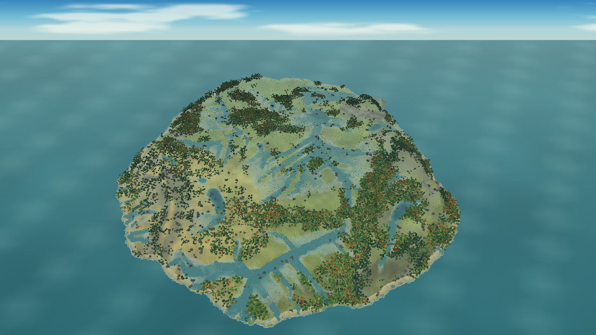

Reforcei a cor quente e a redução de cobertura vegetal na região seca do sudoeste, o tom úmido das planícies alagáveis e a paleta clara das áreas planas. Nas células de pântano com água rasa ou solo úmido, o renderer acrescenta juncos determinísticos com pequenas inflorescências. Esses elementos são receitas de apresentação derivadas do snapshot; não adicionam espécies ao estado, nem alteram o crescimento, a hidrologia ou os streams de RNG científicos. A cena mantém o terreno de 2.560 × 2.560 m e a ilha irregular da iteração anterior.

A captura panorâmica mostra a área seca mais aberta e dourada, embora os juncos ainda fiquem pequenos no enquadramento integral; sua leitura deve ser reavaliada em câmera mais próxima. O limite de ilha, a praia, o céu e o mar permanecem no mesmo enquadramento. O caminho renderizado de água ainda não encontra um afloramento elegível para a fixture de cachoeira, e a vista continua distante da densidade e do relevo da referência.

Build Release em `bin/iteration-116-visual-biomes/`: zero avisos e zero erros. A captura seed 1, 1280 × 720, perspectiva registra 6.215 árvores, 5.710.203 vértices de flora, 51.796 agrupamentos de cobertura, 3.958 flores e 1.877 rochas de avaliação. Benchmark Release com aquecimento de 5 s e medição de 6 s: média 59,99 FPS, P95 22,03 ms, P99 23,47 ms, máximo 25,76 ms, CPU 43,7% de um núcleo, working set 812,9 MiB e memória privada 1.002,6 MiB. Os limites locais de tempo de quadro e memória foram atendidos. Não foram executados testes automatizados; não houve mudança no domínio ou nos parâmetros científicos.

### Iteração 118 — zoom e navegação do mapa

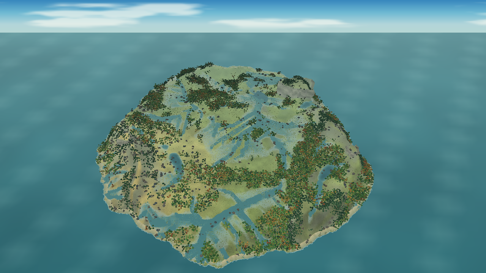

A câmera agora aproxima e afasta pela roda do mouse, pode ser deslocada arrastando com o botão direito e também se move com as setas. O zoom acompanha a posição do cursor e varia entre 45% e 350%; o foco fica limitado a uma faixa curta ao redor da ilha. Isso funciona nas projeções perspectiva e ortográfica. A reconstrução das malhas visuais é adiada até 0,28 s sem movimento, evitando reconstruir flora e rochas em cada quadro de arrasto. Câmera e buffers permanecem na camada de apresentação; o snapshot e a simulação não mudam.

Build Release isolado em `bin/iteration-118-map-navigation/` concluiu com zero avisos e zero erros. Captura inicial seed 1, 1280 × 720, perspectiva, mantém o mesmo enquadramento da iteração 116 e registra 6.215 árvores, 5.710.203 vértices de flora, 51.796 agrupamentos de cobertura, 3.958 flores e 1.877 rochas de avaliação. Nenhum teste automatizado ou benchmark de navegação foi executado nesta rodada.

### Iterações 120–123 — composição, canais e rochas

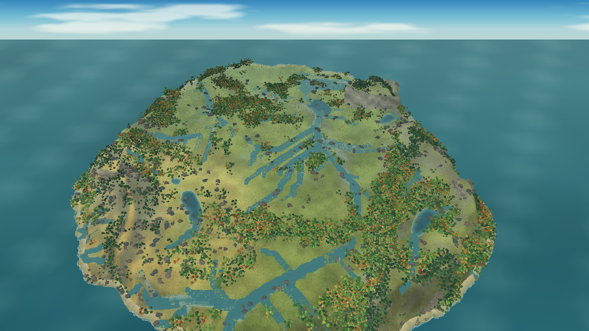

Comparei o mesmo snapshot com zooms iniciais de 100%, 125% e 140%. A vista de referência agora abre em 125%, ampliando árvores, afloramentos e rios, mas ainda preserva quase todo o contorno da ilha. `--camera-zoom 1` recupera a ilha inteira; a roda ajusta o zoom e `Home` restaura enquadramento e foco. A projeção permanece em perspectiva por padrão nesta cena.

A cobertura da água superficial na textura de apresentação passou a usar uma rampa de profundidade de 45–300 mm, antes de suavização de margens. A comparação mostra menos lâmina rasa cobrindo a planície e mais canais D8 legíveis. A água do snapshot, a seleção dos receptores e o RNG não mudaram. As rochas de avaliação ficaram mais largas (fator visual 1,90, antes 1,45); a altura e o relevo total permaneceram iguais.

Build Release isolado em `bin/iteration-123-rock-footprint/` concluiu com zero avisos e zero erros. A captura seed 1, 1280 × 720, perspectiva e zoom 125% registra 6.047 árvores, 5.643.699 vértices de flora, 51.796 agrupamentos de cobertura, 3.958 flores e 1.851 rochas. O diagnóstico continua indicando zero cachoeiras renderizadas a partir do snapshot. A cena se aproxima pelo enquadramento e pela leitura de água, mas ainda tem encostas e afloramentos escassos, grandes clareiras e vegetação menos densa que a referência; o gate visual segue aberto. Nenhum teste automatizado ou benchmark foi executado nesta rodada.

Na consulta SciSpace sobre densidade de povoamentos e alometria de copas, apareceram a revisão de Pretzsch et al. (2019, [DOI 10.3390/f10090810](https://doi.org/10.3390/f10090810)) e modelos de copa condicionados pela densidade (Sattler e LeMay, 2011, [DOI 10.1139/X11-078](https://doi.org/10.1139/X11-078)). A chamada ao Consensus não pôde iniciar uma pesquisa porque a cota mensal de buscas estava esgotada; não usei densidades externas para alterar a população ou os estados ecológicos.

### Iterações 133–135 — rede de rios conectada e máscara de água por profundidade

A comparação da iteração 130 mostrou fragmentos de drenagem semelhantes a uma grade azul. Na iteração 133, a camada de rios passou a manter apenas arestas molhadas que chegam ao curso contínuo dominante. Com o corte visual anterior de 40 células, as arestas desenhadas caíram de 2.439 para 555. Na iteração 134, elevar o corte de acumulação para 160 células (16.000 m² de área contribuinte) reduziu a rede para 241 arestas conectadas, das quais 79 pertencem ao curso dominante; restaram 10 junções e nenhuma diagonal cruzada. Essa alteração controla apenas quais cursos aparecem na tela: receptores, acumulação, água armazenada e snapshots permanecem inalterados.

A iteração 135 aumentou o limiar de cobertura da lâmina superficial para 96–420 mm. Na seed 1, 9.281 células têm pelo menos 96 mm, 1.154 têm pelo menos 180 mm, 256 têm pelo menos 420 mm e 233 passam de 650 mm. A captura usa `--snapshot-water-only`, portanto não contém a fixture de curso ou cachoeira. Os canais ficaram mais legíveis em escala ampla, mas o trecho principal ainda acompanha a grade D8, a água próxima da costa permanece angular e o conjunto não alcança os meandros largos da referência.

Comparei também as seeds 2 e 3; elas mantêm 10.541 e 11.002 árvores visuais, respectivamente, e variam a posição dos cursos sem resolver a distribuição de grandes clareiras. A escala vertical 1,4 melhora o contraste dos paredões (captura `evidence/iteration-134-relief-140.png`), mas permanece como experimento opcional; a composição integral ainda tem menos floresta, rocha e relevo legível que a referência.

Build Release isolado em `bin/iteration-135-depth-water-mask/` concluiu com zero avisos e zero erros. Benchmark Release de 6 s após aquecimento de 5 s, seed 1, perspectiva, 1280 × 720, VSync e simulação pausada: 59,84 FPS, P95 23,63 ms, P99 26,53 ms, máximo 47,03 ms, CPU 58,4% de um núcleo, working set 1.009,6 MiB e memória privada 1.311,1 MiB. O quadro atende aos limites P95/P99 do gate; a memória privada excede o alvo de 1 GiB e requer otimização antes de ampliar a densidade de geometria. Nenhum teste automatizado foi executado nesta rodada.

### Iterações 139–145 — estratos de árvores e porte por espécie

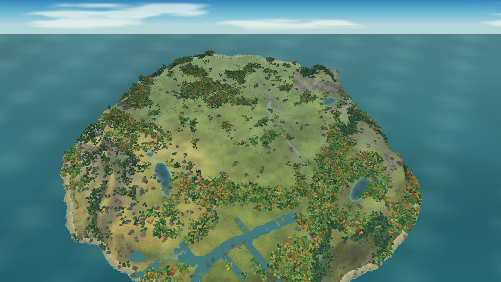

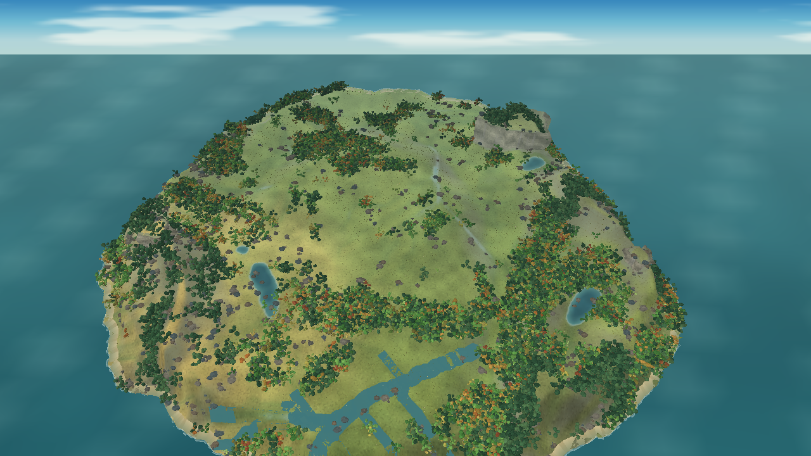

No estado anterior, árvores em patches com apenas 250 g/m² de biomassa lenhosa já recebiam altura-base de 26–30 m, sem depender de espécie. A primeira tentativa de usar a fração de biomassa diretamente como porte reduziu a mediana visual para 8,1 m e o percentil 90 para 11,5 m; na captura, a floresta virou uma camada baixa de pontos. Uma curva de quarta raiz ainda ficou curta (P50 13,7 m; P90 19,8 m) e foi descartada.

A iteração 142 separa altura de biomassa agregada. Carvalho, pinheiro, bétula, bordo e salgueiro recebem alturas de exibição diferentes, com variação individual determinística e um ajuste pequeno pela vizinhança lenhosa. A biomassa dividida pelos troncos do patch alimenta somente o proxy de cobertura e desenvolvimento estrutural da copa; a função continua pertencendo à apresentação, sem criar idade individual nem alterar snapshot, simulação ou RNG ecológico. Na seed 1, a captura ampla registra 11.154 árvores visíveis, alturas P10/P50/P90 de 13,4/22,2/35,3 m, 9.856.509 vértices de flora, 51.796 agrupamentos de cobertura, 3.958 flores e 1.851 rochas. A captura próxima `evidence/iteration-145-species-canopy-close.png` deixa os estratos e silhuetas mais fáceis de ler.

A cena ganha árvores dominantes, sub-bosque e variação por arquitetura, mas continua distante da referência na composição geral: há grandes clareiras, pouca encosta legível no quadro amplo e a rede de água do snapshot permanece angular. O caminho do snapshot ainda não produz cachoeira nesta seed. A fixture de avaliação encontra uma rota com queda de 114,62 m e uma candidata de 21,70 m, mas ela é conteúdo de renderer e não evidência de hidrologia simulada.

O SciSpace encontrou relações altura-diâmetro específicas por espécie e condicionadas pela estrutura/competição do povoamento (Savine et al., 2025, [DOI 10.1101/2025.09.29.679156](https://doi.org/10.1101/2025.09.29.679156)), modelos de diâmetro que melhoram com densidade relativa (Esfahani et al., 2025, [DOI 10.1016/j.foreco.2025.123372](https://doi.org/10.1016/j.foreco.2025.123372)) e modelos de largura de copa que incluem composição e sítio (Buchacher e Ledermann, 2020, [DOI 10.3390/f11010114](https://doi.org/10.3390/f11010114)). Esses estudos usam medições por árvore; não calibram o proxy do renderer porque o snapshot do Genesis agrega a biomassa por 100 m². Os parâmetros de altura atuais são escolhas de exibição.

Build Release final em `bin/iteration-146-species-canopy-final/` concluiu com zero avisos e zero erros; a captura repete a cena/configuração da iteração 142. Benchmark da malha volumétrica (build da iteração 142, 5 s de aquecimento + 6 s de medição, seed 1, perspectiva, 1280 × 720): 60,01 FPS, P95 16,91 ms, P99 17,16 ms, máximo 27,43 ms, CPU 34,0% de um núcleo, working set 1.022,5 MiB e memória privada 1.325,6 MiB. O tempo de quadro fica dentro dos limites, mas a memória supera o alvo de 1 GiB.

A comparação `--hybrid-tree-lod` converteu as 11.154 árvores em billboards cruzados: 3.208.653 vértices de flora e 200.772 vértices de billboard. Benchmark: 60,00 FPS, P95 16,97 ms, P99 17,39 ms, máximo 42,39 ms, working set 639,7 MiB e memória privada 787,9 MiB. A imagem ficou mais plana e amarelo-saturada que a malha 3D e a referência; mantive a malha volumétrica como enquadramento visual atual e registrei o híbrido como melhor perfil de memória, sujeito a melhoria das silhuetas e paleta. Nenhum teste automatizado foi executado nesta rodada.

### Iterações 148–153 — relevo baixo, copas e sinuosidade dos canais

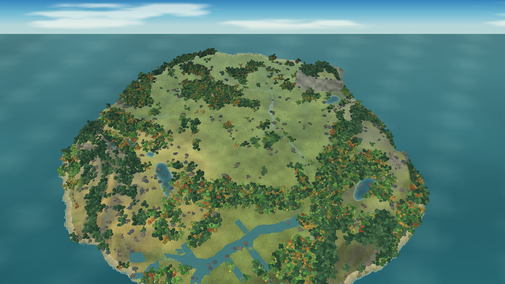

Na iteração 148, planícies receberam ondulação espacial multiescala estável por seed, derivada apenas no renderer. As experiências de copa das iterações 149–150 aumentaram a largura visual de 2,0 para 2,8; a quantidade, a espécie e a altura das árvores permaneceram iguais. Na iteração 151, ajustei a linha central compartilhada pelo canal e pela incisão visual do terreno para produzir curvas mais largas e suaves. A iteração 153 ampliou um pouco a contribuição do relevo largo e do ruído intermediário. A ilha continua com 2.560 × 2.560 m e a altura física do terreno não foi aumentada. As alterações consomem os mesmos snapshots e não mudam hidrologia, parâmetros, crescimento nem RNG ecológico.

A captura seed 1, 1280 × 720, perspectiva mostra mais relevo sutil nas áreas baixas, copas mais largas e um canal principal mais contínuo. Ainda está longe da referência: o centro da ilha continua muito aberto, as árvores se agrupam em faixas e manchas separadas, os rios visíveis seguem estreitos, e faltam encostas extensas, paredões e afloramentos com volume na composição ampla. Não há cachoeira publicada pelo snapshot nesta seed (zero renderizadas); as candidatas e a cascata de fixture continuam sendo apenas avaliação visual. O gate de qualidade visual permanece aberto.

O log da iteração 153 registra 11.173 árvores, alturas P10/P50/P90 de 13,4/22,2/35,3 m, 9.868.239 vértices de flora, 51.796 agrupamentos de cobertura e 3.958 flores. O snapshot tem 19.882 células com água superficial, 9.281 acima de 96 mm, 1.154 acima de 180 mm, 256 acima de 420 mm e 241 arestas conectadas de rio; 79 formam o percurso dominante e há 10 junções. Esses números mantêm a geometria e a contagem observadas; não constituem evidência de correspondência ecológica da densidade com a referência.

As consultas do SciSpace apoiam o uso de padrões multiescala controlados para relevo de apresentação (Grenier et al., [Real-time Terrain Enhancement with Controlled Procedural Patterns, DOI 10.1111/cgf.14992](https://doi.org/10.1111/cgf.14992)) e geração de terreno condicionada por hidrologia (Teoh, [RiverLand, DOI 10.1007/978-3-642-10331-5_44](https://doi.org/10.1007/978-3-642-10331-5_44); Schott et al., [Terrain Amplification using Multi Scale Erosion, 2024](https://doi.org/10.1145/3658200)). Elas orientam o método de apresentação, não a calibração do modelo científico. A cota de consultas do Consensus permaneceu esgotada neste mês.

Build Release isolado em `bin/iteration-153-rolling-lowland/` concluiu com zero avisos e zero erros. `dotnet test Game.sln -c Release --no-restore` passou: 24 testes, zero falhas. As correções nos testes atualizaram limites de raio e amostras de malha para a dimensão atual do mapa e a tolerância de conservação para o arredondamento da soma na grade ampliada. O benchmark mais recente foi feito na iteração 152, não repetido na 153: 60,01 FPS, P95 17,11 ms, P99 17,53 ms, máximo 18,23 ms, CPU 31,2% de um núcleo, working set 995,5 MiB e memória privada 1.293,6 MiB. O quadro ficou estável, mas a memória privada continua acima do alvo de 1 GiB.

### Iterações 154–155 — copa mais larga e escala do rio

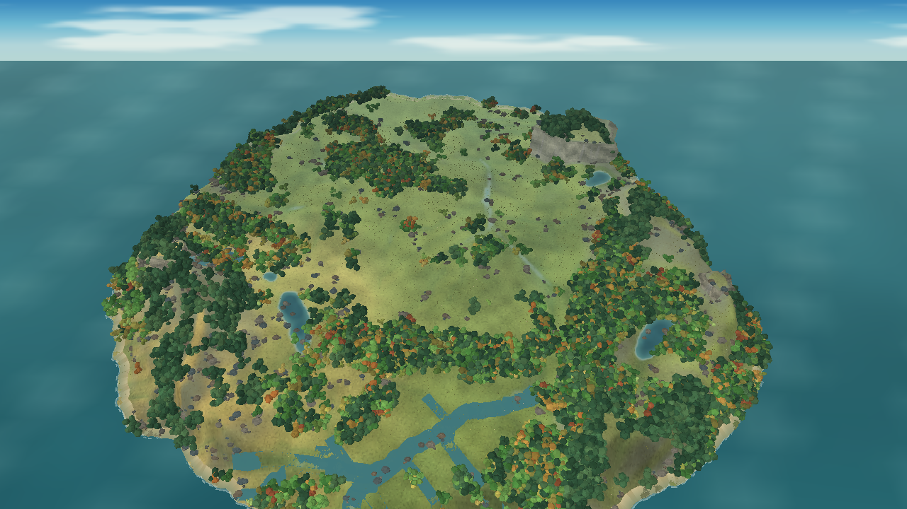

Na iteração 154, a largura de copa do renderer passou de 2,80 para 3,40. Isso aumenta o contato entre copas nas bordas dos bosques sem acrescentar árvores, biomassa ou vértices; a seed 1 manteve 11.173 árvores e 9.868.239 vértices de flora. As manchas florestais ficam mais cheias, embora a clareira central permaneça grande.

Na iteração 155, a escala de largura das fitas de rio passou de 1,8 para 3,2. A mudança afeta somente a malha de água: o snapshot, as 241 arestas e os 79 segmentos do percurso dominante da seed 1 permanecem iguais. A cena seed 1 abre demais a lâmina junto à borda dianteira. Na seed 3, a mesma escala compõe um curso central mais amplo ligado a um lago e se aproxima melhor da referência. O resultado depende da seed; a largura ainda precisa acompanhar melhor a acumulação e os bancos locais.

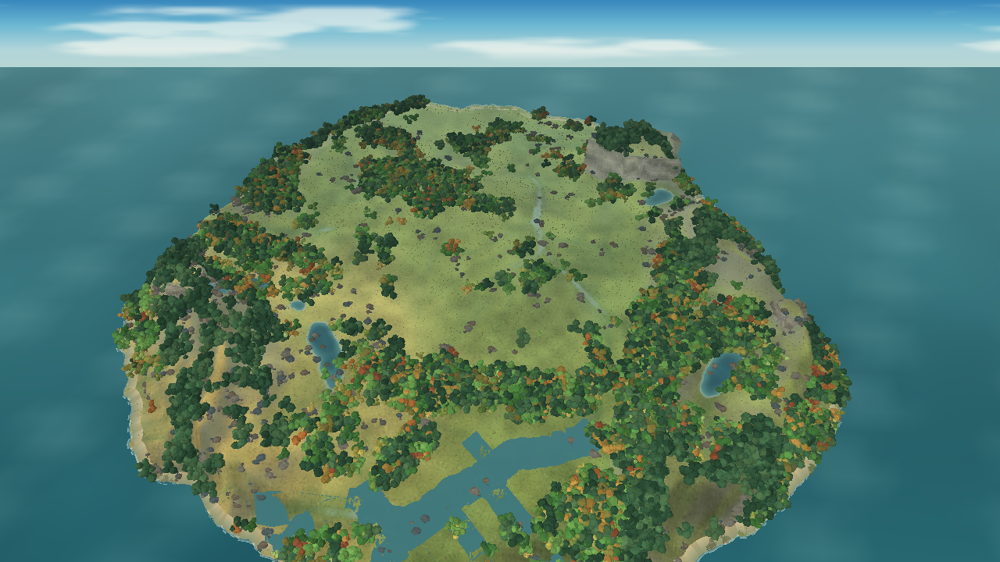

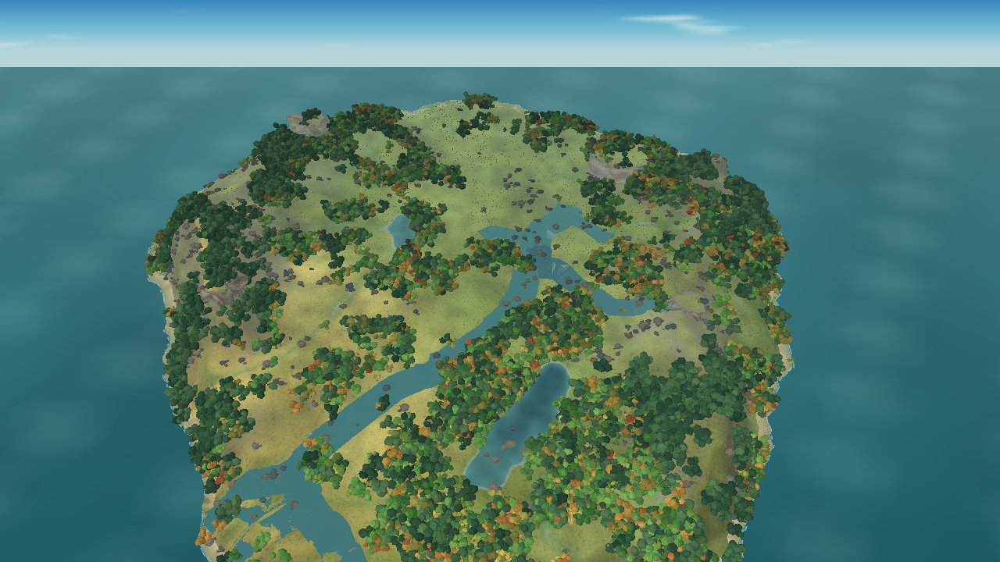

Build Release isolado em `bin/iteration-155-broad-snapshot-rivers/` concluiu com zero avisos e zero erros. `dotnet test Game.sln -c Release --no-restore` passou: 24 testes, zero falhas. Benchmark da seed 3, 1280 × 720, perspectiva, 5 s de aquecimento e 6 s medidos: 60,00 FPS, P95 16,98 ms, P99 17,37 ms, máximo 18,59 ms, CPU 43,1% de um núcleo, working set 1.000,7 MiB e memória privada 1.302,2 MiB. A contagem ficou em 11.036 árvores e 9.655.881 vértices de flora. O custo de memória segue acima do alvo; o gate visual segue aberto devido à clareira central, encostas ainda fracas e à largura de rio irregular entre seeds.

### Iterações 156–165 — mosaico de sub-bosque e relevo em múltiplas escalas

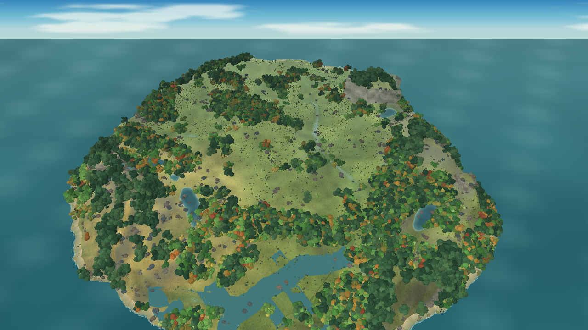

As iterações 156–160 investigaram a distribuição do sub-bosque. A iteração 160 usa amostras espaciais determinísticas em escalas de 30 m e 150 m para concentrar arbustos em manchas, sem alterar sua população científica. A contagem visual permaneceu em 4.352 arbustos e a mudança pouco aparece na vista integral. A busca do SciSpace encontrou evidência de que a relação entre dossel e sub-bosque varia conforme a escala: efeitos locais de coníferas e padrões de caducifólias podem aparecer em faixas espaciais diferentes (Denny e Nielsen, 2017, [DOI 10.3390/f8050146](https://doi.org/10.3390/f8050146)). Como o snapshot agrega estado em células de 100 m², isso orienta uma receita visual multiescala, mas não calibra a ecologia simulada.

As iterações 161–162 reduziram a influência da suavização visual das planícies e encolheram a região plana. As aberturas centrais continuaram grandes, então a causa principal não é apenas o contorno do bioma. Na iteração 163, três escalas de ondulação no renderer (aproximadamente 360 m, 130 m e 40 m) acrescentaram encostas suaves em campos abertos; elas ficam mais legíveis no enquadramento aproximado do que no panorâmico. A iteração 164 alargou e baixou os tufos de gramínea sem acrescentar instâncias ou vértices, com efeito visual pequeno na escala total. A iteração 165 elevou a dispersão da copa de 3,40 para 4,10: as bordas das copas se conectam melhor e a floresta fica um pouco mais cheia, mantendo árvores, alturas, posições e vértices.

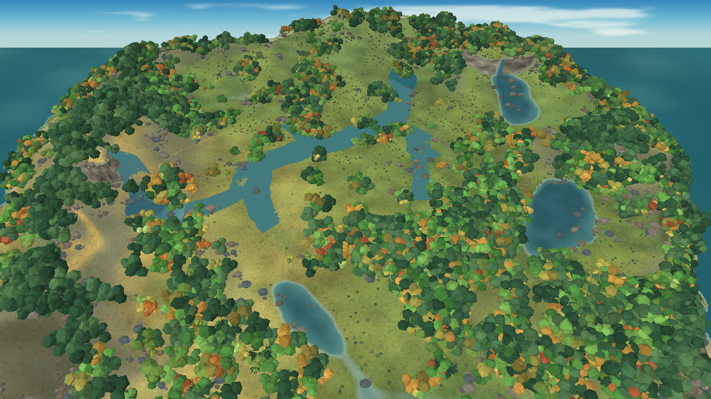

A vista próxima da seed 2 comunica melhor o relevo e o curso d'água; a cascata visível é uma fixture de avaliação do renderer, pois o snapshot não fornece cachoeiras nessa captura. Na vista ampla, ainda há uma clareira central extensa, bosques separados em faixas, copas facetadas, rios com margens angulares e pouco contraste entre encostas e áreas abertas. A ilha mantém 2.560 × 2.560 m e as alterações deste grupo pertencem à apresentação; snapshot, hidrologia, parâmetros biológicos e RNG ecológico não foram modificados. A cena continua distante da densidade e da variedade topográfica da referência, e o gate visual permanece aberto.

`dotnet test Game.sln -c Release --no-restore` passou: 24 testes, zero falhas. `git diff --check` não encontrou erros de whitespace; o Git mostrou apenas avisos de conversão LF/CRLF em arquivos já modificados. Benchmark Release da seed 3, 1280 × 720, perspectiva, simulação pausada, 5 s de aquecimento e 6 s medidos: 59,99 FPS, P95 17,22 ms, P99 17,87 ms, máximo 18,09 ms, CPU 36,9% de um núcleo, working set 1.063,9 MiB e memória privada 1.385,4 MiB. O tempo de quadro ficou próximo de 60 FPS; a memória excede o alvo de 1 GiB. A captura ampla da seed 1 e o enquadramento aproximado da seed 2 estão acima; `iteration-163-multiscale-relief-close-seed-3.png` documenta o relevo antes do alargamento final das copas.

### Iterações 166–169 — continuidade do dossel e agrupamento por espécie

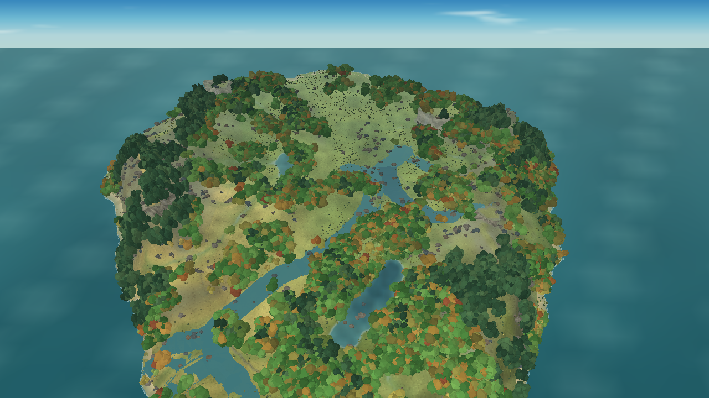

As iterações 166–167 testaram dispersão de copa 5,10 e 6,00, mantendo a última. Comparada ao fator 4,10 da iteração 165, a copa final tem raio 46% maior no LOD de mapa, sem criar instâncias nem vértices por árvore. Ela conecta melhor as bordas dos bosques, mas a clareira central continua visível.

Na iteração 168, a composição das espécies passou a combinar variação local com campos determinísticos de 60 m e 180 m. Os overrides visuais existentes para altitude, margens úmidas e água foram preservados. O LOD agora comprime horizontalmente as coníferas e alonga seus lobos, dá forma mais ereta às bétulas e mantém as copas largas e baixas dos salgueiros. A iteração 169 reduziu o contraste facetado das copas distantes sem subdividir a malha. O close da seed 2 mostra os grupos e suas silhuetas, embora as copas ainda mantenham aparência geométrica.

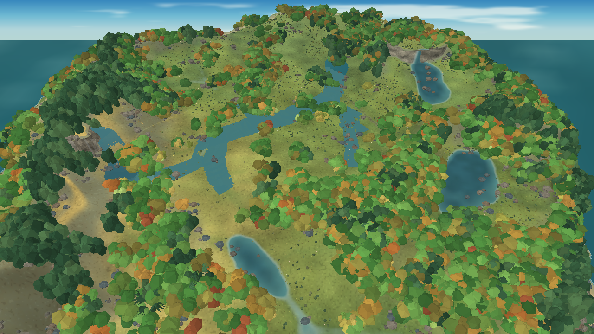

O SciSpace retornou estudos de floresta temperada que descrevem padrões de árvores dependentes da escala, regeneração agrupada em clareiras e mudanças de heterogeneidade de recursos em arranjos agrupados (Akashi, 1996, [DOI 10.1007/BF02347788](https://doi.org/10.1007/BF02347788); Boyden et al., 2012, [DOI 10.1890/11-1469.1](https://doi.org/10.1890/11-1469.1)). Esses resultados justificam experimentar mosaicos de espécie e clareiras, mas não calibram os campos de 60 m e 180 m: eles são escolhas de apresentação. A pesquisa não cria organismos, não redistribui biomassa e não altera snapshot, parâmetros, processos ou RNG ecológico.

Na seed 3, a captura registra 11.023 árvores visíveis, alturas visuais P10/P50/P90 de 13,6/22,4/32,9 m, 10.239.699 vértices de flora, 48.979 agrupamentos de cobertura, 4.352 arbustos, 3.693 flores e 1.944 rochas de avaliação. `dotnet test Game.sln -c Release --no-restore` passou: 24 testes, zero falhas; build Release: zero avisos e zero erros. Benchmark Release da seed 3, 1280 × 720, perspectiva, simulação pausada, 5 s de aquecimento e 6 s medidos: 60,00 FPS, P95 16,96 ms, P99 17,14 ms, máximo 17,67 ms, CPU 34,0% de um núcleo, working set 1.016,5 MiB e memória privada 1.336,2 MiB. O tempo de quadro atende à meta de 60 FPS, mas a memória permanece acima do alvo de 1 GiB. A composição avançou em agrupamento e leitura das coníferas; ainda há uma abertura central ampla, água angular e pouca variação topográfica na vista integral. O gate visual permanece aberto.

### Reavaliação do teto de memória desktop e alvos de hardware

O teto de 1 GiB apareceu como meta de N4 em um benchmark anterior. Em 21/10/2026, o usuário definiu os alvos desktop: **8 GB RAM + 4 GB VRAM como mínimo**, e **16 GB RAM + 8 GB VRAM como configuração recomendada para melhor desempenho**. A máquina desta medição, com 15,87 GiB de RAM e RTX 5060 reportando 8.151 MiB de VRAM, pertence à classe recomendada. O tamanho do processo não é igual à capacidade de memória total da plataforma e não deve ser limitado a 1 GiB sem evidência de pressão real.

Repeti a medição atual em Release, seed 3, 1280 × 720, perspectiva, vista ampla de referência, copas volumétricas, simulação pausada, 5 s de aquecimento e 6 s medidos. Com `--camera-zoom 2.0 --camera-focus 1280 1400`, o resultado foi 60,01 FPS, P95 16,99 ms, P99 17,23 ms, 40,0% de um núcleo, working set 976,7 MiB e memória privada 1.192,3 MiB; a cena mostrou 9.907 árvores, 9.744.711 vértices de flora e 1.879 rochas. Assim, a memória privada ultrapassa o antigo teto em 168,3 MiB, mas as páginas residentes medidas pelo working set ficam abaixo de 1 GiB. São métricas diferentes: `PrivateMemorySize64` conta memória do processo não compartilhável e `WorkingSet64` representa páginas atualmente residentes em RAM ([Microsoft Learn: PrivateMemorySize64](https://learn.microsoft.com/dotnet/api/system.diagnostics.process.privatememorysize64), [Working Set](https://learn.microsoft.com/windows/win32/memory/working-set)).

**Conclusão:** remover 1 GiB de memória privada como gate rígido. Manter bytes privados, working set e memória de GPU como métricas. A cena ampla atende FPS nesta máquina recomendada, com 976,7 MiB de working set e 1.192,3 MiB de memória privada; isso não comprova operação no mínimo de 8 GB/4 GB. A validação mínima ainda precisa ser feita em hardware correspondente, incluindo simulação ativa, carga visual-alvo, outras seeds e memória de GPU por processo. Esta medição cobre uma cena pausada e não cobre dez vezes mais instâncias.

### Iteração 171 — suavização das copas no LOD distante

O LOD distante de árvores agora usa uma subdivisão geodésica nos lóbulos das copas (80 faces por lóbulo, em vez de 20). A mudança mantém espécies, distribuição, alturas, seed e troncos; afeta somente a malha de apresentação. Capturas de comparação para seeds 1–3: `evidence/iteration-171-smooth-canopy-seed-1.png`, `evidence/iteration-171-smooth-canopy-seed-2.png` e `evidence/iteration-171-smooth-canopy-seed-3.png`.

Build Release isolado em `bin/iteration-171-smooth-canopy/`: zero avisos e zero erros. Seed 3, 1280 × 720, perspectiva, `--camera-zoom 2.0 --camera-focus 1280 1400`, 5 s de aquecimento + 6 s medidos: 60,00 FPS, P95 17,02 ms, P99 17,79 ms, máximo 19,00 ms, CPU 36,4% de um núcleo, working set 1.798,8 MiB e memória privada 2.307,0 MiB. A cena registra 9.911 árvores, 22.025.151 vértices de flora, 48.979 grupos de cobertura, 4.352 arbustos, 3.693 flores e 1.879 rochas. Contra a medição ampla anterior da seed 3, a contagem de vértices sobe de 9.744.711 para 22.025.151; working set sobe de 976,7 para 1.798,8 MiB e memória privada de 1.192,3 para 2.307,0 MiB. Os percentis continuam dentro do alvo nesta máquina recomendada. As copas ficam menos facetadas, mas ainda parecem volumes arredondados; clareiras amplas, água angular e densidade/variação foliar continuam distantes da referência. O custo maior é um candidato de qualidade visual para comparar, não uma aprovação final nem prova de que a configuração mínima foi validada.
