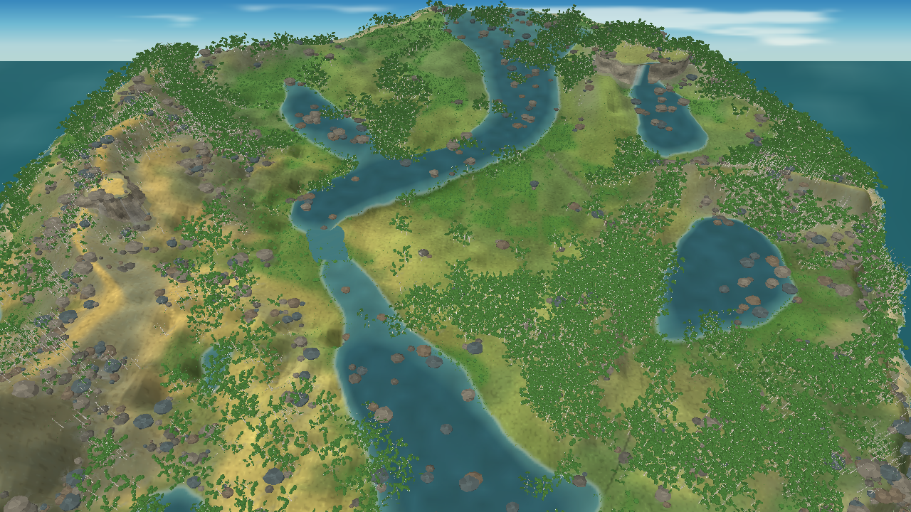

# Avaliação visual do renderer MonoGame — iteração 17 — 21/10/2026

**Estado:** política de cor biológica aplicada; gate visual continua reprovado.  
**Cena:** save realmente simulado, seed 2, tick 24.624, dia 172 (verão), avaliação pausada; água somente do snapshot.  
**Stack:** C#/.NET 10, MonoGame DesktopGL, build Debug, 1280 × 720.

## Decisões implementadas

- A referência continua orientando composição, variedade de silhueta, volume e densidade. Ela não determina pigmentos ou respostas biológicas.
- Removi o outono forçado da câmera de referência, o controle de prévia `V`, o sorteio de espécie dependente da estação e as variações de folhas amarelas/laranjas por seed. A estação exibida vem do snapshot.
- A folhagem saudável usa uma base verde comum e sombreamento geométrico. O seed varia estrutura e posição, não pigmento individual. Nenhum amarelecimento por seca/doença é desenhado porque o snapshot não possui esses estados causais.
- `LeafHabit` distingue perfis decíduos e perenes. No inverno, o renderer remove as folhas apenas dos perfis declarados decíduos; a regra e o calendário de queda ainda são arquétipos temperados não calibrados por espécie/local.
- Flores decorativas foram removidas até a Biosfera publicar espécie e estado reprodutivo. Arquiteturas chamadas carvalho, pinheiro, bétula, bordo e salgueiro ainda são receitas de forma, não perfis taxonômicos validados.
- O cliente aceita `--snapshot-file <caminho>` para carregar saves reproduzíveis e avaliá-los pausados. Assim, a captura de verão abaixo vem de 24.624 ticks efetivamente simulados, sem mudar a estação no renderer.

## Coerência com a futura fauna

[Procedural Pixel Creatures, de idlerunner00](https://github.com/idlerunner00/procedural-pixel-creatures), é um gerador de fauna em pixel art feito em Godot 4.5.2 .NET/C#. A referência é útil para desenho procedural de anatomia, genes/genomas, rigs, animação determinística e streams de seed separados. O repositório publica código MIT; nenhum runtime ou recurso do projeto foi incorporado nesta etapa.

A cena 3D atual ainda não foi validada junto de uma criatura pixelada. O próximo gate de integração precisa comparar, na mesma câmera, a densidade de pixel na tela, escala, silhueta/contorno, detalhe do fundo, iluminação e sombra de contato. Se a mistura parecer incompatível, pixelização/contorno compartilhados ou adaptação da criatura são hipóteses a comparar por captura e custo; não se escolhe agora uma delas por pressuposto.

## Evidência visual

A captura elimina as copas outonais sorteadas e mantém árvores folhadas porque o snapshot carregado está no verão. Ela ainda está longe da referência: há blocos de copa muito granulados, clareiras centrais extensas, rochas espalhadas sem integração suficiente e muitos corpos d'água pequenos. O snapshot contém somente 8 arestas de rio renderizadas e nenhuma cachoeira. A imagem não passa o gate visual nem valida uma representação de espécie.

O estado foi gerado com `Game.App --seed 2 --ticks 24624 --save <arquivo>` e carregado com `--snapshot-file <arquivo>`. Identidade: `state-sha256=B4EA4E5BA710D1BBF87AEBB90A4F3ABD6573FEB7C1254090B40983BA0E7D2531`. O runner reportou resíduos de balanço de `1,074E-003 L` para água, `1,402E-002 g` para matéria seca e `-8,643E-007 g` para nitrogênio.

## Desempenho e limites

Benchmark pausado com a mesma seed, snapshot, câmera e `--snapshot-water-only`; 5 s de aquecimento, 5 s medidos, VSync ligado:

| FPS médio | P95 | P99 | Máximo | CPU de um núcleo | Working set | Memória privada | Árvores visíveis | Vértices de flora |
|---:|---:|---:|---:|---:|---:|---:|---:|---:|
| 59,97 | 26,36 ms | 27,72 ms | 30,74 ms | 74,3% | 1.611,0 MiB | 2.225,5 MiB | 10.186 | 10.245.357 |

A amostra atende aos limites temporais locais de 30 FPS, P95 ≤33,3 ms e P99 ≤50 ms, mas não demonstra o hardware mínimo. Foi build Debug enquanto outro cliente Release permanecia aberto; as medições de memória não são isoladas, VRAM não foi medida e VSync limita a média. A cena exige cerca de 10,25 milhões de vértices de flora nesse enquadramento, portanto LOD/cache e custos de GPU ainda precisam ser validados em Release e em hardware mínimo real.

`dotnet build Game.sln --no-restore` terminou com zero avisos e zero erros. Nenhum teste automatizado foi executado nesta rodada.

## Fontes

- Renner & Zohner (2019), [variação regional e fenológica das cores de outono](https://doi.org/10.1111/nph.15900).
- Xie et al. (2022), [variação de cor e fenologia em 46 espécies decíduas temperadas](https://doi.org/10.1093/jpe/rtab105).
- Liu et al. (2015), [meta-análise de senescência foliar e diferenças de latitude](https://doi.org/10.1093/aob/mcv055).
- [Procedural Pixel Creatures — repositório e licença](https://github.com/idlerunner00/procedural-pixel-creatures).
