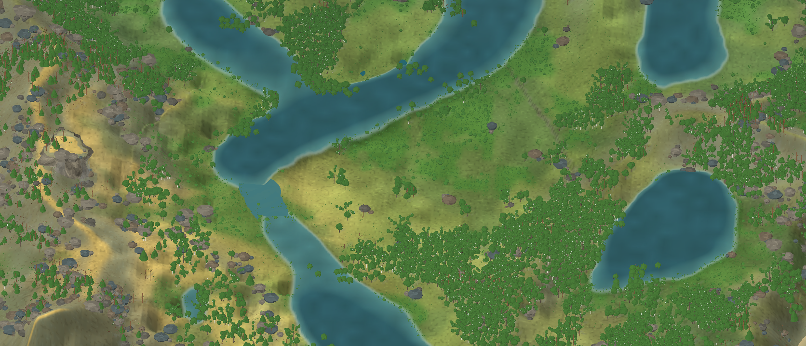
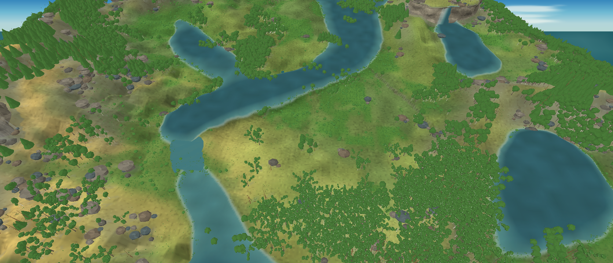

# Avaliação visual do renderer MonoGame — iteração 18 — 21/10/2026

**Estado:** LOD de copa volumétrica aceito como candidato de mapa; gate visual continua reprovado.  
**Cena:** snapshot simulado, seed 2, tick 24.624, dia 172 (verão), pausado; água somente do snapshot.  
**Stack:** Release, C#/.NET 10, MonoGame DesktopGL.

## Mudança demonstrada

O LOD mais distante não desenha cada cartão de broto. Copas espalhadas, verticais e pendentes viram pequenas massas facetadas sobrepostas, com forma limitada pelo perfil de copa. Coníferas usam uma malha de anéis cônicos e degraus rasos de ramos. Rotação e pequenas irregularidades vêm da seed visual da árvore; pigmentos não vêm da seed. O LOD próximo mantém galhos e folhas procedurais texturizadas. Nada nesta troca altera o snapshot, a simulação, os parâmetros biológicos ou o RNG ecológico.

Rochas de superfície agora são suprimidas em células com mais de 420 mm de água, o limiar usado pelo renderer para água profunda. Rochas rasas de margem continuam visíveis; afloramentos não são colocados sobre lagos fundos. Na captura panorâmica, isso reduziu a contagem de 864 para 768 sem alterar o campo hidrológico.

A imagem de referência orienta relevo, composição e densidade visual. A captura segue o snapshot de verão: base verde uniforme, variação pela luz e nenhum amarelo/laranja imposto. O teste do LOD híbrido com sprites adultos foi rejeitado nesta cena porque o recurso `autumn-maple.png` deixou o bordo amarelo no verão. Enquanto a estação e os estados fisiológicos não produzirem pigmentos calibrados, esse modo não é candidato.

Também troquei a casca quase universalmente creme por swatches qualitativos cinza-acastanhados para carvalho/salgueiro, castanho mais quente para pinheiro, castanho-claro para bordo e claro para bétula. Os tons seguem descritores de táxons representativos documentados em [15_RESEARCH.md](../15_RESEARCH.md#casca-diferenças-de-espécie-e-limite-da-representação), não medições espectrais. Não mostro o gradiente de idade documentado para algumas espécies: `TreeVisual.Maturity` estima desenvolvimento de copa pela cobertura lenhosa da célula e não é idade individual.

Composição ortográfica comparável ao recorte amplo: `--reference-landscape-view --camera-zoom 1.8 --camera-focus 1280 1280 --capture-width 1672 --capture-height 720`. As árvores agora leem como copas e manchas de mata, sem o granulado de milhares de cartões, e os lagos fundos estão livres de rochas de superfície.

A perspectiva foi capturada com `--projection perspective --camera-zoom 3.0 --camera-focus 1280 1280`. Ela comunica altura, sobreposição das árvores e o limite de ilha com mais força; a ortográfica conserva uma leitura mais previsível da distribuição. Por enquanto ambas continuam disponíveis. Ainda não alcança a referência: a folhagem e os troncos continuam simplificados, há clareiras extensas e blocos de floresta com borda rígida; o tapete vegetal não tem a densidade de detalhe da imagem; afloramentos não seguem ainda um mapa geológico. O snapshot mantém 8 segmentos de rio e nenhuma cachoeira.

## Comparação e desempenho

Benchmark Release, seed/snapshot iguais, vista de ilha inteira a 1280 × 720, VSync ligado; 5 s de aquecimento e 5 s medidos. A comparação usa a versão anterior de copa em dois cartões agregados e esta versão volumétrica sob a mesma câmera:

| Representação | Vértices da árvore | Vértices totais de flora | Média | P95 | P99 | Máximo | CPU de um núcleo | Working set | Memória privada |
|---|---:|---:|---:|---:|---:|---:|---:|---:|---:|
| Cartões agregados | 1.679.286 | 5.238.555 | 60,00 FPS | 17,08 ms | 17,36 ms | 18,60 ms | 39,1% | 1.082,2 MiB | 1.479,2 MiB |
| Copas volumétricas | 4.184.286 | 7.743.555 | 59,99 FPS | 17,41 ms | 21,81 ms | 23,58 ms | 33,7% | 1.319,3 MiB | 1.793,2 MiB |

Benchmarks panorâmicos Release, VSync ligado, 5 s de aquecimento e 5 s medidos. Cada projeção usa zoom diferente para enquadrar a mesma região; portanto, os valores comparam as vistas de avaliação, não uma quantidade idêntica de instâncias:

| Projeção / zoom | Média | P95 | P99 | Máximo | CPU de um núcleo | Working set | Memória privada | Árvores | Rochas | Vértices de flora |
|---|---:|---:|---:|---:|---:|---:|---:|---:|---:|---:|
| Ortográfica / 1,8 | 60,00 FPS | 17,32 ms | 21,21 ms | 23,36 ms | 36,1% | 1.327,7 MiB | 1.784,4 MiB | 5.534 | 768 | 8.250.423 |
| Perspectiva / 3,0 | 60,00 FPS | 17,14 ms | 18,00 ms | 18,36 ms | 32,2% | 1.265,4 MiB | 1.733,3 MiB | 6.677 | 618 | 7.454.577 |

A média é limitada por VSync. Não há medição de VRAM e esta máquina não prova o requisito mínimo de 8 GB RAM/4 GB VRAM.

O aumento de cerca de 2,5 milhões de vértices de flora custa aproximadamente 237 MiB de working set e 314 MiB de memória privada nessa comparação. O frame pacing segue dentro do limite local de P99 ≤50 ms. O benefício visual da silhueta volumétrica compensa esse custo para a vista ampla testada, mas close-up e hardware mínimo ainda precisam de validação.

## Coerência visual e limites científicos

[Procedural Pixel Creatures](https://github.com/idlerunner00/procedural-pixel-creatures) continua sendo uma referência algorítmica para anatomia, variação genética, rigs e animação da fauna. Seu acabamento pixel-art não se torna um requisito para as árvores ou a paisagem. A integração de fauna ainda deve ser avaliada em uma captura compartilhada; se os estilos divergirem, a decisão precisa comparar o tratamento de renderização do conjunto com uma adaptação do desenho da criatura.

Os nomes carvalho, pinheiro, bétula, bordo e salgueiro são arquétipos gráficos, não espécies medidas. A forma volumétrica demonstra como o renderer consome limites de copa e arquitetura; ela não prova resposta ambiental, cor, fenologia nem genética calibradas. A política e as evidências para pigmentos estão em [15_RESEARCH.md](../15_RESEARCH.md) e na [iteração 17](VISUAL_RENDERER_EVALUATION_ITERATION_17_2026-10-21.md).

`dotnet build src/Game.Client.Desktop/Game.Client.Desktop.csproj --no-restore -c Release` compilou a variante em diretório isolado sem avisos nem erros. Nenhum teste automatizado foi executado nesta rodada.
