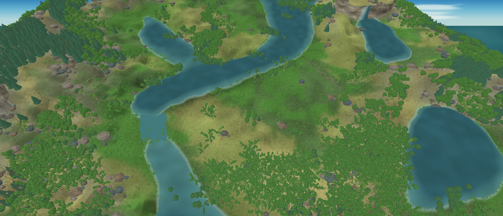

# Avaliação visual do renderer MonoGame — iteração 19 — 21/10/2026

**Estado:** paleta ambiental revisada para remover pistas visuais sem causa no snapshot; gate visual continua reprovado.  
**Cena:** snapshot pausado, seed 2, tick 24.624, dia 172 (verão), água somente do snapshot.  
**Stack:** Release, C#/.NET 10, MonoGame DesktopGL.

## Direção cromática e semântica dos dados

A inspeção da iteração anterior revelou uma máscara de “deserto” posicionada pela seed. Além de pintar o solo de amarelo, ela reduzia gramíneas e ocultava parte das árvores, mesmo quando o snapshot publicava biomassa lenhosa naquela célula. Essa regra foi removida. A presença de árvores e gramíneas agora parte das células e biomassas publicadas; contagem, porte, arquitetura e posição continuam heurísticas de renderer sobre patches, não indivíduos ou populações simuladas.

O tom sutil de superfície seca usa a saturação atual (`soilWater / soilCapacity`) e a água superficial do snapshot. Ele descreve o estado presente do substrato, não uma classificação de deserto nem a resposta cromática de uma planta. O relevo de planície segue sendo aplicado geometricamente, mas a máscara de planície deixou de colorir o chão de amarelo-esverdeado. A cobertura de gramíneas contribui com verde derivado de `Grass.BiomassGPerM2`; substrato arenoso, altura, exposição, umidade e sombra continuam influenciando a leitura do solo.

As copas mantêm swatches verdes qualitativos por arquétipo, apoiados em descritores botânicos, e cascas com swatches igualmente qualitativos. Nenhum desses RGB é uma medida espectral ou um estado individual: o snapshot não publica identificação taxonômica por árvore. A seed varia apenas geometria/posição, não pigmento. Amarelecimento por espécie, estação, seca ou doença requer que o traço e a causa apareçam nos dados. A evidência e os limites dos swatches estão em [15_RESEARCH.md](../15_RESEARCH.md#tons-de-folhagem-sadia-no-verão) e a regra de integração visual está em [22_VISUAL_DIRECTION_AND_TECHNOLOGY.md](../22_VISUAL_DIRECTION_AND_TECHNOLOGY.md#referência-de-fauna-e-integração-visual).

O projeto Procedural Pixel Creatures continua como referência para o algoritmo futuro de anatomia, herança visual, rigs e animação da fauna. Isso não fixa pixel art para a paisagem. A decisão de estilo precisa ser validada com fauna e cenário na mesma câmera, medindo legibilidade de silhueta, escala de detalhe, contorno, iluminação e sombra de contato.

## Custo da cena

Benchmark Release, perspectiva, 1672 × 720, VSync ligado, snapshot pausado; cinco segundos de aquecimento e cinco medidos. A vista mudou a densidade porque a máscara visual não oculta mais árvores/gramíneas. Os números do primeiro benchmark da iteração 19 tiveram frametimes menores; esta tabela registra a execução mais recente e conservadora.

| Versão | Árvores visíveis | Vértices de flora | Média | P95 | P99 | Máximo | CPU de um núcleo | Working set | Memória privada |
|---|---:|---:|---:|---:|---:|---:|---:|---:|---:|
| Iteração 18, antes da remoção da máscara | 6.677 | 7.454.577 | 60,00 FPS | 17,14 ms | 18,00 ms | 18,36 ms | 32,2% | 1.265,4 MiB | 1.733,3 MiB |
| Iteração 19, cena guiada pelo snapshot | 7.408 | 8.192.163 | 60,01 FPS | 21,93 ms | 26,64 ms | 29,50 ms | 40,8% | 1.317,5 MiB | 1.781,3 MiB |

A representação expõe mais 731 árvores e cerca de 738 mil vértices de flora; working set aumentou aproximadamente 52 MiB. Nesta máquina, a execução mais recente manteve 60 FPS e P99 abaixo do gate local de 50 ms. VRAM não foi medida e o alvo mínimo de 8 GB RAM/4 GB VRAM ainda precisa de validação em hardware real.

## Limites visuais e próximos gates

A imagem ainda está longe da referência: copas e troncos são simplificados, a distribuição apresenta blocos e clareiras, o solo carece de detalhe fino e a água não reproduz a rede de cachoeiras da referência. O snapshot usado tem oito segmentos de rio e nenhuma cachoeira. Os cinco perfis arbóreos seguem sendo arquétipos de apresentação; não são populações de espécies validadas nem autorizam inferir seleção, fenologia ou genética.

Próximos passos visuais podem melhorar relevo, silhueta, agrupamento, densidade e sombra sem acrescentar cores fisiológicas. Uma região climática de deserto aguarda dados ambientais que representem aridez em escala apropriada; não deve voltar como uma máscara pela seed. A fauna só será integrada depois de uma criatura procedural de prova poder ser comparada ao cenário nas mesmas condições de projeção.

`dotnet build src/Game.Client.Desktop/Game.Client.Desktop.csproj --no-restore -c Release -p:BaseOutputPath=bin/iteration-189-environment-colors/` compilou sem avisos nem erros. Nenhum teste automatizado foi executado nesta rodada.
