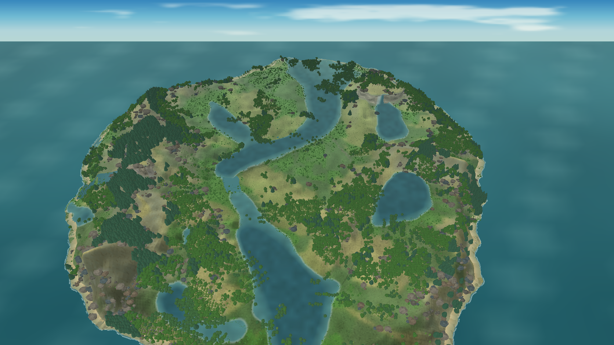
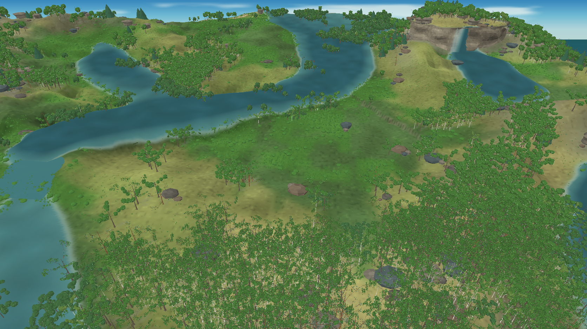
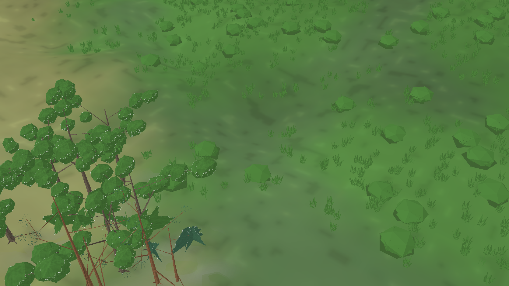

# Avaliação visual do renderer MonoGame — iteração 20 — 21/10/2026

**Estado:** melhoria de superfície de baixo custo para copas distantes; a meta visual segue aberta.  
**Cena:** snapshot da seed 2, tick 24.624, dia 172 (verão), carregado pelo contrato atual e pausado na apresentação.  
**Stack:** Release, C#/.NET 10, MonoGame DesktopGL.

## Ajuste de copa distante

A iteração 20 reaproveita a máscara procedural de copa por perfil no LOD distante e interpola a iluminação sobre as normais aproximadas do elipsoide. A mudança fica no renderer: não introduz pigmentos, estados ecológicos ou consumo do RNG da simulação. Na captura de ilha inteira, árvores e vértices da malha arbórea ficaram em 13.810 e 5.523.636 antes e depois. O custo geométrico, portanto, não aumentou.

| Antes | Depois |
|---|---|
|  |  |

A leitura da ilha permanece distante da referência. Em escala ampla, as folhas não podem ser resolvidas e as copas ainda se agrupam em massas repetidas; a água atual também contém poucas conexões de rio. A mudança melhora discretamente a superfície sem aumentar polígonos, mas não resolve a forma de espécie ou a composição do bosque.

## Arquitetura da árvore em escala próxima

A vista a 3× mostra troncos e ramificação, mas revela que os cachos foliares permanecem grandes e simplificados. Os perfis e a geometria continuam sendo arquétipos visuais; ainda não há identidade taxonômica individual, genótipo ou maturidade persistida no snapshot. Assim, esta captura não demonstra resposta fenotípica a clima/solo, fases reprodutivas ou morte.

Na comparação a 2×, ligar o núcleo volumétrico reduziu os vértices arbóreos de 111.522 para 100.362 (−10,0%) na mesma vista, com mudança visual discreta. O controle e a variante estão em [sem núcleo](evidence/iteration-20-summer-near-volume-off.png) e [com núcleo](evidence/iteration-20-summer-near-volume-on.png); a opção segue restrita à apresentação.

O projeto Procedural Pixel Creatures continua como referência algorítmica para futura fauna. A cena não foi aprovada como estilo final compartilhado: ainda falta comparar uma criatura procedural com as árvores na mesma escala, iluminação e fundo.

## Desempenho observado

Benchmark Release, ilha inteira em perspectiva, snapshot pausado, água derivada somente do snapshot, 1280 × 720, cinco segundos de aquecimento e dez medidos:

| Média | P95 | P99 | Máximo | CPU de um núcleo | Working set | Memória privada | Árvores visíveis | Vértices de flora |
|---:|---:|---:|---:|---:|---:|---:|---:|---:|
| 47,87 FPS | 17,22 ms | 33,72 ms | 1.129,41 ms | 46,8% | 961,8 MiB | 1.518,2 MiB | 12.922 | 8.903.295 |

O pico máximo correspondeu a uma reconstrução de cobertura/posicionamento medida em 1.124,39 ms, embora a P95 tenha permanecido em 17,22 ms. A amostra não serve como prova de desempenho estável: há um pico de construção síncrona e a média ficou abaixo de 60 FPS. VRAM não foi medida; os alvos mínimos de 8 GB de RAM e 4 GB de VRAM não foram validados em hardware dedicado.

## Registro técnico

- Build `bin/iteration-201-canopy-texture/Release`: zero avisos e zero erros.
- A captura de referência e o benchmark usam o mesmo snapshot simulado. A comparação do LOD não alterou alturas, perfis, cores por estação ou dados da Biosfera.
- Nenhum teste automatizado foi executado nesta rodada.
- O ajuste de textura fica registrado como uma melhoria visual pequena e barata. A próxima etapa precisa reduzir o aspecto de cachos redondos e manter continuidade entre os galhos e a forma da copa sem ampliar indiscriminadamente a malha.
