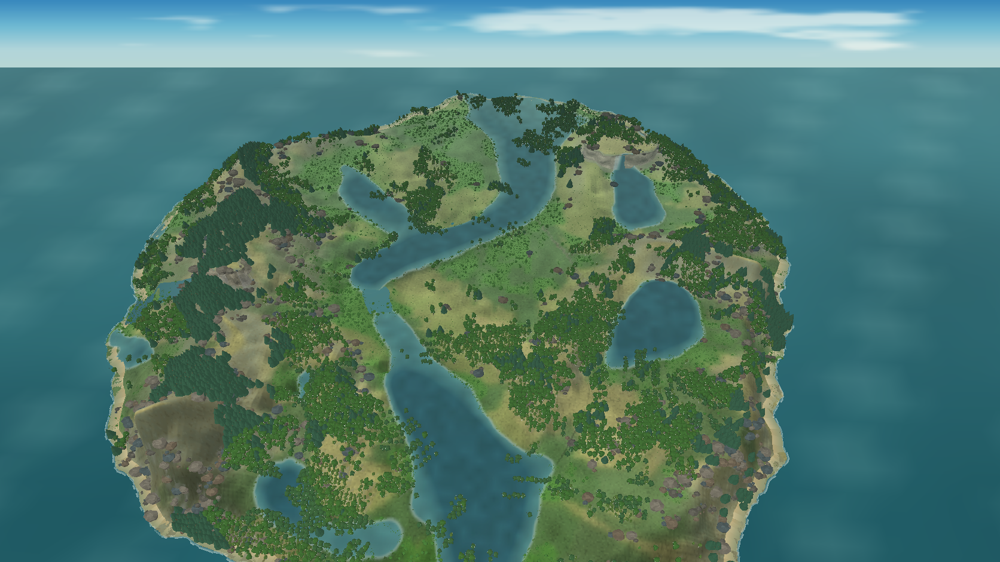
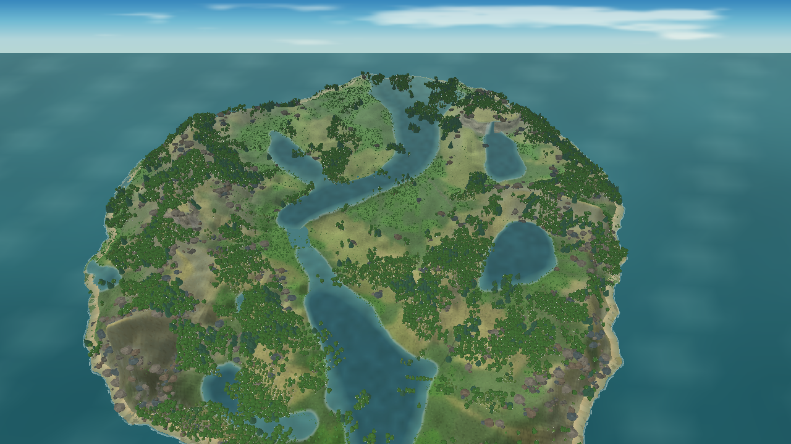
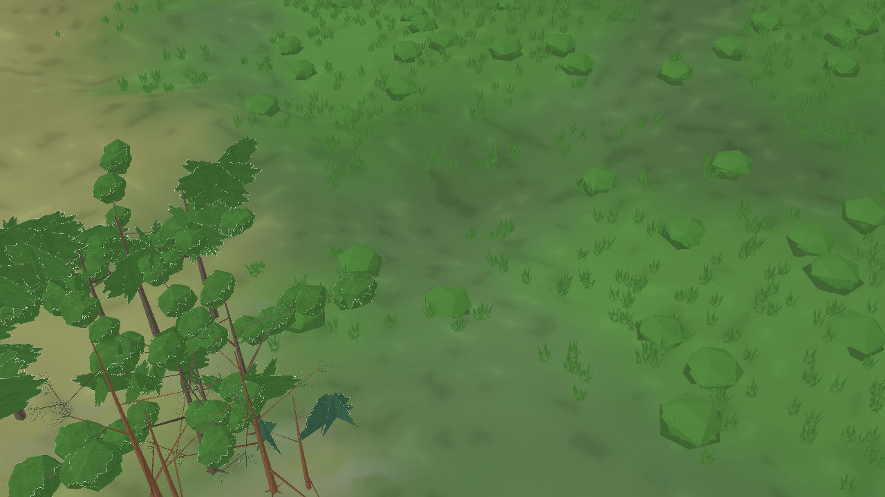

# Avaliação visual do renderer MonoGame — iteração 21 — 21/10/2026

**Estado:** remoção de duas atribuições ambientais sem suporte local e ensaio de variação vertical do tamanho foliar. A meta visual continua aberta.  
**Cena:** snapshot seed 2, tick 24.624, dia 172 (verão); água apenas do snapshot, apresentação pausada.  
**Stack:** Release, C#/.NET 10, MonoGame DesktopGL.

## Ajustes realizados

A seleção de perfil arbóreo deixou de usar altitude para escolher a forma cônica ou umidade para escolher formas pendentes. Os agrupamentos agora vêm de campos espaciais determinísticos e servem somente como composição de **arquétipos de renderer**. Eles não dizem quais espécies ocupam os habitats e não foram calibrados ecologicamente. Limites de colocação e biomassa continuam lendo o snapshot.

O perfil qualitativo de carvalho usa folhas maiores no meio da copa; o perfil de bétula aumenta o tamanho foliar em direção à parte inferior. A curva foi normalizada pela altura dentro do envelope de copa e limitada ao fator ilustrativo 0,90–1,10. Apenas as dimensões das lâminas mudam, sem mudar densidade, pigmento, estrutura dos ramos, simulação ou custo de vértices. Os outros perfis permanecem uniformes. O estudo de Hagemeier e Leuschner descreve essas direções para *Quercus petraea* e *Betula pendula*, mas não fornece coeficientes transferíveis para este cenário; o valor gráfico não é uma medição nem uma calibração. Ver [15_RESEARCH.md](../15_RESEARCH.md#gradiente-vertical-do-tamanho-foliar) e [o artigo](https://www.mdpi.com/1999-4907/10/3/265).

Não introduzi amarelo ou mudança sazonal: a captura é de verão e nenhum estado de espécie, seca ou doença foi alterado. Os swatches existentes continuam fixos e qualitativos; o snapshot ainda não identifica cada árvore.

## Comparação das capturas

As vistas usam a mesma seed, snapshot, perspectiva e zoom amplo. As resoluções diferem; a comparação é de composição, não um teste pixel a pixel.

| Iteração 20 | Iteração 21 |
|---|---|
|  |  |

A ilha mantém a mesma composição ampla, com 13.813 árvores visíveis, 5.143.194 vértices arbóreos e 8.889.693 vértices de flora total nesta captura. A alteração de mistura dos perfis reduziu a contagem de vértices arbóreos em relação ao registro da iteração 20, mas não se trata de uma otimização estrutural planejada. A gradação foliar local não pode ser lida nessa escala.

Na vista próxima, o tamanho das lâminas varia pouco dentro da copa e o desenho ainda se lê como cachos sobre galhos finos. A mudança é sutil e não resolve o maior problema visual: silhuetas repetidas e pouco volume arbóreo na composição ampla. Esse é um limite observado, não uma alegação de que o padrão da copa tenha sido validado botanicamente.

### Comparação visual com a referência

Autoavaliação qualitativa pela escala de 0–4 descrita no gate visual; não é uma medição automatizada nem revisão independente.

| Dimensão | Nota | Evidência / lacuna |
|---|---:|---|
| Relevo | 2 | Ilha, declives e um paredão são legíveis, mas a vista ampla ainda carece de variação de encostas e platôs com a força da referência. |
| Água | 2 | O snapshot produz oito arestas de rio conectadas e nenhum salto de canal maior que 1,72 m; cachoeiras não são estado simulado nesta cena. |
| Vegetação | 1 | Há vários perfis de copa, porém a silhueta e a densidade em escala ampla seguem fragmentadas e repetitivas. |
| Rochas | 2 | Os volumes são facetados e visíveis, mas forma e distribuição repetem-se. |
| Luz e profundidade | 2 | Perspectiva, sombras e faces comunicam volume, ainda sem auto-sombreamento de copa suficientemente rico. |
| Composição | 2 | A ilha e o mar delimitador aparecem, mas a cobertura florestal e os corredores de água não correspondem à leitura visual desejada. |

Todas as categorias permanecem abaixo do mínimo 3 do gate; a cena não está aprovada como direção final.

## Desempenho observado

Benchmark Release, perspectiva ampla, 1280 × 720, snapshot pausado e água apenas do snapshot; aquecimento de 5 s e 10 s medidos.

| Média | P95 | P99 | Máximo | CPU de um núcleo | Working set | Memória privada | Árvores visíveis | Vértices de flora |
|---:|---:|---:|---:|---:|---:|---:|---:|---:|
| 59,95 FPS | 29,23 ms | 30,71 ms | 54,56 ms | 45,1% | 1.389,0 MiB | 1.870,7 MiB | 13.813 | 8.889.693 |

A amostra atende às metas pontuais de média, P95 e P99 do gate nesta máquina, mas inclui um quadro máximo de 54,56 ms e dura somente dez segundos após aquecimento. VRAM não foi medida e o resultado não valida o hardware mínimo.

## Árvore procedimental e ciclo de vida

A forma procedural permite expressar arquitetura, porte e variações de forma, então serve como mecanismo visual para estágios futuros. O protótipo atual ainda recria uma estrutura a partir de seed, perfil, altura e maturidade de apresentação. Os pontos de inserção não são identidades persistidas de gemas/galhos, e a simulação publica biomassa lenhosa agregada por célula, não árvores individuais. Portanto, esta implementação **não simula** crescimento por árvore, reprodução, resposta individual ao clima/solo, senescência ou morte. A sequência necessária de estado individual e snapshot está detalhada em [FLORA_ARCHITECTURE.md](../specs/FLORA_ARCHITECTURE.md#crescimento-individual-e-características-hereditárias).

## Registro técnico

- `dotnet build src/Game.Client.Desktop/Game.Client.Desktop.csproj --no-restore -c Release -p:BaseOutputPath=bin/iteration-21-final/`: êxito, 0 avisos e 0 erros.
- `dotnet test Game.sln --no-restore -c Release -p:BaseOutputPath=bin/iteration-21-final/`: 24 aprovados, 0 falhas, 0 ignorados.
- Capturas usam o mesmo snapshot de verão, com `--snapshot-water-only`; nenhuma fixture de cachoeira foi inserida.
- As alterações ficam na apresentação/perfil visual e não alteram parâmetros físicos, biológicos, dados do snapshot ou RNG ecológico.
- Próxima melhoria deve atacar forma, silhueta, arranjo de copas e ligação entre galho e folhas, mantendo custo medido e sem inventar cores ou respostas ecológicas.
