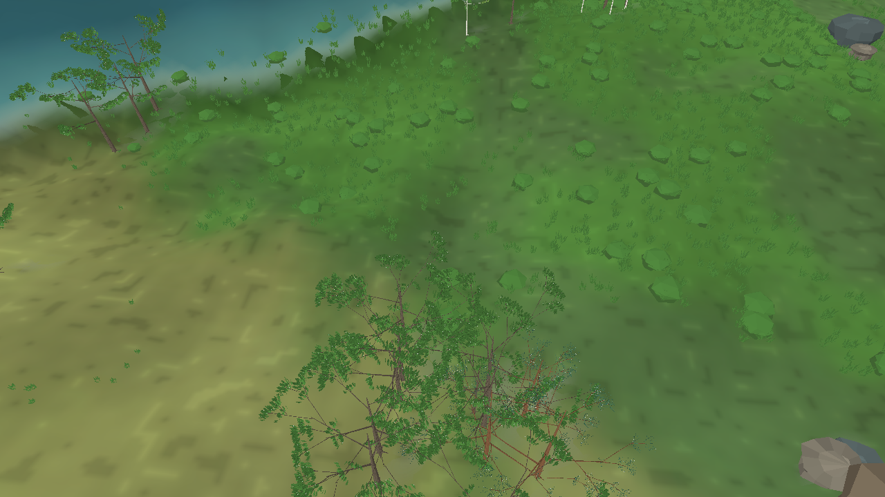

# Avaliação visual do renderer MonoGame — iteração 24 — 21/10/2026

**Estado:** animação de água migrada para shader, vegetação rasteira limitada à área visível e zoom próximo ampliado. A direção visual ainda está aberta.  
**Cena:** snapshot seed 2, tick 24.624, dia 172 (verão); apresentação pausada, sem fixtures de água por padrão.  
**Stack:** Release, C#/.NET 10, MonoGame DesktopGL.

## Uso de GPU e trabalho por quadro

O benchmark anterior mostrou aproximadamente 7–8% de uso da GPU 3D. A comparação entre 1280 × 720 e 1920 × 1080 não elevou o uso nem a taxa de quadros de forma significativa enquanto o renderer estava sincronizado com o passo fixo de 60 Hz. Isso apontava para animação e transferência de vértices no caminho da CPU, e não para falta de resolução ou para um limite de rasterização.

As ondas do mar e os reflexos da água agora são avaliados por um efeito MGFX carregado pelo pipeline de conteúdo do MonoGame. A superfície mantém atributos de direção derivados da drenagem do snapshot; o shader usa esses atributos para orientar os brilhos dos canais. O mar recebe deslocamento vertical e composição de ondas. As malhas ficam em buffers estáticos, removendo as atualizações CPU→GPU a cada quadro para essas superfícies. O novo caminho está em [Water.fx](../../src/Game.Client.Desktop/Content/Effects/Water.fx) e segue o [pipeline oficial de efeitos personalizados do MonoGame](https://docs.monogame.net/articles/getting_started/content_pipeline/custom_effects.html).

O executável mantém VSync e passo fixo como padrão. `--disable-vsync` desliga ambos para medir a capacidade sem o limite de apresentação; não altera o estado da simulação. Amostras de utilização 3D foram coletadas por PID nos contadores de GPU do Windows, em intervalos de aproximadamente 0,7 s.

| Modo | Resolução | FPS médio | P95 | P99 | Pico | CPU de um núcleo | GPU 3D média / pico | Working set | Memória privada |
|---|---:|---:|---:|---:|---:|---:|---:|---:|---:|
| VSync ligado | 1920 × 1080 | 60,00 | 16,97 ms | 17,33 ms | 44,39 ms | 34,3% | 8,39% / 10,73% | 1.296,8 MiB | 1.876,1 MiB |
| VSync ligado, incluindo reconstrução durante a captura | 1280 × 720 | 50,70 | 29,11 ms | 31,56 ms | 1.184,21 ms | 46,9% | 7,07% / 11,20% | 2.221,9 MiB | 3.061,2 MiB |
| Diagnóstico sem VSync e sem passo fixo | 1920 × 1080 | 288,10 | 3,91 ms | 4,36 ms | 437,56 ms | 104,2% | 21,26% / 41,75% | 2.056,6 MiB | 2.653,6 MiB |

A baixa utilização observada no modo normal é coerente com a saída limitada a 60 quadros/s. Sem o limite, a GPU chegou a 41,75% em uma amostra e a CPU de um núcleo passou de 100%; esta execução ainda não satura a GPU. Os dois benchmarks com VSync tiveram resultados diferentes: a captura de 1280 × 720 incluiu 1.167,11 ms na reconstrução de geometria de vegetação, enquanto a de 1920 × 1080 não incluiu reconstrução no intervalo medido. O pico de 437,56 ms do diagnóstico sem limite também inclui uma reconstrução. Esse custo ainda precisa ser movido para processamento incremental ou assíncrono. As leituras de GPU são amostras curtas de contadores do Windows, não um perfil completo nem uma medição de VRAM.

## LOD e alcance próximo

Antes, a malha de cobertura rasteira era gerada para as 65.536 células, mesmo em um enquadramento próximo. A construção agora projeta os cantos da câmera no plano de referência e considera apenas a faixa visível, com uma margem para a variação do relevo e das copas. Em zoom 8, a captura caiu de 3.746.499 para 547.035 vértices de cobertura (51.495 para 7.568 agrupamentos). Em zoom 12, foram gerados 383.358 vértices em 5.234 agrupamentos. Os limites de zoom passam a 12× para permitir inspecionar melhor a vegetação baixa.

O recorte mostra que há gramíneas e arbustos na escala próxima, mas também confirma que as copas ainda parecem ralas e os galhos ficam expostos. A maior contagem de folhas da iteração anterior não resolveu a forma da árvore. Não considero a vegetação aprovada; a próxima revisão deve priorizar a silhueta, a ligação entre galhos e folhas, e as diferenças de arquitetura entre perfis, medindo o custo junto da qualidade.

## Água, horizonte e evidência do snapshot

O céu continua removido. Nuvens, precipitação e suas sombras permanecem dependentes de estado atmosférico publicado. As fixtures de curso d’água e cachoeira ficam desativadas por padrão. No snapshot usado nesta avaliação existem 18 arestas de rio conectadas e 3 junções; nenhuma cachoeira atende aos critérios de conexão e desnível, então nenhuma foi desenhada. A geometria de água usa alturas interpoladas do estágio e a animação de canal acompanha a direção de drenagem. Nenhuma alteração foi feita no snapshot, na hidrologia, no RNG ecológico ou nos estados dos organismos.

As ondas do mar e o padrão de espuma agora têm variação espacial e temporal menos uniforme, mas continuam sendo uma aproximação visual estilizada. Não há simulação física de onda, reflexão, espuma volumétrica ou efeito de costa por vento. O shader não cria água onde o snapshot não indica superfície líquida.

## Registro técnico

- `dotnet build src/Game.Client.Desktop/Game.Client.Desktop.csproj --no-restore -c Release -p:BaseOutputPath=bin/iteration-24-gpu-water/`: êxito, 0 avisos e 0 erros; o MGCB compilou `Water.fx` para DesktopGL.
- `dotnet test Game.sln --no-restore -c Release -p:BaseOutputPath=bin/iteration-24-gpu-water/`: 24 aprovados, 0 falhas.
- Capturas e benchmarks usam o mesmo snapshot de verão. Nenhuma cachoeira de avaliação foi incluída.
- A cena continua abaixo da meta visual mínima nas copas, na densidade e na leitura da água; o desempenho observado não valida o hardware mínimo de 8 GB RAM / 4 GB VRAM.

