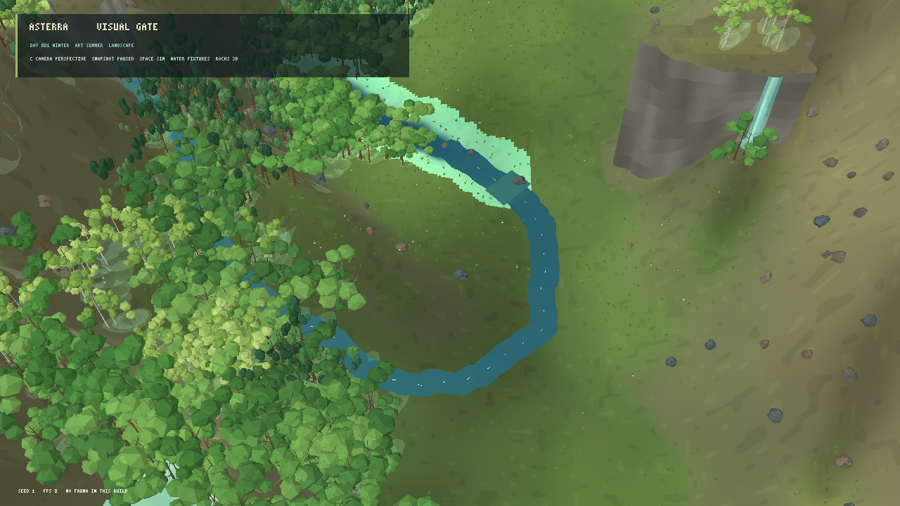
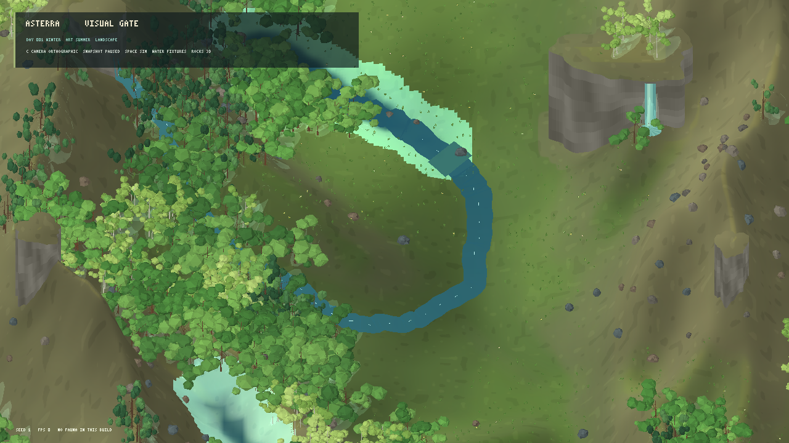
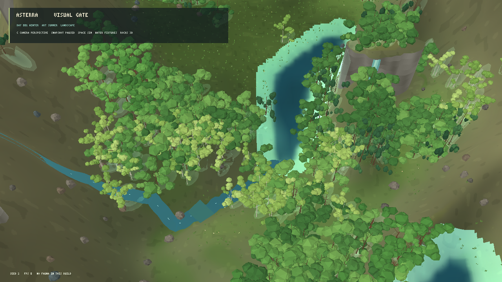
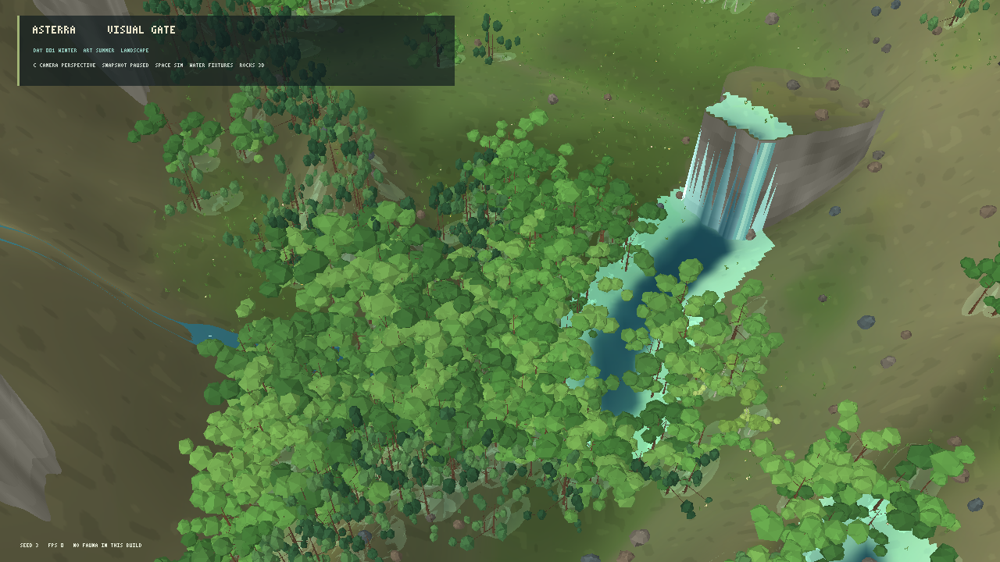

# Avaliação visual do renderer MonoGame — iteração 2 — 21/10/2026

**Estado:** a perspectiva segue como hipótese líder; gate visual continua reprovado.  
**Stack:** C#/.NET 10 e MonoGame DesktopGL.  
**Cena principal:** snapshot L0, seed 1, modo de avaliação pausado; seeds 2 e 3 usados para comparar a distribuição de água e flora.  
**Escopo:** segunda prova pequena de malhas 3D, cobertura de solo, materiais e câmeras; não é renderer de produção.

## O que mudou desde a primeira prova

- O terreno de avaliação usa uma cobertura contínua de cor calculada de campos do snapshot, com amostragem linear e maior resolução visual. O modo normal mantém uma textura mais barata.
- Copas broadleaf e coníferas usam volumes facetados irregulares em vez de folhas triangulares planas. A distribuição de gramíneas e flores deriva de campos publicados de biomassa, umidade, água e elevação.
- Rochas de avaliação têm escala maior e formas procedurais volumétricas. A cena de avaliação usa malhas suaves de sombra conformadas ao terreno; são uma aproximação pré-calculada, não sombras dinâmicas nem oclusão ambiente.
- A água do snapshot recebe uma suavização somente visual. Há também uma fixture de curso descendente construída a partir do campo de elevação e uma fixture de queda d'água para testar a leitura da composição. O HUD identifica as fixtures como `WATER FIXTURES`; elas não são processos hidrológicos simulados e não escrevem no snapshot.
- A apresentação recalcula a posição da vegetação no fechamento do dia simulado, e não a cada hora. Isso reduz o custo recorrente sem mudar a cadência científica nem seus RNGs.
- A estação visual da avaliação é verão para aproximar a paleta verde da referência. Ela não avança ou altera o calendário do snapshot.

## Capturas e comparação com a referência

Capturas 1280×720, seed 1, com a mesma área e posição de câmera:

| Projeção ou seed | Captura | Leitura |
|---|---|---|
| Seed 1, perspectiva |  | Melhor leitura de encostas, distância e paredão. O prado central ainda é grande e vazio; a água de fixture fica muito evidente. |
| Seed 1, ortográfica |  | Facilita comparar distribuição e escala, mas achata a profundidade e as paredes. |
| Seed 2, perspectiva |  | Melhor composição água–bosque e maior continuidade do lago/canal do snapshot; copas ainda repetem volumes facetados e margens expõem a grade. |
| Seed 3, perspectiva |  | Mais mata junto da água e uma queda visualmente forte; a densidade fica concentrada e a fixture ainda pode ser confundida com hidrologia real. |

Comparada à imagem de referência, a prova já mostra volume, variedade de altura e uma relação espacial entre mata, água e encosta. Ainda se distancia bastante: a referência tem composição mais ampla e equilibrada, transições de margem orgânicas, árvores com silhuetas mais diversas, copas menos repetidas, rochas integradas aos paredões e sombras que unificam a cena. O protótipo mostra apenas uma região de cerca de 44 células da grade 64×64; não satisfaz a composição de grade inteira descrita no gate visual.

| Critério | Nota 0–4 | Estado observado nesta iteração |
|---|---:|---|
| Terreno | 2 | Encostas e paredões têm volume. A superfície ainda parece uma malha lisa com material simples; faltam melhor leitura de cristas, platôs, escarpas e variação de detalhe. |
| Água | 2 | Seeds 2 e 3 exibem água de snapshot mais legível. A margem ainda denuncia a grade; o curso descendente e a queda demonstrativa são fixtures, não validação hidrológica. |
| Vegetação | 2 | Existem volumes arbóreos, coníferas, sub-bosque e flores. A copa facetada ainda repete a mesma linguagem e algumas áreas permanecem vazias ou agrupadas de forma abrupta. |
| Rochas | 2 | Pedregulhos são volumétricos e determinísticos, mas pequenos e escassos na vista ampla; faltam integração e diversidade de afloramentos. |
| Luz e profundidade | 2 | Facetas pré-sombreadas e malhas de sombra ajudam a separar copas e chão. Não há sombra geométrica dinâmica nem oclusão ambiente coerente entre todos os objetos. |
| Composição | 2 | Perspectiva aproxima mais da vista elevada da referência. A amostra é estreita, o prado vazio domina parte do seed 1 e o destaque da queda compete com a paisagem. |

O gate do documento de direção pede ao menos 3/4 em cada categoria. A cena não passa. Perspectiva é a hipótese principal para a próxima prova; ortográfica continua útil para inspeção de campos e posicionamento. Esta comparação não avaliou ainda billboards híbridos, shaders próprios, oclusão ambiente, 10× instâncias nem outros alvos de plataforma.

## Desempenho

Build Release concluído sem avisos ou erros. Nenhum teste automatizado foi executado nesta rodada. A medição usou 1280×720, MonoGame DesktopGL e 5 s de aquecimento; a amostra pausada é a cena rica de avaliação. A amostra ativa mede o cliente normal por 30 s e atravessa a reconstrução diária. VSync limita a média pausada a 60 FPS.

| Execução | Média | P95 | P99 | Máximo | Memória privada | CPU de um núcleo | Observações |
|---|---:|---:|---:|---:|---:|---:|---|
| Avaliação pausada, seed 1, perspectiva, 10 s | 60,00 FPS | 16,95 ms | 17,19 ms | 17,78 ms | 242,4 MiB | 17,2% | 451 árvores visíveis, 877.620 vértices de flora, 2.898 agrupamentos de cobertura, 226 flores, 16.236 vértices de sombra e 73 rochas. |
| Cliente normal ativo, seed 1, perspectiva, 30 s | 59,33 FPS | 17,59 ms | 44,91 ms | 159,98 ms | 305,4 MiB | 39,8% | Água: rebuild máximo 39,07 ms; sprites: 53,97 ms; textura de terreno: 53,24 ms. |

A cena pausada passa os limites locais de média ≥30 FPS, P95 ≤33,3 ms, P99 ≤50 ms e memória privada ≤1 GiB. O cliente normal ativo também passa média e P99, mas o frame máximo de 159,98 ms revela uma pausa perceptível durante a atualização diária. A próxima otimização deve escalonar ou dividir a geração dessa atualização sem reduzir dados científicos ou frequência de simulação. As medições são desta máquina Windows; não são uma garantia para GPUs ou plataformas diferentes.

## Contratos preservados

**Revisão posterior em 21/10/2026:** a captura e os benchmarks acima antecedem a política de cor fenologicamente fundamentada documentada em [FLORA_ARCHITECTURE.md](../specs/FLORA_ARCHITECTURE.md). O renderer deixou de forçar verão/outono para compor a imagem; folhas não recebem variação alaranjada por seed, e detalhes de flores foram desativados enquanto não houver estado de espécie/reprodução no snapshot. Por isso, os números e as flores descritas nesta medição são linha de base anterior a essa revisão, não uma captura da cena corrente.

- Câmera, meshes, texturas, sombras aproximadas, fixtures e cadência de cache são estado de apresentação.
- Flora visível usa campos e snapshots publicados e receitas determinísticas do renderer; ela não cria organismos no modelo científico.
- A fixture de curso de água e a fixture de cachoeira são identificadas como apresentação. Não são atribuídas ao snapshot hidrológico, não alteram parâmetros físicos e não consomem RNG ecológico.
- A avaliação em pausa permite comparar o mesmo snapshot. As alterações de apresentação não mudam o RNG do mundo, a conservação, a cadência, o estado nem os contratos dos módulos científicos.
- A simulação continua autorizada a usar campos/grades 2D mesmo com apresentação 3D.

## Reprodução

Abrir a cena rica do seed 2:

```powershell
dotnet run --project src/Game.Client.Desktop/Game.Client.Desktop.csproj -c Release -- --visual-evaluation --projection perspective --seed 2
```

Troque `--projection perspective` por `--projection orthographic` para comparar câmeras. `C` alterna a projeção e `Space` retoma os ticks. Para medir a avaliação pausada, acrescente `--benchmark-seconds 10`; para medir atualizações do cliente normal, retire `--visual-evaluation` e use `--benchmark-seconds 30`.

## Próximo passo técnico

Manter MonoGame e a perspectiva elevada como base experimental. Antes de ampliar a implementação, corrigir o pico da reconstrução diária e fazer uma terceira comparação com o mesmo recorte incluindo uma composição híbrida de billboards/elementos planos. Priorizar margem de água e integração de cascata, diversidade de silhuetas e densidade natural de sub-bosque; depois testar material de água/shader e oclusão/sombras. Só escolher a técnica de renderer depois de repetir as capturas, a rubrica e o perfil por seed; não ajustar a ciência para esconder limitações visuais.
