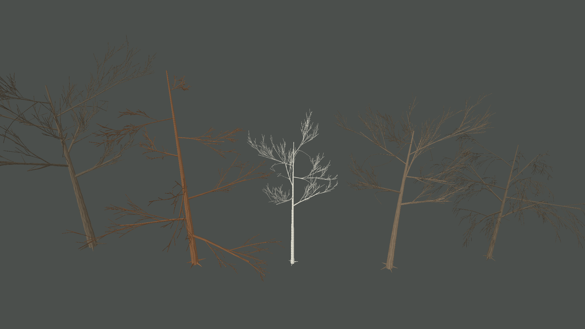
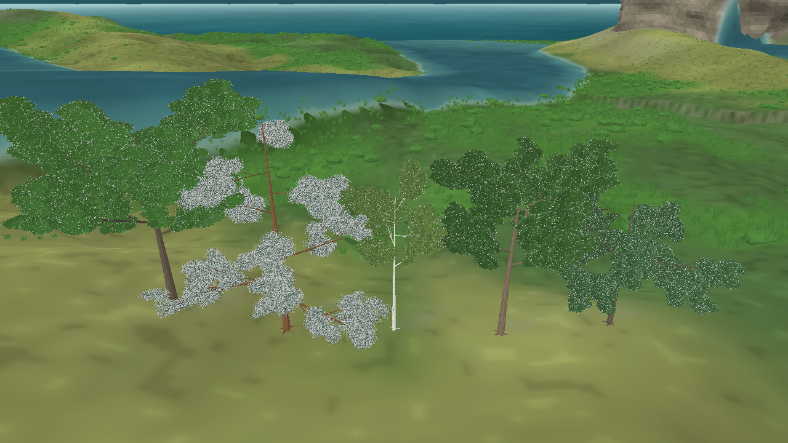

# Revisão da arquitetura dos galhos — iteração 38 — 22/10/2026

**Estado:** melhoria estrutural em andamento; as árvores ainda não atingem a referência. A próxima prioridade continua sendo arquitetura e leitura dos galhos.  
**Cena:** snapshot seed 2, tick 24.624, dia 172 (verão); cinco perfis renderizados em maturidade completa apenas para avaliação visual.  
**Stack:** Release, C#/.NET 10, MonoGame DesktopGL.

## O que mudou

O esqueleto agora usa curvas cúbicas subdivididas em 2 a 4 segmentos por ramo, com espessura afunilando ao longo do eixo. As ramificações secundárias distribuem seus filhos ao redor da direção do ramo e recebem variações determinísticas de ângulo, posição, comprimento e curvatura. Os perfis ganharam um quarto nível estrutural e mais ramos laterais. A malha usa seções transversais com mais lados nos troncos e nos ramos principais.

Essas mudanças só afetam a representação visual. A galeria força cinco arquétipos adultos para comparar formas; ela não altera maturidade, genótipo, biomassa, RNG ecológico nem o snapshot. Os perfis ainda são receitas visuais qualitativas, não parâmetros medidos de espécies reais.

## Comparação e limites

O modo `--tree-branches-only` oculta folhas, terreno e vegetação rasteira para expor o esqueleto. Ele confirma ramificações em várias ordens e diferenças de forma entre os cinco perfis. A captura completa mostra como esse esqueleto se integra à cena atual.

A comparação com `bmheojgbuqi91.jpg` ainda é desfavorável: os galhos têm curvatura e hierarquia, mas as junções continuam rígidas, a distribuição ainda parece proceduralmente regular e a forma dos ramos principais precisa de mais caráter por espécie. A captura completa também mostra copas em grupos separados; conforme a orientação mais recente, não ampliei a densidade da copa nesta revisão. O sistema não está aprovado como qualidade final.

## Custo observado

Na galeria sem folhas, os cinco indivíduos geraram 161.256 vértices de galhos. Na captura completa, a malha arbórea chegou a 2.005.176 vértices e a cobertura rasteira a 2.992.104 vértices, incluindo vegetação de fundo visível. Esses valores são contagens de geometria, não um benchmark de FPS, CPU, GPU ou VRAM. A complexidade do LOD próximo ainda precisa ser medida em uma cena representativa com muitas árvores.

## Registro técnico

- `dotnet build src/Game.Client.Desktop/Game.Client.Desktop.csproj -c Release -p:BaseOutputPath=bin/iteration-38-organic-branching/`: êxito, 0 avisos e 0 erros.
- Capturas reproduzíveis: `--visual-evaluation --tree-branches-only --projection perspective --camera-zoom 44 --capture-width 1920 --capture-height 1080 --snapshot-file <snapshot>` e `--visual-evaluation --tree-quality-view --projection perspective --camera-zoom 35 --snapshot-file <snapshot>`.
- Nenhuma alteração foi feita aos contratos científicos, ao estado da simulação ou aos parâmetros ecológicos. A suíte automatizada não foi executada nesta revisão.
