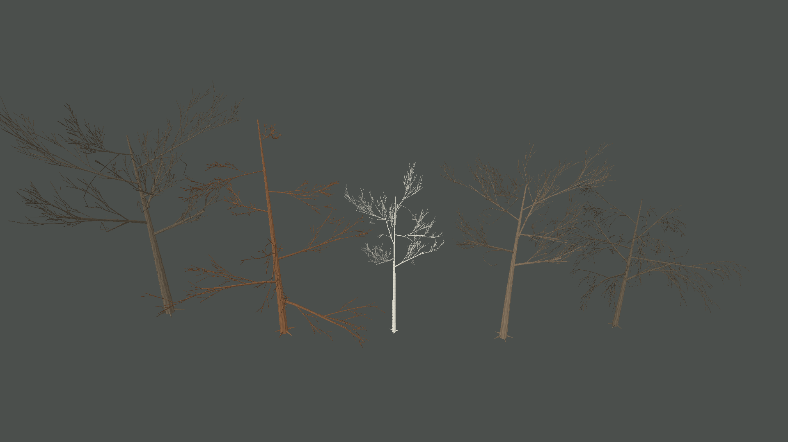
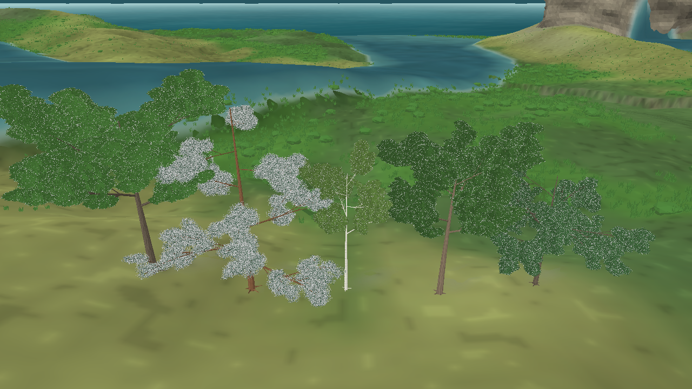

# Revisão dos ramos e brotos — iteração 39 — 22/10/2026

**Estado:** estrutura dos galhos em desenvolvimento; qualidade final ainda não atingida. Esta revisão atende à prioridade pedida: melhorar os galhos antes de retomar o trabalho das copas.  
**Cena:** snapshot seed 2, tick 24.624, dia 172 (verão); cinco perfis renderizados em maturidade completa somente para avaliação visual.  
**Stack:** Release, C#/.NET 10, MonoGame DesktopGL.

## Mudanças de estrutura

- Cada ramo segue uma curva cúbica e é dividido em segmentos, com raio afunilando da base à ponta.
- As ordens de galho usam seções transversais mais detalhadas nos troncos e nos ramos principais.
- Ramos filhos variam em ângulo, posição e comprimento e se distribuem ao redor do eixo de crescimento.
- O passe de colonização do espaço da copa aumentou para até 64 brotos adicionais nos perfis de folhas largas.
- A galeria `--tree-branches-only` oculta folhas e o cenário para permitir revisar tronco, galhos e brotos sem distração.

Os esqueletos já mostram hierarquia e formas diferentes, mas ainda parecem finos e mecânicos comparados à referência. A distribuição dos ramos principais por perfil, as junções e a silhueta da conífera continuam precisando de trabalho. A captura completa também confirma que as copas seguem abaixo da referência; elas ficaram congeladas nesta rodada para manter o foco nos galhos.

## Custo e validação

Na vista isolada, cinco indivíduos produziram 162.504 vértices de galhos. Na cena completa, foram 2.017.968 vértices nas árvores e 2.992.104 na cobertura rasteira visível. São contagens de geometria; ainda não medi FPS, CPU, GPU ou VRAM nesta configuração. O custo deve ser medido com uma população representativa depois da próxima revisão estrutural.

- Build Release: êxito, 0 avisos e 0 erros, em `bin/iteration-39-attractor-branchlets/`.
- Não foram alterados snapshots, estados biológicos, parâmetros ecológicos ou RNG da simulação. Os cinco indivíduos adultos e suas seeds existem somente no renderer de avaliação.
- A suíte automatizada não foi executada nesta revisão.
