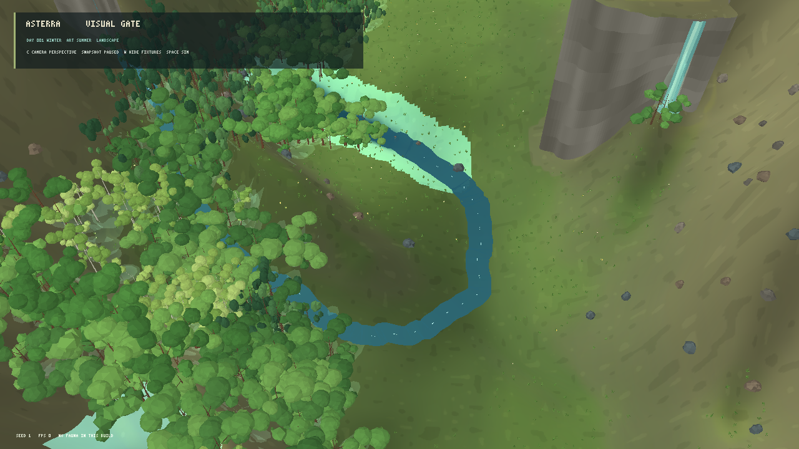
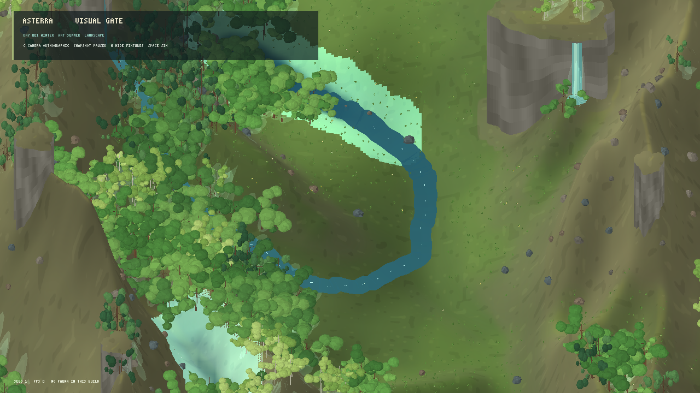
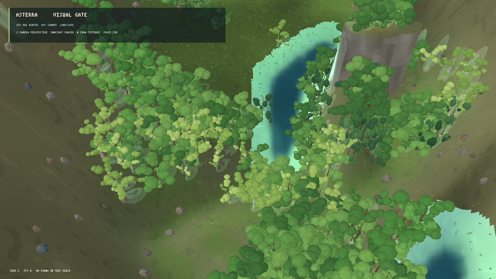
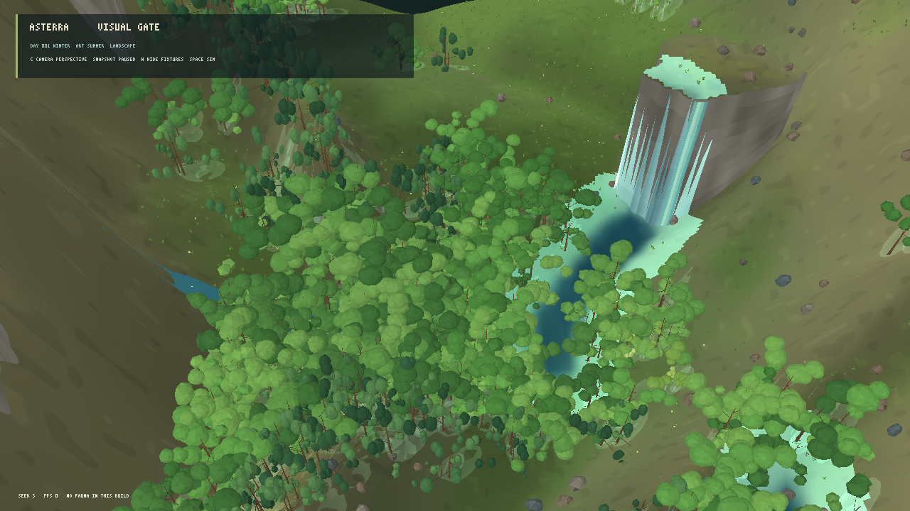

# Avaliação visual do renderer MonoGame — iteração 3 — 21/10/2026

**Estado:** perspectiva permanece líder; gate visual ainda reprovado.  
**Stack:** C#/.NET 10 e MonoGame DesktopGL.  
**Cena:** snapshots L0 pausados, seeds 1, 2 e 3; resolução das capturas 1280×720.  
**Escopo:** pequena prova de 3D estilizado com materiais e apresentação da água separada por toggle; não é renderer de produção.

## Ajustes guiados pela comparação anterior

- Copas de árvores próximas usam uma subdivisão geodésica da malha facetada, com sombreado de faces menos contrastado. Árvores distantes mantêm malhas mais leves. As formas ficam mais arredondadas, mas ainda repetem uma linguagem de copa em blocos.
- O modo de avaliação exagera a altura visual do relevo em 1,4× ao redor da elevação média e usa perspectiva de 32°. Isso melhora a leitura de encostas sem alterar `ElevationM`, hidrologia, vegetação ou qualquer outro dado do snapshot. O cliente normal mantém escala 1×.
- O renderer não desenha um fragmento de um ou dois elos de drenagem como se fosse um rio completo. Componentes superficiais muito pequenos e isolados também são filtrados na máscara visual; o campo de água do snapshot continua intacto.
- As extremidades do curso descendente de avaliação afunilam para evitar terminais quadrados.
- `W` alterna o curso e a cachoeira de fixture; `--snapshot-water-only` inicia sem as fixtures. Isso permite examinar a água apresentada a partir do snapshot separadamente do exemplo artístico. Os dois modos continuam pausados no mesmo snapshot.
- O modo de verão e todos os objetos decorativos continuam ligados a receitas determinísticas e a campos publicados.

## Evidência visual

| Cena | Captura | Observação |
|---|---|---|
| Seed 1, perspectiva |  | A perspectiva comunica distância e deixa a margem de um curso longo visível. Ainda há um campo vazio grande e uma encosta lisa. |
| Seed 1, ortográfica |  | Mantém a distribuição comparável, mas comprime o paredão e a distância. |
| Seed 2, perspectiva |  | Melhor composição entre bosque, lago e encosta nesta amostra. As margens ainda mostram a resolução do campo e as copas são repetitivas. |
| Seed 2, só água do snapshot |  | A fixture sai da apresentação; o snapshot ainda fornece um lago amplo. Esta captura não atribui a queda d'água à simulação. |
| Seed 3, perspectiva |  | Bosque denso acompanha a água, mas árvores escondem partes da margem e a queda de teste é dominante. |

Em relação à referência, a cena agora separa melhor os volumes das copas e deixa o relevo mais evidente. Ainda faltam uma silhueta muito mais variada de árvores, folhagem em escalas menores, transição entre vegetação e solo, margens orgânicas, rochas maiores e melhor união de luz e sombras. O recorte usa aproximadamente 44 células de um mundo de 64×64, e por isso ainda não testa a vista ampla completa do gate.

| Critério | Nota 0–4 | Avaliação desta iteração |
|---|---:|---|
| Terreno | 2 | A escala vertical maior destaca paredes e encostas. Os vales ainda são suaves e parte dos platôs parece uma superfície simples. |
| Água | 2 | O seed 2 oferece um lago legível e a alternância de fixtures torna explícita a fronteira entre snapshot e apresentação. Margens ainda têm bordas escalonadas; a fixture de cascata não comprova uma cachoeira simulada. |
| Vegetação | 2 | Copas arredondadas ajudam a silhueta. Espécies e árvores individuais continuam parecidas; o sub-bosque e as gramíneas não produzem a cobertura miúda da referência. |
| Rochas | 2 | Pedregulhos têm volume, mas são pequenos e esparsos; os paredões têm bandas regulares. |
| Luz e profundidade | 2 | Relevo exagerado, facetas e malhas de sombra aproximadas aumentam a separação. Faltam sombras geométricas coerentes e oclusão ambiente. |
| Composição | 2 | A perspectiva é a melhor opção entre as duas testadas. Os seeds 2 e 3 funcionam melhor que o seed 1 para água e bosque, mas nenhum enquadra o mundo inteiro ou iguala a riqueza e o equilíbrio da referência. |

O critério registrado em `docs/22_VISUAL_DIRECTION_AND_TECHNOLOGY.md` exige pelo menos 3/4 em cada categoria; a técnica ainda não passa o gate visual.

## Desempenho

Build Release concluído sem avisos nem erros. Não executei testes automatizados nesta avaliação. Benchmarks usam 5 s de aquecimento e VSync; a amostra pausada mede a cena rica de avaliação, enquanto a amostra ativa mede o cliente normal ao atravessar uma atualização diária.

| Execução | Média | P95 | P99 | Máximo | Memória privada | CPU de um núcleo | Custos de reconstrução |
|---|---:|---:|---:|---:|---:|---:|---|
| Avaliação pausada, seed 2, perspectiva, 10 s | 60,00 FPS | 16,99 ms | 17,32 ms | 17,76 ms | 347,7 MiB | 17,7% | 533 árvores, 1.995.279 vértices de flora, 2.698 agrupamentos de cobertura, 217 flores, 19.188 vértices de sombra e 53 rochas. |
| Cliente normal ativo, seed 1, perspectiva, 30 s | 59,17 FPS | 17,34 ms | 47,08 ms | 156,88 ms | 304,2 MiB | 44,4% | Água: 32,51 ms; flora/sprites: 54,45 ms; textura: 49,25 ms no pior rebuild amostrado. |

A cena pausada passa os limites locais de FPS, percentis e memória. O modo ativo também passa P99 ≤50 ms, mas o máximo de 156,88 ms é um hitch perceptível na atualização diária e segue como gargalo. Esta execução não representa um ensaio de 10× instâncias ou outros alvos de plataforma.

## Contratos e operação

- Nenhuma alteração desta rodada escreve nos estados científicos nem modifica os parâmetros físicos ou biológicos. A escala 1,4× só transforma alturas na apresentação do modo de avaliação.
- As receitas visuais consomem o snapshot; o filtro da máscara e o curso de água são escolhas do renderer. O flag `--snapshot-water-only` e a tecla `W` mudam somente a visualização.
- A amostra avaliada continua sendo parcial. A etapa seguinte deve validar uma área maior sem ampliar os campos de ciência e perfilar a reconstrução diária antes de aumentar a densidade de instâncias.

## Reprodução

```powershell
dotnet run --project src/Game.Client.Desktop/Game.Client.Desktop.csproj -c Release -- --visual-evaluation --projection perspective --seed 2
dotnet run --project src/Game.Client.Desktop/Game.Client.Desktop.csproj -c Release -- --visual-evaluation --projection perspective --seed 2 --snapshot-water-only
```

`C` alterna ortográfica/perspectiva, `W` alterna fixtures de água e `Space` retoma a simulação. Para repetir os perfis, acrescente `--benchmark-seconds 10` com a avaliação pausada ou rode o cliente sem `--visual-evaluation` e acrescente `--benchmark-seconds 30` para atravessar a atualização diária.

## Decisão e próximo avanço

Manter MonoGame e a perspectiva elevada como hipótese líder. O aumento da malha de copas se manteve dentro dos limites do benchmark pausado, então pode seguir nas próximas comparações. A prioridade é dividir o rebuild diário para remover o hitch; em paralelo, testar materiais/shader de água e uma composição híbrida com billboards para folhagem pequena. Repetir a rubrica com o mundo inteiro, conferir as margens e a identidade de cada espécie, e só então consolidar a técnica de produção. Não alterar a simulação para compensar limitações de renderer.
