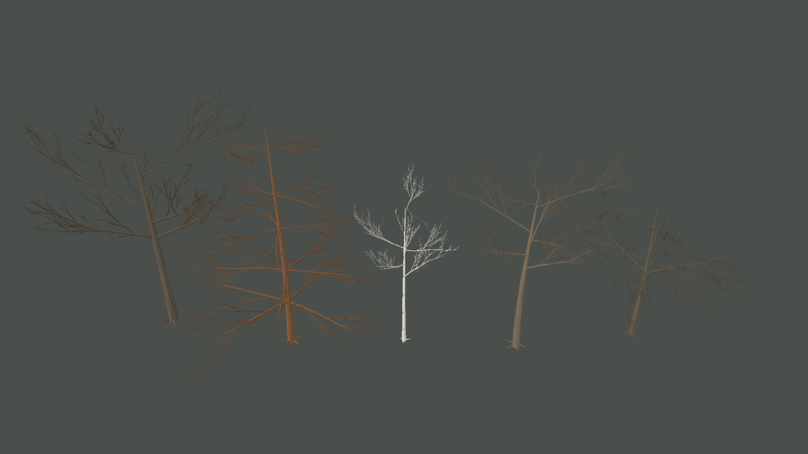
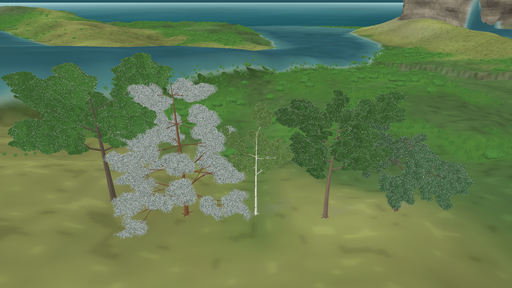

# Revisão estrutural das árvores e pesquisa de geradores — iteração 40 — 22/10/2026

**Estado:** etapa incremental focada em troncos e galhos. A árvore ainda não alcança a qualidade da referência; não alterei a malha nem os parâmetros visuais das folhas/copa. Ramos novos geram seus pontos foliares associados normalmente.  
**Cena:** snapshot seed 2, tick 24.624, dia 172; cinco arquétipos adultos render-only.  
**Stack:** Release, C#/.NET 10, MonoGame DesktopGL.

## Diagnóstico do gerador atual

- `ProceduralTreeGenerator` já separa o esqueleto botânico da geometria MonoGame. O esqueleto usa perfis fixos qualitativos, tronco por segmentos, ramificação recursiva em quatro ordens, curvas cúbicas, afunilamento e uma passagem limitada de Space Colonization para brotos de árvores de folhas largas.
- A altura, inclinação e espessura são determinísticas por perfil, maturidade visual e seed. O tronco tinha inclinação global suave; as posições primárias eram espaçadas quase uniformemente; os filhos recebiam o raio da ponta do ramo pai, mesmo quando nasciam perto da base.
- O renderer construía um tubo separado para cada pequeno segmento. Cada tubo escolhia um novo referencial e reiniciava as coordenadas locais da seção, produzindo torções, costuras e junções rígidas.
- Folhagem é anexada a posições no grafo, mas os arquétipos e seus valores ainda não são calibrados a espécies medidas. As copas e a densidade de folhas seguem aquém das imagens enviadas.
- A geometria é montada quando a apresentação reconstrói os objetos visíveis e fica em buffers GPU para desenho. Não há cache reutilizável de esqueletos individuais por seed/perfil/idade; o gerador não é executado a cada quadro normal de desenho.
- A Biosfera fornece o snapshot e seeds visuais derivadas. O renderer não escreve estado biológico nem consome o RNG ecológico. Nenhum contrato ou parâmetro da simulação foi alterado.

## Mudanças implementadas

- O eixo do tronco usa dez seções e uma curvatura em “S” de amplitude pequena, além da inclinação determinística existente.
- Os ramos primários de folhas largas usam posições de inserção irregulares, mas ordenadas e reproduzíveis pela seed. O pinheiro usa cinco níveis com quatro ramos em cada verticilo, preservando um líder dominante.
- O ramo filho calcula seu raio a partir do raio local do pai na posição de inserção, em vez de herdar sempre o raio terminal do pai. Isso dá sustentação mais plausível aos ramos que nascem perto da base.
- Segmentos consecutivos da mesma ordem agora formam uma malha tubular contínua. A seção transversal é transportada ao longo da curva, sem reiniciar o quadro em cada segmento, e a ponta recebe um estreitamento final.
- A quantidade e as posições dos ramos primários permanecem estáveis entre LODs. LOD ainda reduz subdivisões, ordens mais finas, ramificações secundárias e locais foliares; portanto, a silhueta completa ainda pode mudar parcialmente à distância.
- O algoritmo continua híbrido: hierarquia recursiva com perfis parametrizados para a estrutura principal e Space Colonization de orçamento fixo para brotos de folhas largas. Não foi introduzida dependência externa, código de Unity, asset ou textura. O atlas de materiais existente foi preservado.

Na vista isolada, os ramos primários estão mais espessos e a conífera mostra níveis reconhecíveis de ramificação. Os trechos de cada ramo agora curvam sem torções entre seções. As junções entre ramos diferentes ainda são interseções de tubos separados; a malha não funde o xilema em bifurcações suaves. A vista completa confirma que as copas continuam fragmentadas e que a árvore inteira ainda fica distante da referência. Os parâmetros de forma e tamanho da copa ficaram congelados nesta etapa.

## Pesquisa dos repositórios indicados

Os repositórios foram consultados em 22/10/2026, nos commits indicados abaixo. Foram estudados como referências algorítmicas; nenhum código ou asset foi copiado.

| Referência e commit | Técnica observada | Aplicação/limite para o Gênesis |
|---|---|---|
| [EZ-Tree](https://github.com/dgreenheck/ez-tree/tree/dcf309b), `dcf309b` | Gera um esqueleto determinístico antes de criar a geometria. Seus LODs amostram as mesmas seções, mantendo as pontas e a silhueta do esqueleto; raio, taper, curvatura, força e níveis de ramificação são parâmetros por ordem. | A separação já existe no Gênesis. A preservação de extremidades entre LODs motivou manter as inserções primárias fixas. Próximo passo é manter também as extremidades dos ramos estruturais escolhidos, reduzindo somente sua malha. |
| [MTree](https://github.com/GoodPie/modular_tree/tree/ab71f84), `ab71f84` | Modelo de nós de crescimento com regras para vigor, dominância apical, quebra, bifurcação, gravidade e raio. A geometria percorre splines e constrói anéis de seção. O addon é Blender; o núcleo tem licença própria. | Inspira adicionar controles por ordem e, no futuro, vigor/dominância para formas diferentes. Uma simulação temporal completa não cabe no snapshot biológico atual e não deve ser simulada dentro do renderer. |
| [Space Colonization](https://github.com/jakobrichert/space-colonization/tree/34966a3), `34966a3` | `tree.c` associa cada atrator ao nó mais próximo dentro do raio de influência, soma direções e estende novos nós. Uma grade espacial acelera busca e remoção; uma regra de estagnação direciona ramos individualmente quando a média cancela. A espessura no código é proporcional à raiz quadrada da contagem de folhas descendentes. | O passe do Gênesis usa poucos atratores e orçamento baixo; sua busca direta permanece limitada e não justifica uma grade/KD-tree agora. A espessura por carga descendente é uma heurística útil, mas precisa de validação antes de substituir o raio por perfil. |
| [SeedThree](https://github.com/SkyeShark/SeedThree/tree/cf2eaad), `cf2eaad` | Subconjunto parametrizado de Weber–Penn com número de ordens, quantidade de filhos, forma da copa, espaçamento não linear, jitter, verticilos, atração vertical, curvatura e taper; uma etapa separada converte caules amostrados em tubos. O projeto declara `v0.1.0-alpha`. | É a referência mais direta para enriquecer `TreeRenderProfile` sem criar um gerador diferente por espécie. Os controles de posição/curva por ordem são candidatos ao próximo passo; os valores não devem ser copiados como biologia validada. |
| [Unity Space Colonization](https://github.com/jasonwebb/unity-space-colonization/tree/51c6683), `51c6683` | Exemplo C# com KD-tree para associar atratores, nós pais/filhos e geração de raios por segmento. O README também requer um `TubeRenderer` comercial para a apresentação dos galhos. | A parte do algoritmo é independente do motor e confirma o modelo de associação pai/filho; o projeto e seu renderer não são dependências adequadas. Nada de Unity ou TubeRenderer foi introduzido. |

## Validação e custo observado

| Vista | Iteração 39 | Iteração 40 | Diferença |
|---|---:|---:|---:|
| Esqueletos isolados, 5 árvores | 162.504 vértices | 186.168 vértices | +14,6% |
| Cena completa, malha arbórea | 2.017.968 vértices | 2.148.432 vértices | +6,5% |
| Cena completa, cobertura rasteira | 2.992.104 vértices | 2.992.104 vértices | sem mudança |

Essas contagens vêm das capturas com a mesma resolução e snapshot; não são medidas de FPS, CPU, GPU ou VRAM. O aumento vem das seções adicionais do tronco, dos verticilos do pinheiro e dos ramos e pontos foliares associados. O desempenho ainda precisa ser medido com uma população florestal representativa.

- `dotnet build src/Game.Client.Desktop/Game.Client.Desktop.csproj -c Release -p:BaseOutputPath=bin/iteration-40-final-build/`: êxito, 0 avisos e 0 erros.
- `dotnet test tests/Game.Tests/Game.Tests.csproj -c Release -p:BaseOutputPath=bin/iteration-40-final-validation/ --no-restore`: 33 aprovados, 0 falhas.
- Novos testes verificam hierarquia e continuidade de segmentos, associação da folhagem a ramos, determinismo por seed, variação entre indivíduos e posições dos ramos primários estáveis entre LODs.

## Próxima etapa

1. Usar os parâmetros de perfil por ordem do Weber–Penn como inspiração para controlar comprimento, ângulo, inserção, curvatura e densidade de ramificação sem impor valores não documentados.
2. Revisar bifurcações e relação de espessura entre ramo pai e filhos; a malha ainda usa tubos separados nos nós.
3. Capturar cada espécie e os mesmos indivíduos em diferentes ângulos e LODs e medir tempo de geração/desenho com uma população representativa.
4. Só depois retomar a organização das copas e os grupos de folhagem associados aos ramos terminais.
