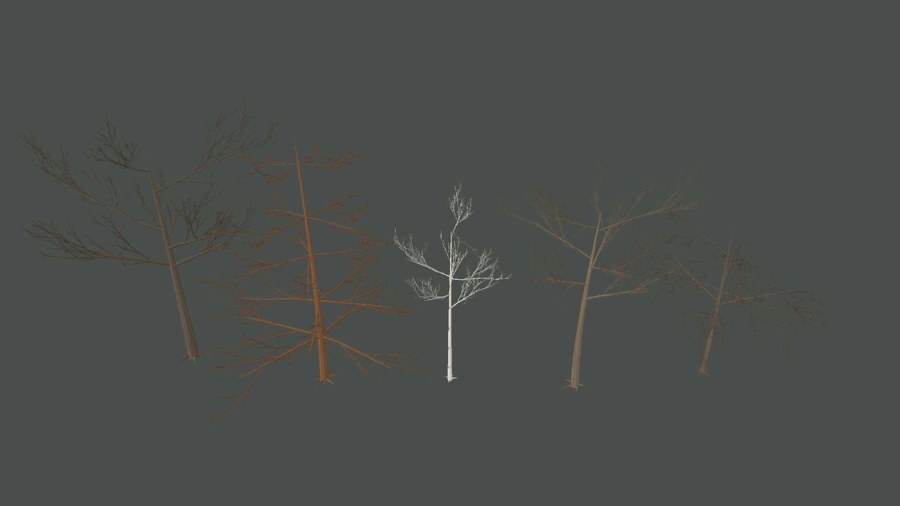
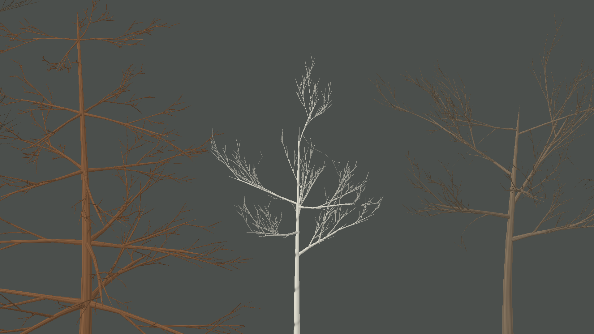
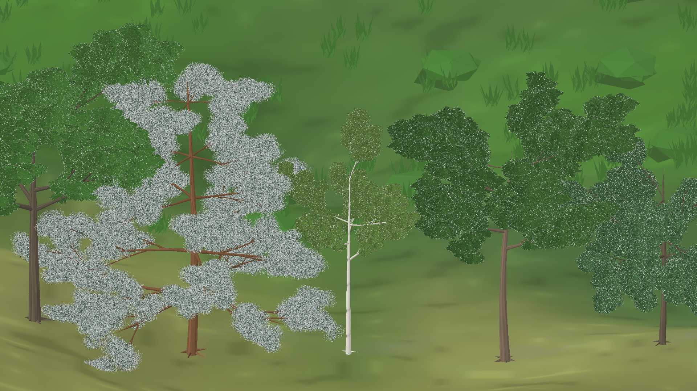

# Revisão das junções e espessura dos galhos — iteração 41 — 22/10/2026

**Estado:** rodada incremental focada em galhos. A arquitetura completa ainda não alcança a referência; as copas ficaram congeladas e as bifurcações ainda não são uma malha orgânica fundida.
**Cena:** snapshot seed 2, tick 24.624, dia 172; cinco arquétipos adultos render-only.
**Stack:** Release, C#/.NET 10, MonoGame DesktopGL.

## Diagnóstico e decisões

A captura isolada da iteração 40 confirmou que a hierarquia e a curvatura dos ramos estavam presentes, mas a relação entre o eixo principal e as bases dos galhos permanecia fina e mecânica. Um primeiro teste inseriu dois anéis extras em cada raiz de galho para formar colares. A leitura visual pouco mudou e a malha isolada passou de 186.168 para 274.680 vértices (+47,5%); por isso o método foi descartado.

O renderer agora usa um raio de raiz maior no primeiro anel existente do galho. A seção fica embutida no eixo parental e afunila ao longo do galho. O limite é calculado a partir do raio local do ramo pai e do raio inicial do filho. Nas inserções dos galhos primários, o tronco recebe uma expansão curta em três anéis interpolados para suavizar sua silhueta. As pontas terminam com 2% do raio anterior, formando uma terminação mais aguda sem novos segmentos.

O raio relativo dos ramos primários passou a ser um parâmetro de `TreeRenderProfile`. Os arquétipos atuais usam 0,48 para o pinheiro e 0,62–0,67 para as quatro formas de folhas largas. Esses valores são receitas visuais qualitativas, não medidas de espécies botânicas. O parâmetro permite diferenciar sustentação e arquitetura sem introduzir dependência de renderização na Biosfera.

As raízes dos galhos principais agora têm mais presença, o eixo parental engrossa discretamente nas inserções primárias e as pontas ficam mais finas. A silhueta das bifurcações melhorou de forma limitada: ainda são tubos sobrepostos, sem superfície fundida ou normais compartilhadas no nó, e as interseções continuam visíveis de perto. Na vista completa, a folhagem ainda esconde partes da hierarquia e as copas continuam mais fragmentadas que a referência. Esta rodada não alterou a organização das copas.

## Validação estrutural

Foi acrescentado um teste parametrizado para os cinco perfis. Ele verifica que ramificações de ordens diferentes apontam para um segmento parental próximo da posição de inserção e que o filho não excede o raio local do pai. O limite aceita raio igual quando o passe de Space Colonization prolonga um ramo a partir de sua ponta.

- Build Release do cliente: êxito, 0 avisos e 0 erros.
- Testes focados de `ProceduralTreeStructureTests`: 14 aprovados, 0 falhas.
- Suíte completa de testes: 38 aprovados, 0 falhas.
- Malha dos cinco esqueletos isolados: 191.028 vértices (+2,6% sobre os 186.168 da iteração 40).
- Malha arbórea na cena completa: 2.153.292 vértices (+0,2% sobre os 2.148.432 da iteração 40).
- Cobertura rasteira nesta captura da cena completa: 109.536 vértices; a configuração de captura difere da contagem de cobertura registrada na iteração 40, então não há comparação direta desse buffer.

As contagens arbóreas usam a mesma resolução e snapshot. A pequena elevação vem dos três anéis extras em cada inserção primária do tronco; a tentativa anterior com dois anéis por raiz de galho elevava o custo em 47,5%. Não foram medidos FPS, tempo de CPU, GPU ou VRAM nesta rodada. A população visual é uma galeria de cinco árvores, não um benchmark de floresta.

## Compatibilidade e limites

O gerador continua produzindo primeiro um grafo determinístico independente de MonoGame; o renderer constrói as seções tubulares a partir dele. Seeds visuais continuam separadas do RNG ecológico. Não foram alterados snapshots, contratos, simulação, crescimento biológico, textura ou material.

As técnicas seguem a leitura da iteração 40: perfis paramétricos inspirados em Weber–Penn/SeedThree, vigor e gravidade como regras estruturais, Space Colonization limitado a brotos de folhas largas, e seções varridas em curva. EZ-Tree e o exemplo em C# de Unity permanecem referências conceituais; nenhum código, asset, biblioteca Unity ou TubeRenderer foi adicionado. O comparativo completo dos repositórios está em [iteração 40](VISUAL_RENDERER_EVALUATION_ITERATION_40_2026-10-22.md).

## Próxima etapa

1. Resolver junções entre ordens com uma superfície contínua ou patch local, comparando custo e silhueta com os tubos atuais.
2. Inspecionar a mesma árvore de outros ângulos e em uma população, pois galhos que parecem unidos de frente ainda podem se separar em profundidade.
3. Só depois retomar agrupamentos foliares e silhueta das copas, mantendo cada agrupamento associado a ramos terminais reais.
4. Medir construção de malha, draw calls e memória com uma floresta representativa antes de escalar a densidade.
