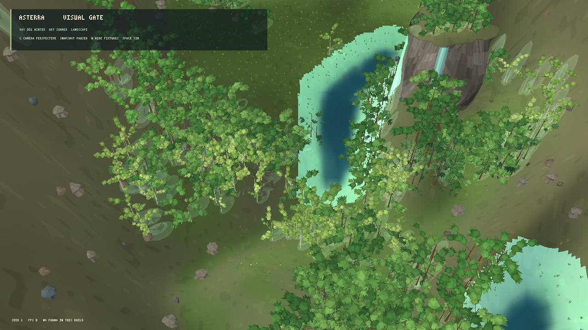
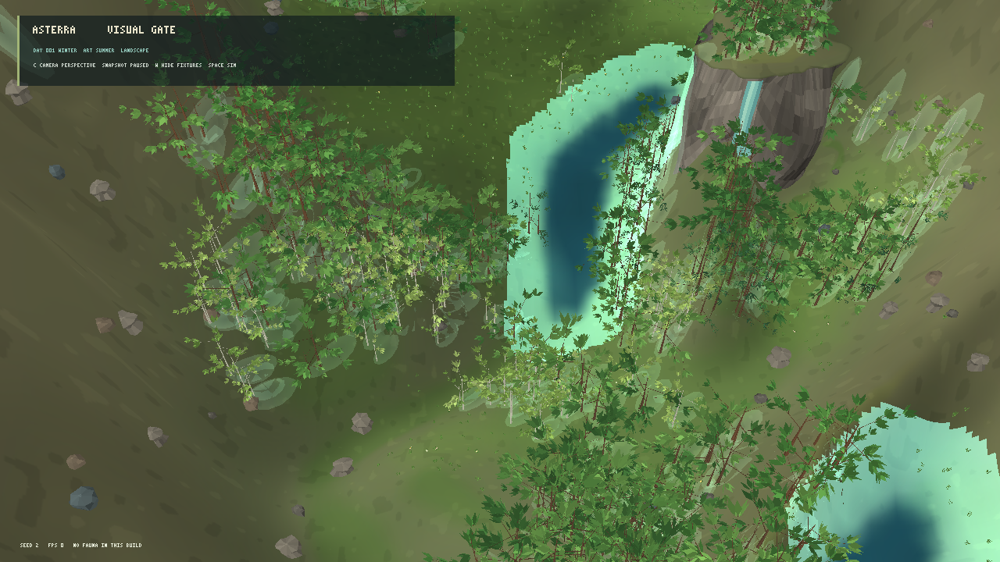
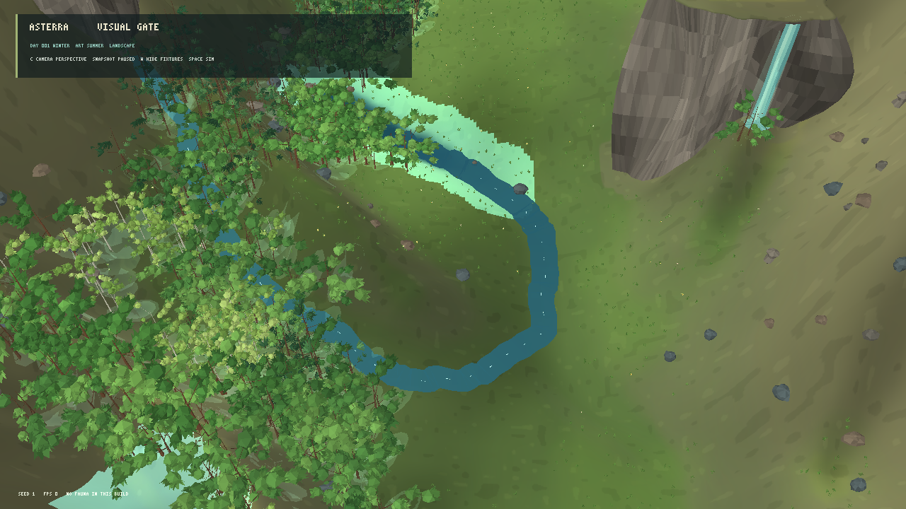
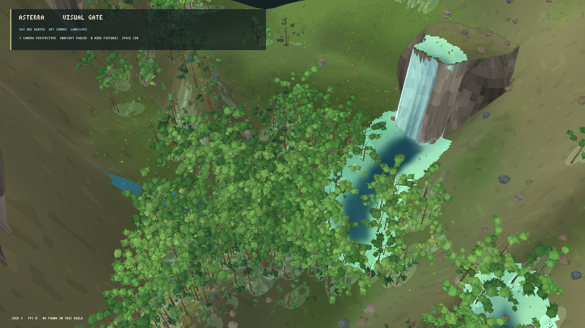
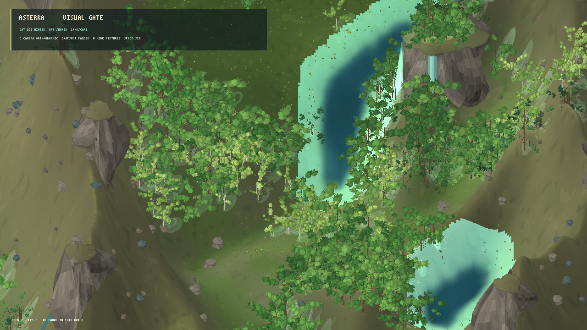
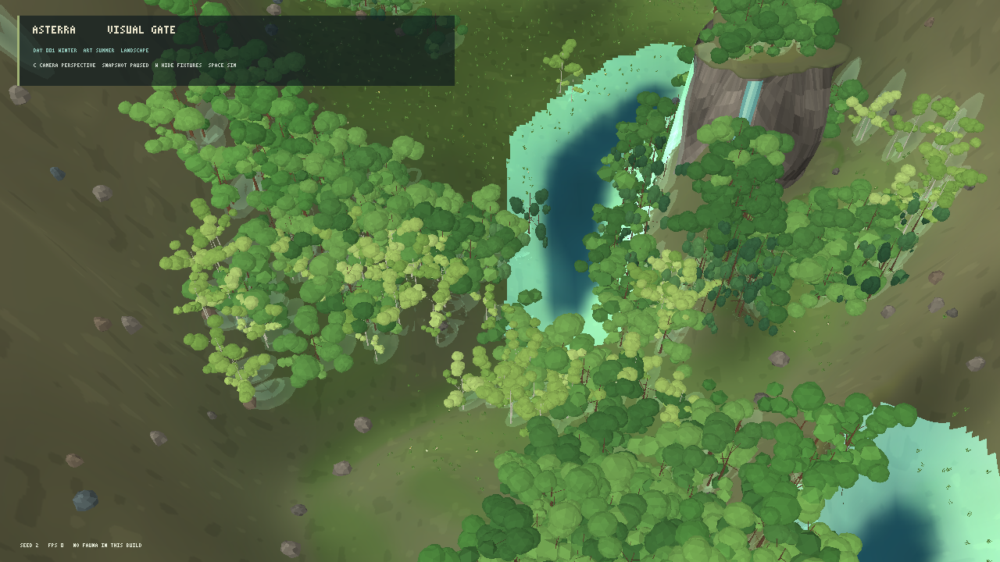

# Avaliação visual do renderer MonoGame — iteração 4 — 21/10/2026

**Estado:** 3D estilizado permanece como hipótese líder; gate visual ainda reprovado. A composição híbrida de copas é uma candidata para a próxima cena comparativa, não uma decisão de produção.  
**Stack:** C#/.NET 10 e MonoGame DesktopGL.  
**Cena:** snapshots L0 pausados, seeds 1, 2 e 3; capturas em 1280×720.  
**Escopo:** experimento de apresentação sobre a pequena cena existente. Não altera o modelo científico nem fecha a implementação gráfica do cliente.

## Pesquisa aplicada e alterações

- O gerador botânico continua criando um grafo hierárquico de tronco e galhos, com locais foliares nos ramos. A mudança desta iteração está no renderer: os locais de folhas largas agora recebem lâminas tridimensionais agrupadas e um núcleo de copa facetado em baixa resolução. Coníferas recebem leques de agulhas estreitas. Os dados estruturais, a geração determinística e os perfis de espécie não foram alterados.
- O núcleo facetado mantém cobertura de copa em vista distante; as lâminas quebram parte da silhueta arredondada e tornam galhos e folhagem mais legíveis. Uma tentativa somente com lâminas foi descartada: ela reduziu a malha para 1.133.679 vértices, mas deixou as copas esparsas e excessivamente ramificadas. A combinação usa 1.683.051 vértices e preserva melhor a leitura de massa vegetal.
- Paredões de fixture usam perturbação determinística radial e vertical, com iluminação por face, reduzindo a aparência de bandas lisas. O construtor de rochas agora possui quatro perfis de contorno, altura e número de lados; a variação entre pedregulhos é perceptível, mas ainda modesta na vista ampla.
- O protótipo continua consumindo o snapshot publicado e mantendo fixtures de apresentação separadas. Não houve alteração de câmera, geometria ou shader nos estados simulados, RNG ecológico ou parâmetros físicos/biológicos.

## Evidência visual

| Cena | Captura | Observação |
|---|---|---|
| Seed 2, perspectiva, copa híbrida |  | Melhor equilíbrio testado entre massa de copa e folhas/galhos visíveis. Ainda aparecem núcleos arredondados e troncos finos; a cobertura não tem a textura fina e a variedade da referência. |
| Seed 2, teste só com lâminas |  | As copas ficam transparentes demais e parecem brotos esparsos. Não foi adotado. |
| Seed 1, perspectiva |  | A rede de água é visível, mas a área aberta e o paredão de fixture dominam a composição. |
| Seed 3, perspectiva |  | Bosque mais denso evidencia a variação de copas, mas esconde margens e continua distante da vista ampla da referência. |
| Seed 2, ortográfica |  | Enquadra a mesma região, mas comprime a altura do paredão, a queda e a profundidade do vale. A perspectiva permanece preferível nesta cena. |
| Parede rochosa irregular |  | Facetas verticais irregulares são mais legíveis que as bandas regulares da iteração anterior. A forma ainda lembra um bloco alto isolado. |

### Comparação com a referência

A referência mostra uma região extensa e equilibrada, com bosque denso atravessando prados, várias margens orgânicas, afloramentos integrados e água que percorre o vale. A prova atual enquadra um recorte pequeno: uma mancha de floresta, áreas vazias grandes, uma superfície de água simplificada e uma queda de água demonstrativa. A vista não cobre a grade L0 inteira.

As lâminas acrescentam variação à folhagem, mas o resultado ainda alterna entre núcleos arredondados e ramos aparentes. Não há diferença suficiente entre as silhuetas das espécies na escala de vista. A superfície do terreno permanece lisa e quase uniforme; as pedras continuam pequenas e separadas; a queda é uma fixture de apresentação e não uma cachoeira comprovada pelo snapshot. Sombras aproximadas ajudam a separar volumes, mas não substituem sombras geométricas consistentes ou oclusão ambiente. Água, margens, composição e luz ainda não comunicam a integração vista na referência.

| Critério | Nota 0–4 | Evidência desta iteração |
|---|---:|---|
| Terreno | 2 | Parede irregular e diferença de altura são mais claras; encostas, vales, platôs e transições ainda têm pouca variação de material e escala. |
| Água | 2 | Perspectiva mostra o curso e a bacia; bordas ainda são simplificadas e a cachoeira é explicitamente uma fixture. |
| Vegetação | 2 | Folhas direcionais e núcleos de copa equilibram detalhe e densidade; espécies e indivíduos ainda não têm silhuetas suficientemente distintas. |
| Rochas | 2 | Quatro perfis aumentam variedade de forma, mas os pedregulhos são pequenos e não formam afloramentos integrados ao relevo. |
| Luz e profundidade | 2 | Facetas recebem sombreado direcional; as sombras de copas são aproximadas e faltam oclusão e coerência entre todas as superfícies. |
| Composição | 2 | A perspectiva é a líder no mesmo recorte; nenhum seed cobre a escala ou o equilíbrio da imagem de referência. |

O gate de `docs/22_VISUAL_DIRECTION_AND_TECHNOLOGY.md` exige pelo menos 3/4 em cada categoria. Esta técnica ainda não passa.

## Desempenho observado

Build Release da variante avaliada concluído sem avisos nem erros. Benchmark pausado de 10 s, com aquecimento de 5 s, VSync e resolução 1280×720:

| Execução | Média | P95 | P99 | Máximo | Memória privada | CPU de um núcleo | Conteúdo visível |
|---|---:|---:|---:|---:|---:|---:|---|
| Iteração 3, seed 2, perspectiva | 60,00 FPS | 16,99 ms | 17,32 ms | 17,76 ms | 347,7 MiB | 17,7% | 533 árvores; 1.995.279 vértices de flora; 2.698 agrupamentos de cobertura; 217 flores; 53 rochas. |
| Iteração 4, seed 2, perspectiva | 60,00 FPS | 16,84 ms | 16,98 ms | 17,15 ms | 330,2 MiB | 16,1% | 533 árvores; 1.683.051 vértices de flora; 2.698 agrupamentos de cobertura; 217 flores; 19.188 vértices de sombra; 53 rochas. |

Na amostra pausada, o híbrido reduziu os vértices de flora em aproximadamente 15,6% e a memória privada em aproximadamente 5,0% em relação à iteração 3, mantendo 60 FPS. Este benchmark não mede o hitch de rebuild diário nem prova desempenho em outros hardwares ou com dez vezes mais instâncias. Não executei testes automatizados nesta avaliação.

## Próximo experimento

Manter as lâminas foliares com núcleo de malha baixa como candidata visual. Para a próxima comparação, ampliar o enquadramento sem alterar a simulação, integrar melhor o terreno e a margem d'água e testar distribuição em manchas de vegetação. A cena deve continuar explícita sobre fixtures; capturar novamente perspectiva e ortográfica, confirmar variedade em seeds 1–3 e medir custos antes de qualquer consolidação. MonoGame permanece a stack obrigatória.
