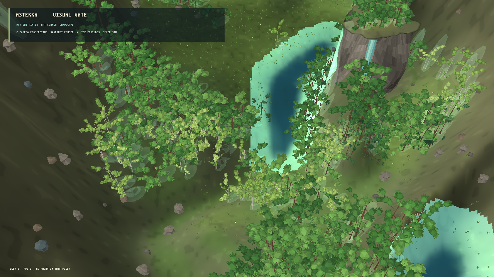
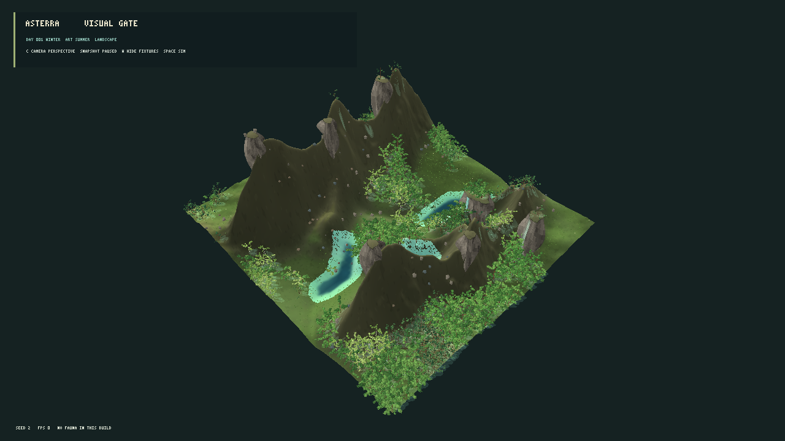
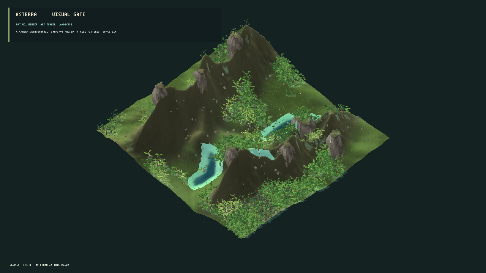

# Avaliação visual do renderer MonoGame — iteração 5 — 21/10/2026

**Estado:** 3D estilizado continua em avaliação; não há renderer de produção homologado.  
**Stack:** C#/.NET 10 e MonoGame DesktopGL.  
**Dados:** snapshot L0 pausado, seed 2. As alterações são somente de apresentação.

## Experimentos

### Relevo e material do solo

- O terreno já usa malha subdividida e normais derivadas da elevação contínua. A cena de avaliação agora testa mais luz direcional e menos luz ambiente (`0,50` ambiente e `0,53` difusa); o cliente normal mantém sua configuração anterior.
- Uma tentativa com contraste ainda mais forte (`0,36` ambiente e `0,70` difusa) escureceu as encostas íngremes quase até preto na vista ampla. Foi descartada. A configuração moderada comunica um pouco melhor o relevo sem esse esmagamento das sombras.
- A textura de avaliação ganhou variação macro, média e fina mais forte e tons de gramínea de verão mais claros. A composição continua usando biomassa, umidade, solo, elevação e seeds visuais já existentes. Não gera cobertura vegetal nova nem altera estado científico.



O solo agora mostra manchas mais legíveis, mas ainda parece um material uniforme em áreas extensas quando comparado às pradarias, arbustos baixos e transições de solo da referência. A iluminação acrescenta profundidade nas encostas, mas não cria detalhes geométricos novos.

### Enquadramento de toda a grade

Adicionei `--wide-evaluation-view` para testar a grade L0 inteira (64×64) sem substituir o recorte de avaliação anterior. Perspectiva e ortográfica mostram as quatro bordas, mas a área se torna um losango pequeno cercado por vazio. Os paredões escuros também dominam a leitura. A opção serve como diagnóstico de cobertura do mapa; não é a composição escolhida para o objetivo visual.

| Projeção | Captura | Resultado |
|---|---|---|
| Perspectiva |  | Mostra toda a área, mas a ilha de terreno ocupa pouco espaço e as encostas ocultam o vale. |
| Ortográfica |  | A mesma borda vazia permanece e a projeção comprime a profundidade. |

O recorte próximo ainda produz a leitura mais rica de árvores, água e paredões. A prova agora explicita o trade-off: o recorte favorece detalhe e composição, enquanto a grade inteira ainda não preenche a tela com uma paisagem coerente. Não resolvi isso alterando a dimensão da simulação ou inventando conteúdo biológico fora do snapshot.

## Desempenho da grade inteira

Build Release sem avisos ou erros. Benchmark pausado de 10 s, 5 s de aquecimento, VSync, 1280×720, seed 2 e enquadramento amplo:

| Média | P95 | P99 | Máximo | Memória privada | Árvores visíveis | Vértices de flora | Rochas |
|---:|---:|---:|---:|---:|---:|---:|---:|
| 60,00 FPS | 16,87 ms | 17,11 ms | 17,51 ms | 613,8 MiB | 1.490 | 4.432.743 | 188 |

Também foram desenhados 2.698 agrupamentos de cobertura, 217 flores e 53.640 vértices de sombra. A grade inteira passa os limites de quadro e memória do gate local, mas usa aproximadamente 2,6 vezes os vértices de flora do recorte de 533 árvores. O P99 não mede a reconstrução diária; a sessão ativa ainda precisa ser perfilada.

## Comparação e decisão provisória

Em relação à referência, a textura do solo tem manchas um pouco mais legíveis e a perspectiva mantém volume real. A cena ainda não tem a extensão visual da referência, margens naturais, copas de espécies distinguíveis, grandes afloramentos integrados ou luz equilibrada sobre as faces altas. Na câmera de grade completa, a composição recebe **1/4**; no recorte próximo, as categorias permanecem em torno de **2/4**. O gate exige no mínimo 3/4 em cada dimensão, então o renderer continua reprovado.

Manter a iluminação moderada e a textura mais rica apenas no modo de avaliação até comparar com uma próxima composição. Manter `--wide-evaluation-view` como ferramenta de diagnóstico, sem usá-la como padrão. O próximo avanço precisa preencher a vista com uma região natural coerente e melhorar a transição entre mata, prado, terreno e água sem quebrar a fronteira snapshot/apresentação.

## Reprodução

```powershell
dotnet run --project src/Game.Client.Desktop/Game.Client.Desktop.csproj -c Release -- --visual-evaluation --projection perspective --seed 2
dotnet run --project src/Game.Client.Desktop/Game.Client.Desktop.csproj -c Release -- --visual-evaluation --wide-evaluation-view --projection perspective --seed 2
dotnet run --project src/Game.Client.Desktop/Game.Client.Desktop.csproj -c Release -- --visual-evaluation --wide-evaluation-view --projection orthographic --seed 2
```
