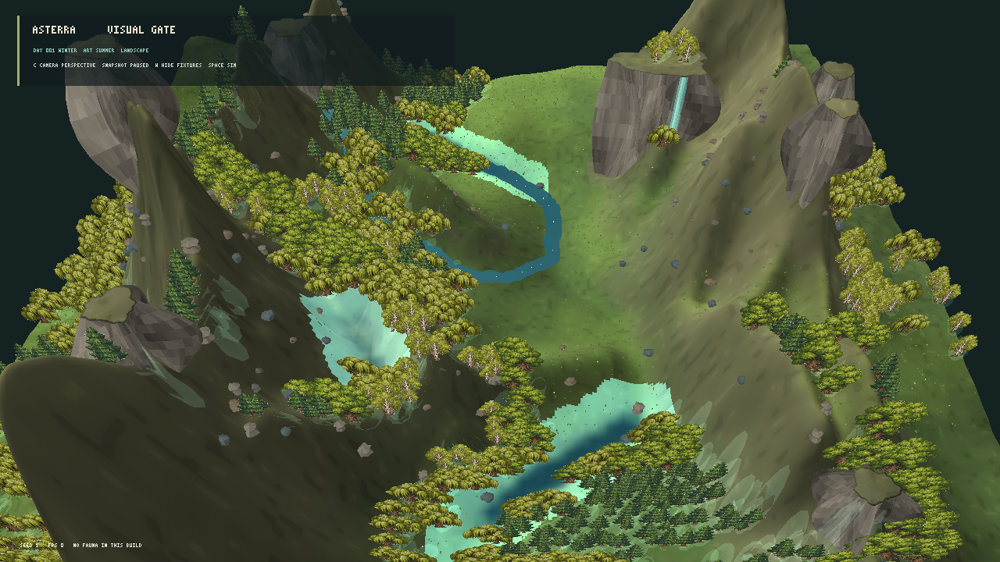
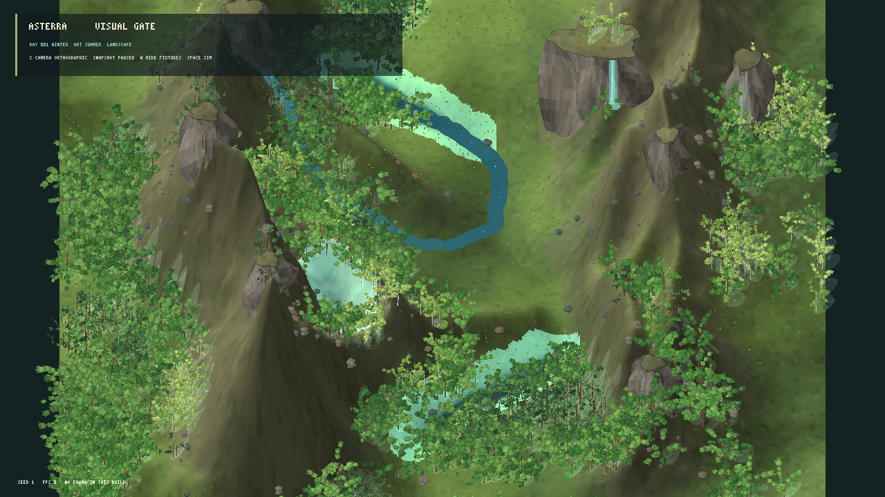

# Avaliação visual do renderer MonoGame — iteração 7 — 21/10/2026

**Estado:** protótipo demonstrado; gate visual continua reprovado; nenhuma técnica foi escolhida para produção.  
**Stack:** C#/.NET 10, MonoGame DesktopGL, build Release.  
**Cena:** snapshot L0 pausado, seed 1, 1280 × 720, vista panorâmica de avaliação. A câmera, os buffers e os materiais são estado de apresentação.

## Orientação aplicada

Esta rodada segue a direção visual de [22_VISUAL_DIRECTION_AND_TECHNOLOGY.md](../22_VISUAL_DIRECTION_AND_TECHNOLOGY.md) e ADR-0004: MonoGame permanece obrigatório; 3D, híbrido e 2D são alternativas a medir; snapshots e contratos científicos continuam separados da apresentação. A pesquisa botânica anexada orienta a preservação da estrutura 3D e a avaliação de billboards como representação visual/LOD, sem tratar uma imagem plana como arquitetura da árvore.

Adicionei `--panorama-evaluation-view` para enquadrar a mesma cena em uma região mais ampla, mantendo `--wide-evaluation-view` como diagnóstico da grade inteira e o enquadramento próximo original. O modo continua restrito a `--visual-evaluation`.

## Comparação visual

### Malhas 3D procedurais e perspectiva


O relevo tem volume e árvores com troncos, galhos, copas e sombras em geometria. O rio aparece como percurso contínuo e a cena inclui queda d'água de avaliação. Ainda assim, o quadro é dominado por paredões estreitos e muito íngremes; a folhagem facetada não forma copas densas como as da referência, e partes da água ficam escondidas pelo relevo ou pela mata.

### Billboards de árvores com terreno 3D



Os planos texturizados aumentam a leitura das manchas florestais e reduzem fortemente a quantidade de geometria. A cena perde volume nas árvores, repete copas e mostra alguns planos muito estreitos em ângulos oblíquos. Este teste usa, apenas como comparação de técnica, cinco sprites adultos do pacote fornecido pelo usuário em `Spectators-of-Life`; eles não são estado ecológico nem entradas dos geradores. A arte desses sprites não é a solução procedural de produção.

### Perspectiva e ortográfica



A ortográfica preserva melhor a distribuição espacial do vale e reduz a distorção de árvores no primeiro plano, mas comprime a altura e afasta a sensação de profundidade. A perspectiva comunica mais volume nas encostas e nas cachoeiras, embora cristas próximas obstruam a paisagem. Ambas usam o mesmo snapshot e o mesmo centro de câmera; muda apenas a projeção.

## Comparação qualitativa com a referência

Rubrica 0–4 do gate visual, com mínimo 3 em cada dimensão:

| Dimensão | Nota | Evidência e lacuna |
|---|---:|---|
| Relevo | 2/4 | Encostas, vale, platôs e faces têm volume; as paredes estreitas e os picos dominam a cena e as transições são suaves demais em outras áreas. |
| Água | 2/4 | Há um rio e uma queda legíveis; a cor ciano está saturada, margens são duras e o relevo oculta trechos. A queda é uma fixture visual identificada, não um processo simulado. |
| Vegetação | 2/4 | A cobertura e as diferenças entre malha e billboard são visíveis; as silhuetas ainda repetem formas e não têm a densidade de copa da referência. |
| Rochas | 1/4 | Rochas pequenas parecem pedregulhos dispersos; as faces dos paredões não se integram como afloramentos naturais. |
| Luz e profundidade | 2/4 | Perspectiva, normais e sombras ajudam a ler o volume; faces escuras e oclusão limitada reduzem a separação das formas. |
| Composição | 1/4 | A câmera panorâmica ocupa a tela, mas a crista central e os paredões dividem a vista. Ainda não há uma paisagem ampla e equilibrada como a referência. |

O protótipo não passa o gate e não deve ser tratado como a direção final.

## Desempenho

Benchmarks Release em 1280 × 720, seed 1, simulação pausada, VSync habilitado, 5 s de aquecimento e 10 s medidos. Máquina observada: Intel Core i3-10105 e NVIDIA GeForce RTX 5060, driver 32.0.16.1088. O VSync limita a média a 60 FPS; os tempos de quadro são mais úteis que a média para comparar estas duas variantes.

| Variante | FPS médio | P95 | P99 | Máximo | Memória privada | Vértices de flora |
|---|---:|---:|---:|---:|---:|---:|
| Árvores em malha 3D | 60,00 | 16,92 ms | 17,15 ms | 17,85 ms | 584,0 MiB | 4.358.292 |
| Billboards + terreno 3D | 60,00 | 16,95 ms | 17,27 ms | 17,70 ms | 176,3 MiB | 179.724 |

As duas variantes atendem aos limites locais de quadro e memória do gate nessa máquina. Os billboards reduzem em aproximadamente 96% os vértices de flora e 70% a memória privada medida; a P95/P99 permanece semelhante por causa do limite de VSync. Isso demonstra uma vantagem de custo para um possível LOD híbrido, mas não prova que as imagens planas atendam à qualidade ou à produção procedural exigidas.

O benchmark não mede custo de reconstrução durante evolução diária nem escala de 10×. O driver e a resolução foram registrados; não foram medidos draw calls, GPU time isolado ou tempo de geração da árvore durante a captura.

## Fronteira científica e determinismo

As duas apresentações consomem as mesmas instâncias derivadas do snapshot pausado. Billboards só substituem o desenho das árvores no renderer de avaliação. Câmera, projeção e geometria não escrevem no snapshot nem alteram RNG ecológico, parâmetros físicos, biomassa ou regras biológicas. Cachoeira e volumes auxiliares da demonstração são fixtures de apresentação, sem alegação de simulação hidrológica.

## Decisão e próximos gargalos

Manter a malha 3D como linha de base de volume e manter billboards apenas como experimento de apresentação/LOD. Não escolher a variante texturizada como saída final: ela depende de imagens prontas e tem variedade limitada. A próxima iteração precisa gerar a própria folhagem a partir de código, parâmetros e seeds, reduzir a dominância dos paredões, integrar rochas ao relevo e equilibrar os materiais de água e terreno antes de ampliar o mundo ou consolidar o renderer.

Build isolado em `bin/panorama-evaluation/` terminou com zero avisos e zero erros. `git diff --check` não reportou erros de whitespace. Não foram executados testes automatizados nesta rodada; a validação solicitada foi visual, de build e de desempenho.

## Reprodução

```powershell
dotnet src/Game.Client.Desktop/bin/panorama-evaluation/Release/net10.0/Game.Client.Desktop.dll --visual-evaluation --panorama-evaluation-view --projection perspective --seed 1
dotnet src/Game.Client.Desktop/bin/panorama-evaluation/Release/net10.0/Game.Client.Desktop.dll --visual-evaluation --panorama-evaluation-view --tree-billboards --projection perspective --seed 1
dotnet src/Game.Client.Desktop/bin/panorama-evaluation/Release/net10.0/Game.Client.Desktop.dll --visual-evaluation --panorama-evaluation-view --projection orthographic --seed 1
```
