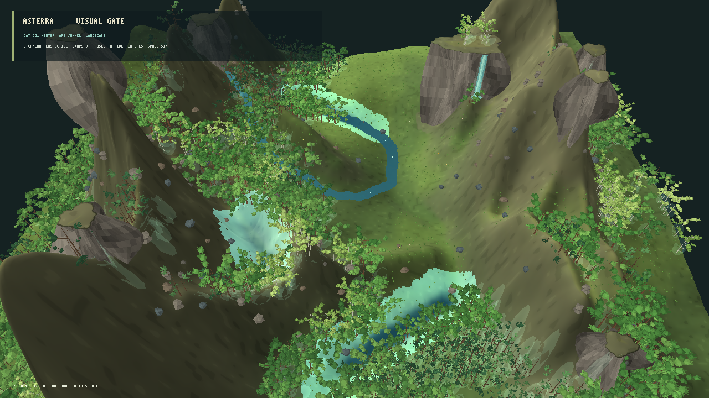

# Avaliação visual do renderer MonoGame — iteração 8 — 21/10/2026

**Estado:** variante procedural de copa volumétrica promissora; gate visual segue reprovado.  
**Stack:** C#/.NET 10, MonoGame DesktopGL, build Release isolado.  
**Cena:** snapshot L0 pausado, seed 1, 1280 × 720, mesma câmera panorâmica e mesma população nas duas capturas.

**Nota de escala:** essas capturas e benchmarks ainda usavam a ampliação vertical de 1,40 do renderer de avaliação. A iteração 9 compara esse valor com a elevação do snapshot em escala 1,00.

## Experimento

O experimento acrescenta `--volume-canopy` ao modo de avaliação. A estrutura de galhos e os pontos de folhagem continuam vindo do gerador botânico determinístico. A apresentação dá mais volume às copas largas e ajusta sua proporção para os perfis espalhados, eretos e pendentes; reduz as lâminas triangulares visíveis de 7/10/13 para 3/4/5 por ponto de folhagem. Toda a folhagem desta variante é construída em malhas a partir de parâmetros e seeds, sem carregar os sprites usados na comparação de billboards anterior.

### Linha de base — malhas 3D anteriores



### Copas volumétricas procedurais


A variante preenche melhor os espaços entre os galhos e forma manchas de copa mais contínuas. A leitura ainda é low-poly; as copas não mostram a textura visual rica da referência, e as árvores continuam sem variação suficiente de densidade e de silhueta em escala ampla.

## Desempenho

Benchmarks feitos no mesmo build para as duas variantes: 1280 × 720, seed 1, simulação pausada, perspectiva, VSync, 5 s de aquecimento e 10 s medidos. Máquina: Intel Core i3-10105 e NVIDIA GeForce RTX 5060, driver 32.0.16.1088.

| Variante | FPS médio | P95 | P99 | Máximo | Memória privada | Vértices de flora |
|---|---:|---:|---:|---:|---:|---:|
| Linha de base | 60,00 | 16,78 ms | 16,90 ms | 16,99 ms | 583,2 MiB | 4.358.292 |
| Copa volumétrica | 60,00 | 16,82 ms | 17,03 ms | 17,71 ms | 532,8 MiB | 3.445.908 |

As duas médias estão limitadas a 60 FPS pelo VSync. A variante reduz os vértices de flora em 21% e a memória privada em 50,4 MiB (8,6%). P95 e P99 permanecem próximos; este benchmark não mostra uma melhora mensurável de quadro com VSync ativo. Mesmo assim, a redução geométrica ocorre sem trocar por imagens prontas nem remover os troncos e ramos do gerador.

## Critério visual

A variação melhora a cobertura da vegetação em relação à linha de base, mas a paisagem ainda não passa o gate da iteração 7. Relevo e cachoeira são dominados por paredes e ciano intenso; rochas ficam pequenas e soltas; as sombras e oclusão não separam suficientemente as copas em profundidade; o enquadramento permanece centrado numa crista. A rubrica continua abaixo de 3/4 nas seis dimensões.

## Decisão e continuidade

Manter copas volumétricas como variante da linha 3D procedural para o próximo teste visual. A comparação não seleciona ainda o renderer final. O próximo trabalho precisa melhorar as formas do terreno e os agrupamentos de rocha junto com o mapa de materiais, além de variar mais a silhueta e a densidade de copa sem regressar aos planos de arte prontos. O estado científico continua isolado: apenas a camada de desenho recebe a opção `--volume-canopy`.

Build Release em `bin/procedural-canopy-next/` terminou com zero avisos e zero erros. `git diff --check` não reportou erros de whitespace. Não foram executados testes automatizados; esta rodada valida apresentação, build e desempenho.

## Reprodução

```powershell
dotnet src/Game.Client.Desktop/bin/procedural-canopy-next/Release/net10.0/Game.Client.Desktop.dll --visual-evaluation --panorama-evaluation-view --projection perspective --seed 1
dotnet src/Game.Client.Desktop/bin/procedural-canopy-next/Release/net10.0/Game.Client.Desktop.dll --visual-evaluation --panorama-evaluation-view --volume-canopy --projection perspective --seed 1
```
