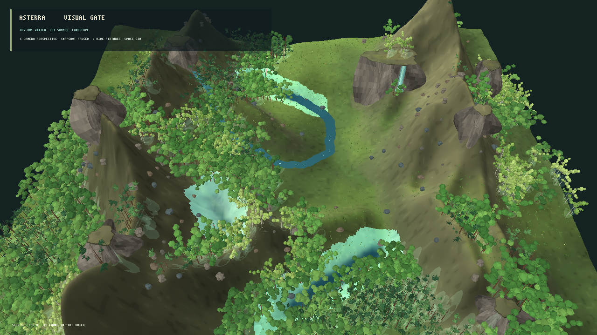
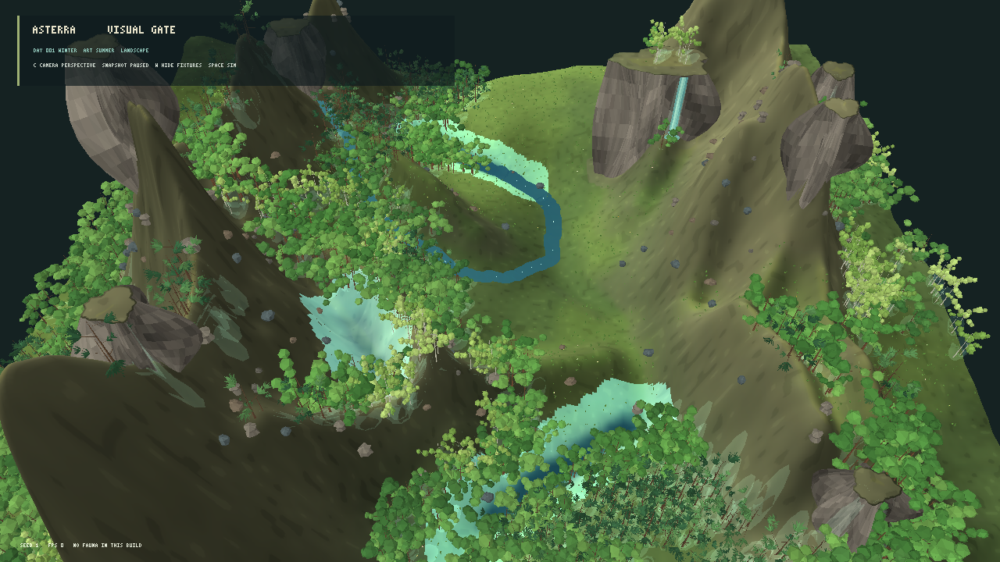

# Avaliação visual do renderer MonoGame — iteração 9 — 21/10/2026

**Estado:** escala de elevação corrigida para o valor do snapshot; gate visual segue reprovado.  
**Cena:** snapshot L0 pausado, seed 1, perspectiva panorâmica, copa volumétrica procedural. A simulação e os dados usados são iguais nas capturas.

## Comparação de escala





O modo de avaliação anterior multiplicava a variação de elevação por 1,40 ao montar a malha e as fixtures de terreno. A escala 1,00 mostra o relevo nos metros do snapshot; os paredões diminuem sem desaparecer, e a vista revela mais terreno entre as cristas. Ela se aproxima melhor da leitura da referência e mantém a medida física representada.

Defini escala 1,00 como padrão em todas as vistas. `--exaggerated-relief-view` mantém 1,40 disponível apenas para comparações diagnósticas. Isso altera somente a transformação de apresentação; nenhum valor de elevação ou processo do snapshot foi reescrito.

## Limitações ainda visíveis

Mesmo sem exagero, as cordilheiras do seed 1 e os outcrops físicos ocupam grande parte da composição. A proporção entre parede e árvore ainda parece alta para uma paisagem natural ampla. Rochas pequenas continuam espalhadas pela encosta, enquanto a água e a vegetação deixam as transições de habitat pouco claras. Alterar a geometria da apresentação para esconder esses dados não seria uma correção apropriada; o modelo geográfico precisaria de uma revisão científica própria caso o relevo gerado permaneça excessivamente abrupto em várias seeds.

Não reavaliei o benchmark completo nesta etapa; a quantidade de vértices e o modo de copa são os mesmos da iteração 8. A decisão sobre desempenho permanece baseada nos benchmarks pareados daquela rodada.

## Reprodução

```powershell
dotnet src/Game.Client.Desktop/bin/natural-relief-comparison/Release/net10.0/Game.Client.Desktop.dll --visual-evaluation --panorama-evaluation-view --volume-canopy --natural-relief-view --projection perspective --seed 1
dotnet src/Game.Client.Desktop/bin/natural-relief-comparison/Release/net10.0/Game.Client.Desktop.dll --visual-evaluation --panorama-evaluation-view --volume-canopy --projection perspective --seed 1
```
