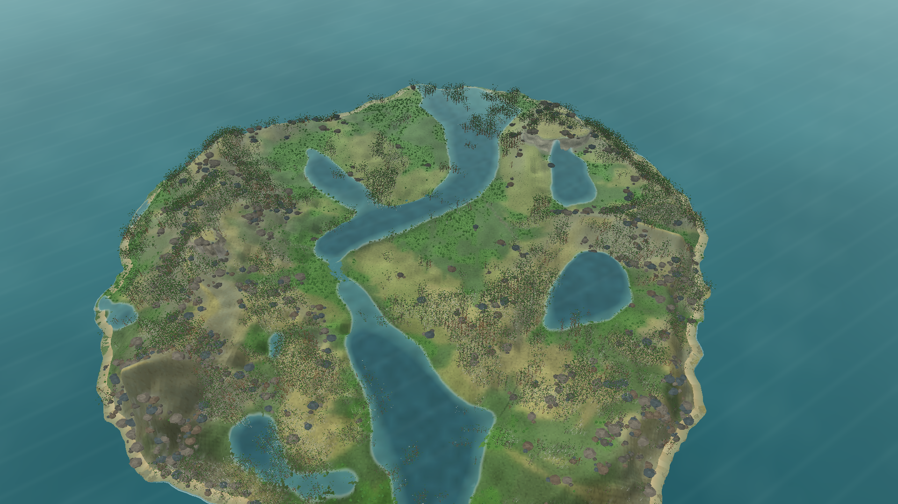
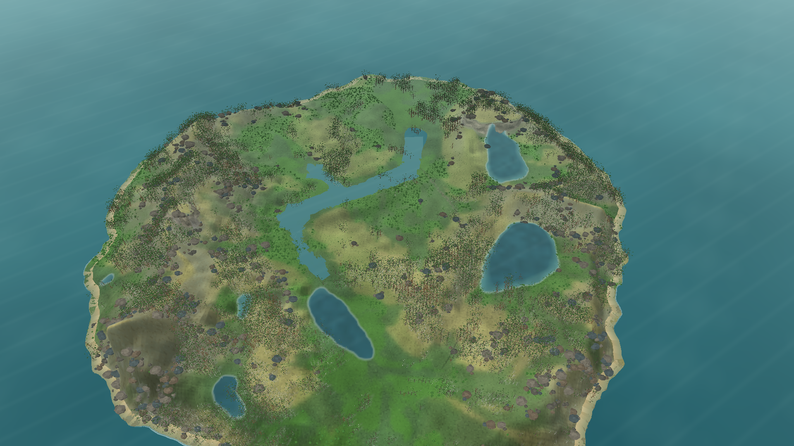

# Representação de rios conectados e lagos — 22/10/2026

## Objetivo e base de comparação

Esta etapa aproxima a leitura da água na vista ampla da ilha sem editar o snapshot. Usei o mesmo arquivo em ambas as capturas: seed 2, tick 24.624, dia 172, hash `B4EA4E5BA710D1BBF87AEBB90A4F3ABD6573FEB7C1254090B40983BA0E7D2531`.

No estado observado, o snapshot tem 12.307 células com pelo menos 20 mm de água superficial e 9.138 com pelo menos 420 mm. O renderer anterior preenchia todas as células conforme a profundidade, mas suprimia as arestas D8 quando ambos os lados passavam de 250 mm. Na captura, só 18 arestas de rio permaneciam conectadas; os canais profundos apareciam como manchas largas.

## Alteração

O renderer agora usa a topologia de depressões do relevo para desenhar pools em nível e usa arestas D8 com água no snapshot para desenhar os canais fora dessas depressões. A filtragem por profundidade que eliminava trechos profundos foi retirada. O leito, as células, a vazão simulada, o RNG, os parâmetros ecológicos e o save não mudaram.

Essa escolha segue a separação entre depressões, armazenamento, movimento e apresentação documentada no projeto. A literatura consultada descreve depressões naturais como elementos que retêm e conectam água por enchimento, extravasamento e fusão; elas não devem ser tratadas automaticamente como erro do relevo ([Barnes, Callaghan e Wickert, 2021](https://esurf.copernicus.org/articles/9/105/2021/)). A rede D8 usada aqui continua sendo uma rota potencial: o solver atual é difusivo e ainda não calcula vazão persistente por aresta.

## Resultado

- A saída passou de 18 para **339 arestas de rio conectadas** no mesmo snapshot.
- O build Release de `Game.Client.Desktop` passou, com 0 avisos e 0 erros.
- `Game.Tests` passou: 48/48.
- O snapshot permaneceu idêntico; a alteração foi somente de apresentação.

## Limitações e próxima etapa

Parte da água superficial que não está em depressões nem nas arestas D8 selecionadas não aparece como superfície azul. Isso melhora a continuidade visual, mas não prova que as arestas representam fluxo hidráulico real. O solver `Route` ainda usa difusão de superfície, sem vazão persistente, momentum ou calibração; a captura também registrou zero cachoeiras. O próximo gate deve comparar um solver conservativo com fluxos por aresta e tratamento wet/dry. A aproximação local inercial é uma candidata para fluxos subcríticos baixos, mas seus erros crescem com número de Froude e gradientes de profundidade; precisa de fixtures comparáveis antes de substituir o MVP ([de Almeida e Bates, 2013](https://agupubs.onlinelibrary.wiley.com/doi/full/10.1002/wrcr.20366)).

SciSpace foi consultado. A busca do Consensus continua no limite mensal informado na tentativa anterior; ela volta a ficar disponível em 1/11/2026.
