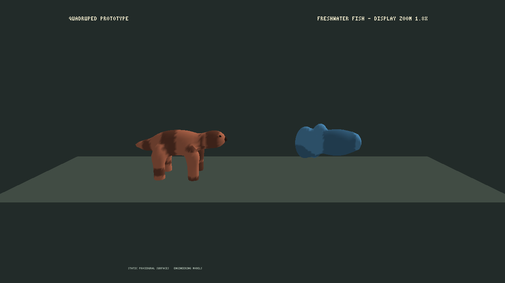
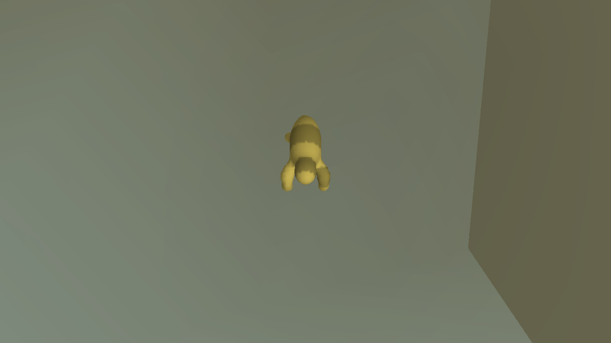
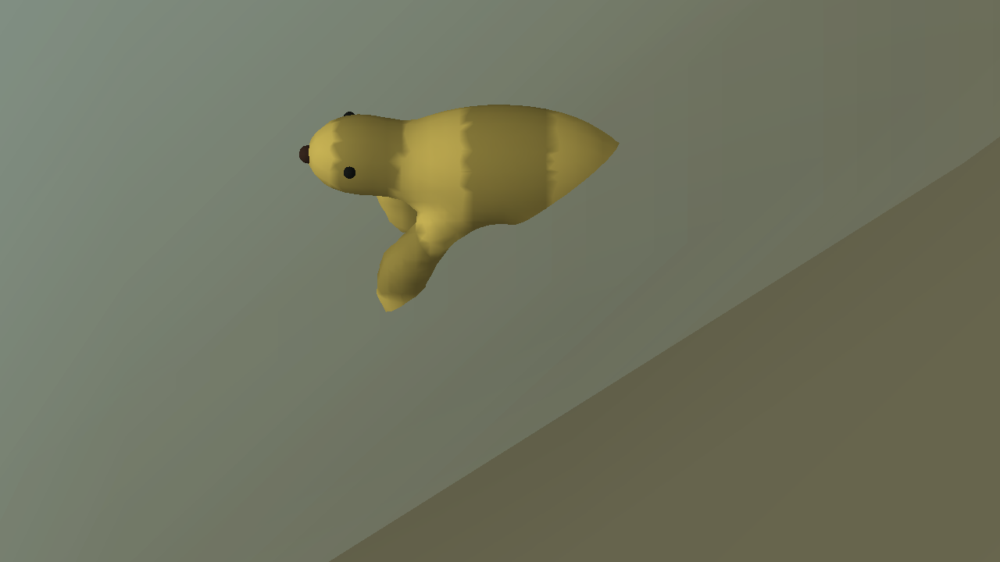
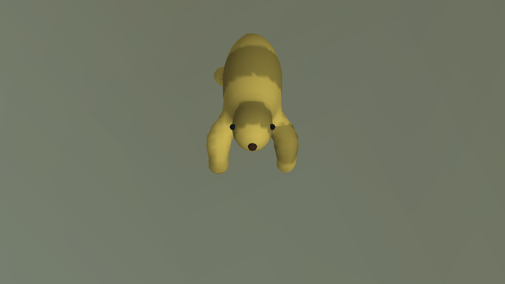
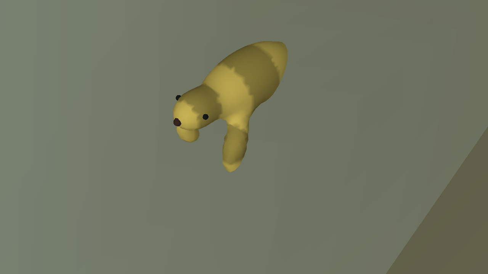
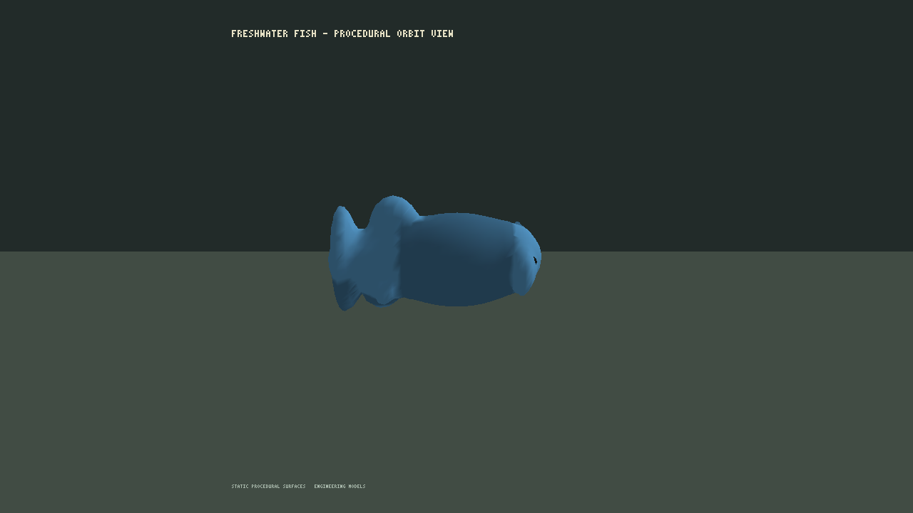
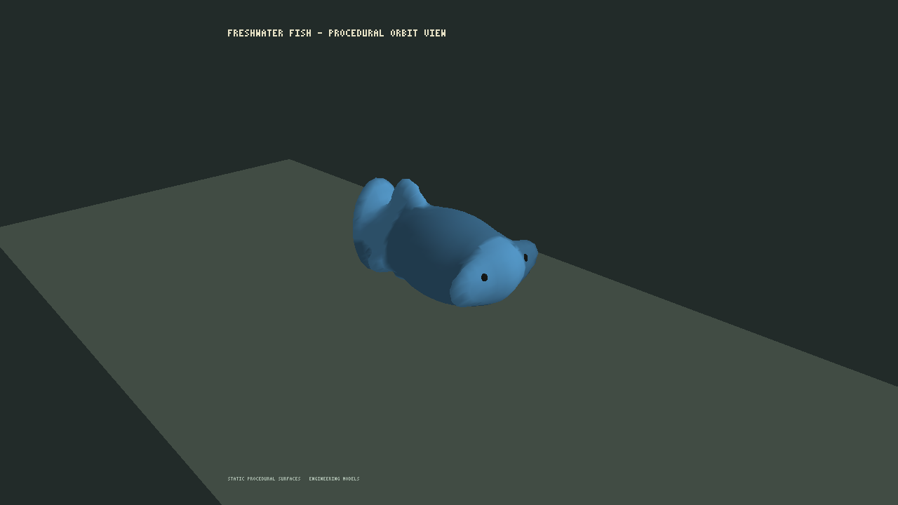
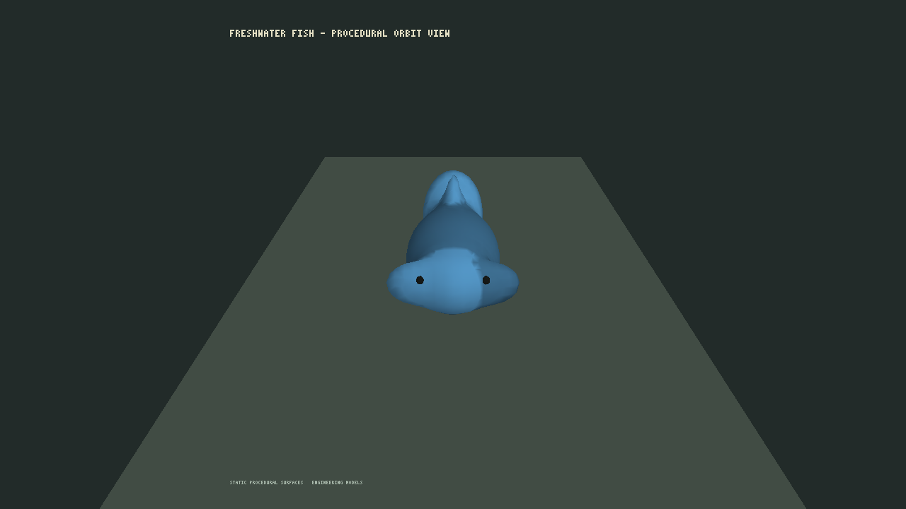

# Zoology Z4 — geometria procedural e integração visual

**Data:** 2026-10-22

**Estado:** geração geométrica e postura estática das patas integradas em modo de diagnóstico. A versão v8 corrige a orientação local das faces e foi validada em uma matriz de genomas e tesselações. As revisões multiângulo do quadrúpede e do protótipo genérico de peixe são reproduzíveis; o gate Z4 continua aberto para morfologia por espécie, animação, custo e auto-interseções mais amplas.

## Entregas

- `ICreatureGeometryBuilderV1` recebe anatomia desenvolvida e receita visual sem depender de renderer ou GPU. `CreatureGeometryBuilderV1` v8 mantém superfícies-fonte por parte, metadados explícitos, normais, UVs, cores e marcadores sensoriais para pose e inspeção. Depois da pose, `BuildUnifiedRenderGeometry` extrai uma superfície de renderização da união suave de campos elipsoidais e conectores implícitos ao longo dos elos pai-filho; os marcadores sensoriais permanecem separados. A regressão estrutural cobre dois planos corporais, três pares de genoma/pigmento e duas tesselações. Nos 12 casos, a superfície tem um componente conectado, cada aresta é incidente em dois triângulos com winding oposto, cada link de vértice é um único ciclo e triângulos degenerados são rejeitados. A verificação espacial não encontrou interseções em pares de triângulos sem vértices compartilhados. Pares que compartilham vértices ainda são excluídos dessa busca; portanto, ausência geral de auto-interseções em todas as seeds/resoluções continua sem comprovação. O afinamento das nadadeiras laterais e o alongamento da caudal em 1,6× continuam correções somente de apresentação, não medidas biológicas nem mudanças em `DevelopedBodyV1`.
- O adaptador MonoGame exibe os protótipos quadrúpede e peixe na galeria estática `--zoology-gallery`. O modo `--zoology-gallery-fish` isola o peixe e reutiliza os argumentos de zoom, azimute e elevação para uma revisão orbital legível.
- O modo opcional `--creature-geometry-view` desenha a população N3 usando as posições atuais dos agentes. Sem snapshot, inicializa 32 herbívoros e 4 predadores; com snapshot, usa a população carregada. A anatomia desenvolvida e a receita de pigmento vêm do genoma persistido de cada agente; malhas MonoGame são cacheadas por genoma e estágio visual de desenvolvimento. A exibição não escreve no estado de simulação.
- O modo integrado aplica as soluções IK de Z2 às quatro superfícies de pata, em uma postura estática de apoio. Alvos de contato são derivados da altura local mínima da própria malha. A postura não recebe estado de movimento, não anima passos e não grava posições/contatos na simulação.
- A câmera de diagnóstico aceita zoom, foco, azimute e elevação. O campo ortográfico-base foi reduzido de 180 m para 80 m somente nesse modo, para enquadrar o corpo adulto em zoom próximo sem alterar a câmera normal do mundo.
- Os marcadores de visão e olfato do quadrúpede foram deslocados para atravessar a superfície da cabeça. A vista frontal confirma olhos e focinho visíveis; um teste regressivo verifica que eles se sobrepõem à cabeça e também projetam para fora dela.
- Teste de não mutação compara saves de dois mundos iguais após 24 ticks; gerar anatomia e postura para cada agente em um deles preserva exatamente o JSON salvo e a igualdade entre estados.
- Sem foco de câmera explícito, o modo centraliza o agente terrestre com maior cota observada e começa com zoom 32. `--camera-focus`, `--camera-zoom`, `--camera-azimuth` e `--camera-elevation` permitem escolher e reproduzir o enquadramento. O modo oculta sprites de fauna e flora para inspecionar a geometria sobre o terreno e a água.

## Evidências

Captura da superfície unificada do protótipo estático:



Captura do modo integrado com postura estática IK, seed 1 e zoom 64. A vista de diagnóstico usa um campo ortográfico mais estreito, sem alterar o enquadramento normal do mundo. A saída registrou 36 agentes, 36 instâncias desenhadas e 36 buffers de genoma/estágio. A geometria fundida é usada no modo integrado; esta captura confirma execução e posicionamento, mas não substitui revisão de silhueta em múltiplos ângulos.



Após ajustar o campo de visão e posicionar os marcadores faciais, as capturas v19 mostram o quadrúpede em perfil, frente e três quartos, a zoom 64. A forma é legível como protótipo quadrúpede; a inspeção não valida anatomia de uma espécie real.







O modo orbital do peixe revelou que a nadadeira caudal estava larga no eixo longitudinal do corpo. A geometria v7 agora a afina nesse eixo e a mantém mais ampla no plano da nadadeira; os marcadores de visão também foram reposicionados para aparecer nas vistas frontal e oblíqua. Capturas v22 documentam as vistas lateral, três quartos e frontal. Elas confirmam inspeção multiângulo do **protótipo genérico**; corpo, nadadeiras e dimensões ainda não representam uma espécie/população calibrada, e o peixe ainda não é parte da população persistente N3.







Comando reproduzível:

```powershell
dotnet src/Game.Client.Desktop/bin/Release/net10.0/Game.Client.Desktop.dll --zoology-gallery --disable-vsync --capture docs/reports/evidence/z4-creature-gallery-v7.png
dotnet src/Game.Client.Desktop/bin/Release/net10.0/Game.Client.Desktop.dll --creature-geometry-view --camera-zoom 64 --seed 1 --disable-vsync --capture docs/reports/evidence/z4-creature-world-v16.png
dotnet src/Game.Client.Desktop/bin/Release/net10.0/Game.Client.Desktop.dll --creature-geometry-view --camera-zoom 64 --seed 1 --disable-vsync --camera-azimuth 90 --camera-elevation 45 --capture docs/reports/evidence/z4-creature-world-v19-side.png
dotnet src/Game.Client.Desktop/bin/Release/net10.0/Game.Client.Desktop.dll --creature-geometry-view --camera-zoom 64 --seed 1 --disable-vsync --camera-azimuth 0 --camera-elevation 45 --capture docs/reports/evidence/z4-creature-world-v19-front.png
dotnet src/Game.Client.Desktop/bin/Release/net10.0/Game.Client.Desktop.dll --creature-geometry-view --camera-zoom 64 --seed 1 --disable-vsync --camera-azimuth 45 --camera-elevation 45 --capture docs/reports/evidence/z4-creature-world-v19-three-quarter.png
dotnet src/Game.Client.Desktop/bin/Release/net10.0/Game.Client.Desktop.dll --zoology-gallery-fish --camera-zoom 2.0 --camera-azimuth 0 --camera-elevation 25 --disable-vsync --capture docs/reports/evidence/z4-fish-v22-side.png
dotnet src/Game.Client.Desktop/bin/Release/net10.0/Game.Client.Desktop.dll --zoology-gallery-fish --camera-zoom 2.0 --camera-azimuth 45 --camera-elevation 25 --disable-vsync --capture docs/reports/evidence/z4-fish-v22-three-quarter.png
dotnet src/Game.Client.Desktop/bin/Release/net10.0/Game.Client.Desktop.dll --zoology-gallery-fish --camera-zoom 2.0 --camera-azimuth 90 --camera-elevation 25 --disable-vsync --capture docs/reports/evidence/z4-fish-v22-front.png
```

`CreatureGeometryBuilderTests` passou **11/11** após a geometria v8; a suíte completa Release passou **151/151**. A regressão da malha verifica determinismo, índices/normais válidos, conectividade, incidência e winding de arestas, links cíclicos dos vértices, rejeição de degenerações, interseção entre faces disjuntas por vértices, silhueta da nadadeira caudal e ancoragem dos marcadores faciais. O teste de raízes verifica expressão superficial por perfil: maior no carvalho, intermediária no bordo, discreta no salgueiro e ausente na referência do pinheiro e da bétula.

## Correção de orientação local da malha — v8

O teste expandido encontrou uma falha real de winding no protótipo de peixe, no genoma `(13, 29)` e tesselação `6×8`: três arestas compartilhadas pelos mesmos triângulos apareciam com a mesma direção. O extrator orientava cada triângulo usando a média das normais dos vértices; em regiões pequenas essa média pode apontar para dentro, mesmo quando as normais médias da malha parecem aceitáveis.

A v8 calcula o gradiente exato do campo escalar interpolado linearmente dentro de cada tetraedro e usa esse gradiente para orientar os triângulos daquele tetraedro. A versão geométrica foi incrementada de 7 para 8 para invalidar geometria em cache. A nova regressão cobre os dois planos corporais, três pares de genoma/pigmento e duas tesselações (`6×8` e `8×12`), totalizando 12 combinações. Todas passaram conectividade, incidência/winding, link de vértice, degenerações e busca de interseções já coberta pelo teste.

O teste de interseções continua omitindo pares de triângulos que compartilham vértices. A matriz abrange os casos listados, mas não é uma prova geral de ausência de auto-interseções para todas as seeds ou resoluções.

## Limites atuais

- Herbívoros e predadores ainda são perfis funcionais, ambos ligados ao protótipo quadrúpede Z1. O tamanho visual adulto de referência (1,35 m e 2,0 m) continua sendo um proxy. O corpo usa 12 passos de desenvolvimento visual entre nascimento e maturidade, sem calibrar crescimento biológico.
- Nos 12 casos amostrados, a superfície conectada tem arestas fechadas com winding coerente e links de vértice cíclicos; faces degeneradas são rejeitadas. A busca espacial cobre triângulos sem vértices compartilhados, não todos os pares possíveis, e ainda não cobre um conjunto amplo de seeds/resoluções. O protótipo de peixe agora pode ser revisto em múltiplos ângulos, mas a silhueta continua genérica e não foi calibrada por espécie. As patas seguem pose estática de IK: não há gait, orientação por velocidade, contato/carga persistidos ou correção por colisão. O peixe ainda não faz parte da população persistente N3.
- As revisões v19 e v22 cobrem lado, frente e três quartos de protótipos genéricos em zoom próximo. Não cobrem variações de espécie/população, estágios representativos, peixe no mundo N3, distâncias e LOD. O teste de não mutação cobre geometria e postura fora do renderer; ainda falta comparar o cliente real com variações de câmera, FPS, culling/LOD, além de medir custo por criatura, cache e metas de desempenho.
- Formas e pigmentos continuam protótipos sem calibração por população, conforme [Z1](ZOOLOGY_Z1_2026-10-22.md). A silhueta do peixe segue segmentada; a cobertura topológica atual não representa um colisor e não certifica ausência geral de auto-interseções em todas as seeds/resoluções.
- Este modo não substitui nem fecha a avaliação visual N4 do mundo.

## Próximos critérios de Z4

1. Substituir o peixe genérico por um body plan versionado associado a espécie/população escolhida antes de alegar fidelidade biológica; em paralelo, ampliar a busca de interseção para pares com vértices compartilhados e uma amostragem mais ampla de seeds/resoluções antes de reivindicar ausência geral de auto-interseções.
2. Animar a pose quadrúpede a partir de estado de locomoção explícito e calibrado, sem fazer a simulação depender do estado de GPU.
3. Estender o teste de não mutação para comparar o cliente real sob câmera, FPS, culling/LOD e renderização ligada/desligada; verificar crescimento visual por estágio sem divergência do N3.
4. Medir custo e memória para 1, 10, 100 e 1000 criaturas antes de fixar metas.
5. Reavaliar o gate visual somente após essas evidências.
